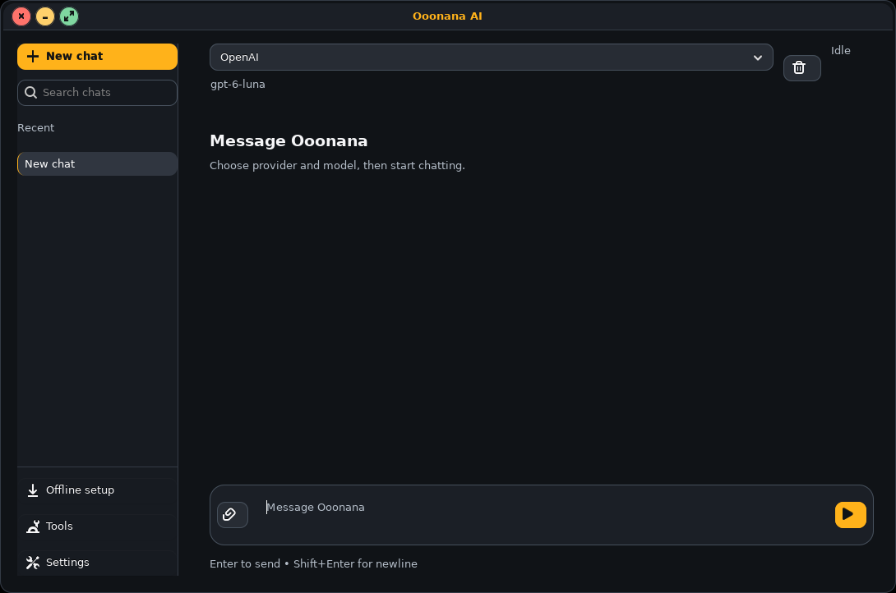
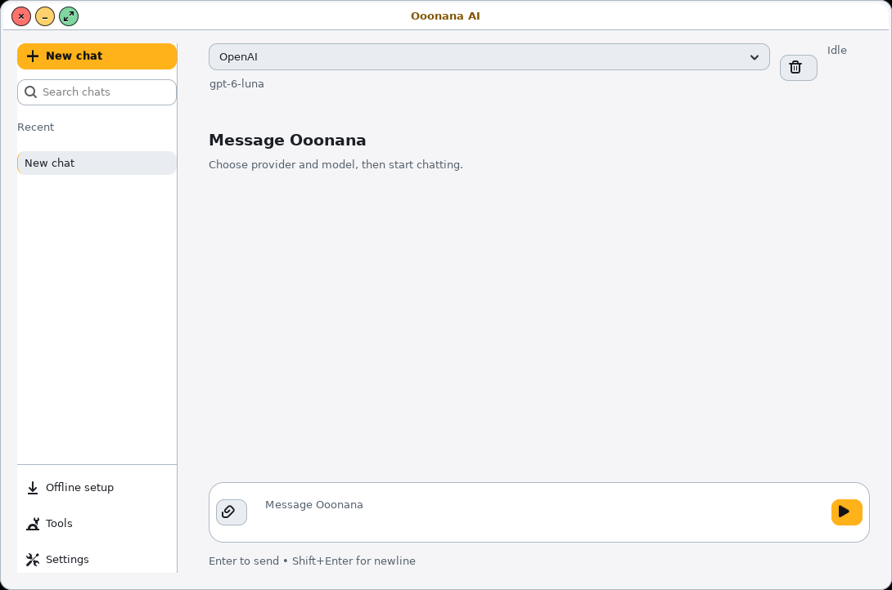

# OpenAI provider follow-up — November5,2026

Core0.10.0 remains a candidate. A new key was created only after the user
confirmed its local `.env.local` destination. Git's local exclusion protects
that untracked file; no credential is added to source, packages or WSL config.
The private repository-signing key remains local and unchanged.

## Provider gap repaired

The native app previously offered NIM, Gemini and OpenVINO; the Python client
did not route OpenAI credentials. A shell fallback even counted an OpenAI key
as a NIM credential. OpenAI is now an independent CLI/native-GUI choice with
its own key, URL, model and aliases. Other providers keep their credentials.
Existing provider selection is preserved; this does not silently select OpenAI.

OpenAI requests use Chat Completions with `max_completion_tokens`. Default
`gpt-6-luna` uses `reasoning_effort:none`; temperature is omitted to avoid
incompatible reasoning-model options. Explicit model overrides remain available.
See the [official model documentation](https://developers.openai.com/api/docs/models/gpt-6-luna)
and [request reference](https://developers.openai.com/api/reference/resources/chat/subresources/completions/methods/create).

Quota exhaustion and transient request-rate limits produce different messages.
Authentication/model-access, network, malformed and empty responses fail clearly.
Configuration output fully redacts all provider keys, including their prefixes.
No retry loop spends additional requests after exhausted balance.

## Evidence and remaining live gate

Six offline provider tests exercise credential/endpoint separation, auto
selection, environment/model aliases, payload limits, streaming/nonstreaming,
quota/rate classification, malformed/empty responses and redaction. The CLI/
fallback regression and native GTK streaming/cancel/read-failure checks pass.
Graphite/Paper native renders show the added OpenAI choice and model without
changing control dimensions or theme layout. Impeccable4.8.0 guidance was used.

The new key authenticates against the models endpoint. The first GPT-4.1-nano
probe returned `model_not_found`; this is retained as an unsuccessful probe.
A documented current starter model, GPT-6 Luna, reaches the API but returns
HTTP429, `insufficient_quota` / `credit_balance_exhausted`. No successful live
generation, long cloud transcript, live cancellation or recovery is claimed.
Item11's live gate remains pending available API balance; no more paid requests
are made by this pass. OpenVINO and physical/held VM checks remain deferred.

Private probes/captures stay under
`C:\Users\7ryan\AppData\Local\Temp\ooonana-ai-provider-20261105\`.
## Signed candidate and WSL boundary

Runtime freeze `9051f6dc9c2d4d3ade7699b3b046e43afe1d96bc` passes
[GitHub CI](https://github.com/Ooonana/Ooonana-OS/actions/runs/41938787486) and
[GitLab CI](https://gitlab.com/Ooonana/ooonana-repo/-/pipelines/3029619591).
Generation `81a738401be5d57114240e673e38f03fb3b7afe8542957e2676add68234e95b1`
is signed, validates718 packages/637 dependency nodes and is published on F:.
Previous210cf509 and its signed checksum manifest are preserved.

Only core-runtime changes: four AI CLI/client/UI files. Other package metadata
and payloads remain unchanged. The actual new credential is explicitly checked
absent from the rebuilt archive. Earlier public cursor/key exclusion holds for
unchanged archives. Both installed renders below use fixed provider-status data;
they prove presentation, not successful cloud generation.




Native index scratch is cleaned. Slow F: indexing was stopped with its owned
scratch cleaned; a native WSL copy reused existing verified archive hardlinks.
History, source, signing material, generations and recovery data are retained.

An earlier WSL sync was held when C: fell to about1.3GiB free, below the3.5GiB
pre-transfer reserve. It aborted before changing installed packages. That failure
receipt remains; the hold is now resolved.

## Resumed installed verification

After C: reserve returns to about5.9GiB, transfer reuses707 verified native
archives and copies one503,407-byte runtime archive. Trusted-key publication
validates the native generation before changing installed payload. Dry-run names
only core/runtime reinstall; actual core/runtime/i3 verification passes.
Installed CURRENT now equals81a73840, matching F:.

All65 preexisting protected account, PAM policy/module, configuration, trust and
OpenVINO hashes remain unchanged. New recovery checkpoints remain available.
Provider selection and key redaction pass against the actual installed module.
No real API key is copied into WSL configuration, and no models are downloaded.

Installed Graphite/Paper renders are reviewed using existing Impeccable guidance:
OpenAI selection/model, four provider choices, unchanged control dimensions and
readable layout pass at1090x722. Fixed provider status is explicit; no successful
cloud generation is inferred. login1 startup still reports unsupported-wsl with
power_requests:false. The packaged nested launcher remains executable:

```powershell
wsl -d Ooonana -u ooonana -- /usr/local/bin/start-ooonana-i3 --nested
```

The prior cleanup scans selected C: project roots,454 F: directories,671 Ubuntu
project roots and26 Ooonana temporary roots. No new confirmed cache junk is found;
old manual targets are absent. Nothing is deleted; history/models/keys/recovery
stay. C: remains about5.8GiB free after sync. No ISO or stable promotion.
