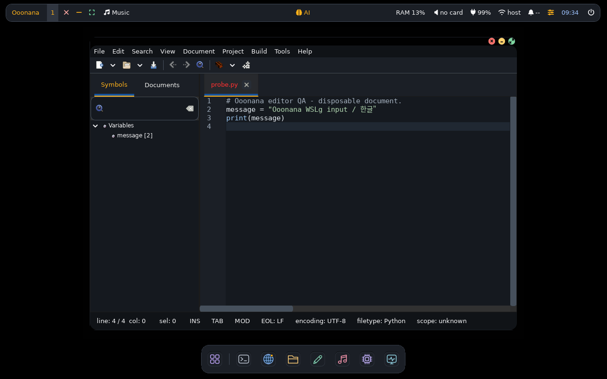
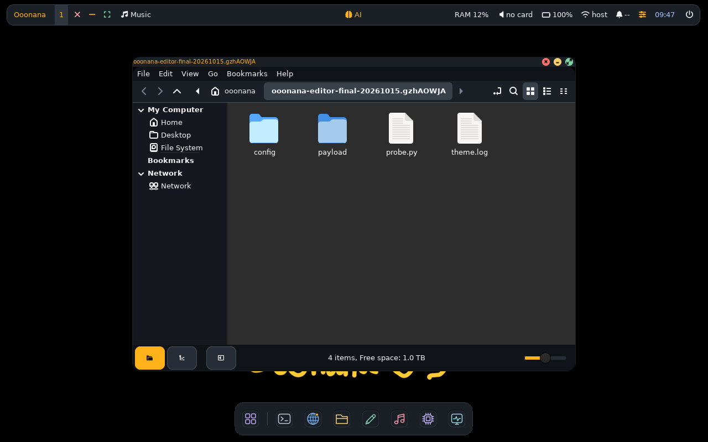
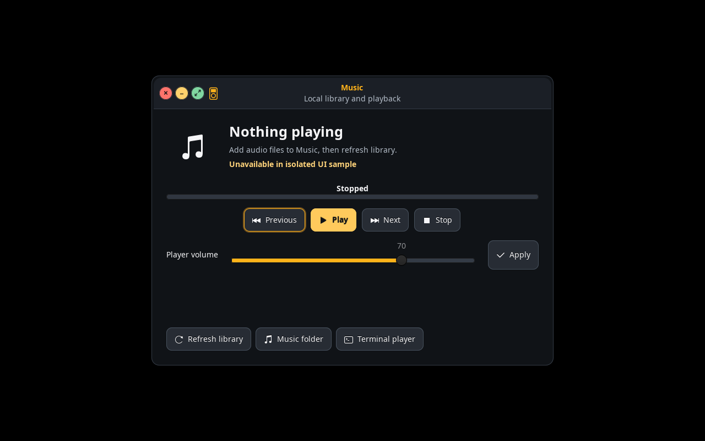

# October 15 native application polish

Impeccable-guided refinement preserves Ooonana's opaque graphite/amber theme
and native GTK behavior. No replacement editor, transparency or UI fork.

## Changes

- Geany first-run defaults: compact icon-only toolbar with eight frequent
  actions, 11-point code font and no empty messages pane. Other actions remain
  available in native menus. Every file argument is retained, including spaces.
- Ooonana Graphite/Paper editor palettes: syntax, selection, caret and gutters;
  ordinary text colors checked at 4.5:1 or higher against their background.
- Existing Geany preferences and custom toolbar files are never replaced.
  The new toolbar/palette defaults apply only when no editor profile exists.
  Existing users can select Graphite/Paper through View → Change Color Scheme.
- Shared GTK toolbars/tab-close buttons have compact padding and visible focus.
- Fixed a real cascade conflict: user-level GTK CSS obscured native pressed and
  suggested/destructive action states. Hover/press feedback is now distinct.
- Header subtitles no longer inherit dimmed opacity. Notification count uses
  singular correctly. AI request status says **Idle**, not misleading **Ready**;
  its tooltip explicitly says this does not prove model loading.

## Verification

- Fresh-profile dark/light, permissions, symlink/custom preference protection,
  XML toolbar, multiple-file arguments and palette contrast fixtures passed.
- Real GTK parsing and resolved button-state/contrast checks passed with the
  generated global theme loaded, not just the native application's CSS.
- Settings, Music, Task Manager, Power, Notifications, AI, Launcher, Wi-Fi,
  Bluetooth and Packages rendered within both 1280×800 and 1024×768 displays.
  Their backends were mocked or read-only; no hardware action was triggered.
- AI loading timer, low-memory caption and return-to-Idle fixture passed.
- Source-only manifest, package-index and GUI-preferences fixtures passed.
- Impeccable detector reported no findings for the edited generator; it does
  not certify native GTK visuals. Rendered checks supply that evidence.
- Actual installed Ooonana WSLg: mouse focus, physical `a`, Backspace and
  selection worked. Geany's real GTK picker opened within
  the display and Escape returned focus to the editor.
- Installed Files/Nemo exposed a genuine WSLg/Xephyr repaint defect: sidebar
  and menu stayed black in both Windows capture and native X11 readback.
  Restarting the owned compositor with `--no-use-damage` restored both.
  The WSL-local adapter now installs that full-repaint wrapper, preserving any
  custom local wrapper/symlink. Physical/ISO compositor policy is unchanged.

Private disposable editor profile/document; no user file was edited.

Actual installed Nemo, showing only the owned QA folder. Native X11 readback;
no Windows capture artifact and no change to physical compositor settings.

Isolated GTK preview; no sound played. Playback and hardware routing untested.

## Remaining gates

- Windows-to-nested-WSLg automated Unicode text did not arrive; physical keys
  did. Clipboard shortcuts were exercised, but independent native and Windows
  clipboard reads did not confirm delivery. Treat clipboard as unpassed.
  Real Korean IME composition is not covered by literal Korean text.
- PDF Chrome viewer still rejects automated local `file:` navigation. Manual
  boot time, Backspace and `ooonana --version` latency results remain pending.
- Firefox first-run/picker and installed new-base Qt dialogs need separate
  actual-session confirmation. No browser was installed by this polish pass.
- Notification layout rendered; its action fixture could not run on Ubuntu
  because that QA host lacks Dunst. Do not count it as a runtime pass.
- Lock/logout/suspend, physical USB fault/recovery and hardware remain separate.
- Signing enrollment and stable promotion remain deferred. Private key local.

## Delivery

These are packaged runtime changes, so the previously built ISO/USB does not
contain them. Refresh the signed local candidate repository and installed WSL
through native package transactions before a new user-built ISO. Do not resume
an old completed ISO to apply new runtime inputs. Stable channel stays 0.9.9;
this branch remains the 0.10.0 candidate. No ISO is constructed by this pass.

Runtime commit `2998ab6` and clarification `74fb79d` passed both
[GitHub regression](https://github.com/Ooonana/Ooonana-OS/actions/runs/38661006709)
and [GitLab smoke](https://gitlab.com/Ooonana/ooonana-repo/-/pipelines/2948877441).
Installed Ooonana WSL core/runtime reinstallation and individual verification
passed through signed native package transactions, with rollback checkpoint
retained. Source snapshot and private key remain outside system payload.
