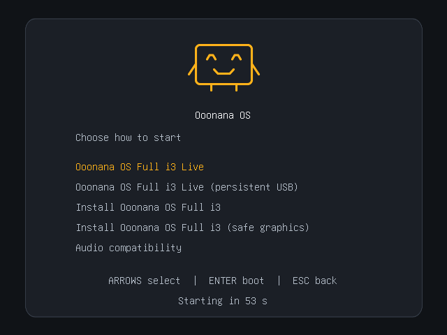
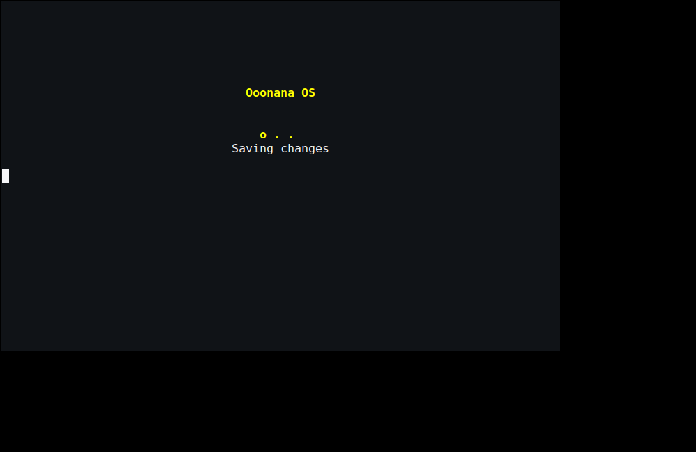
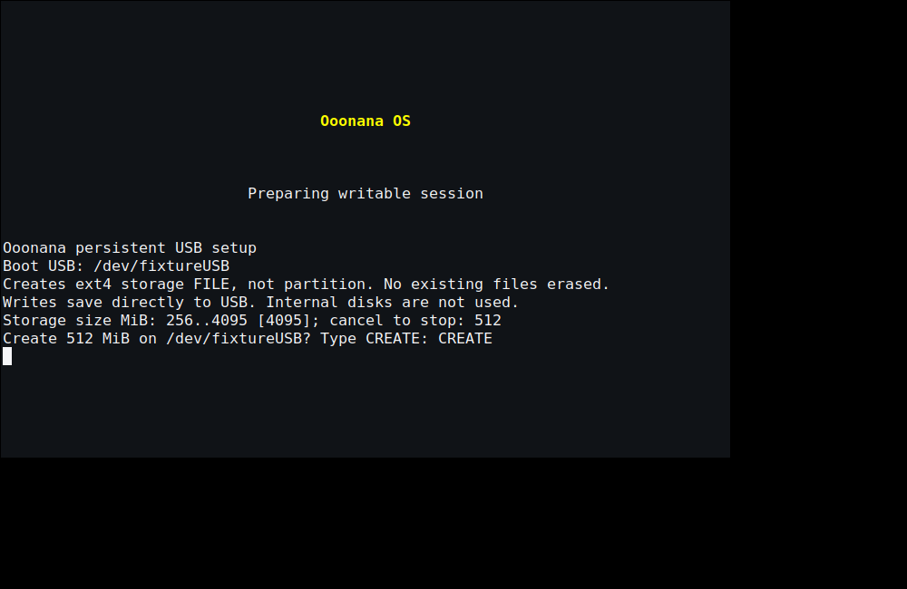
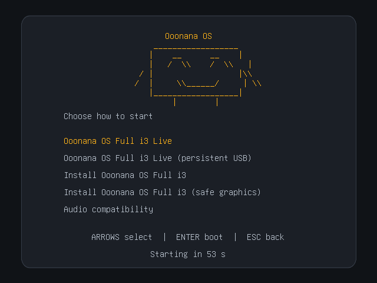

# Boot UI refinement — October 15

Impeccable refinement preserves opaque graphite/amber and the existing mascot.
No ISO was built. A fresh user build is required to include these changes.

## Logo and persistence follow-up

Earlier captures still used a font-dependent ASCII mascot. Spacing changes did
not repair its disconnected strokes. Full-i3 live ISO GRUB now uses a small
continuous-stroke image of the same smiling box mascot, with separately centered
brand name. Canonical ASCII branding remains unchanged for legacy text surfaces;
there were no doubled backslashes in the actual source.

Text-only boot/shutdown now deliberately use a compact **wordmark**, not a
graphical mascot. No framebuffer/Plymouth backend or dependency was added.
The old startup script no longer redraws the large ASCII face over this layout.

Persistent USB remains the second GRUB entry. Eligible first boot shows the
existing **text-based** size selection and exact `CREATE` confirmation. Splash
drawing ends before input; cancel, timeout, invalid size and unconfirmed creation
now explain the stopped setup. These paths still make no storage file, and do
not silently continue in supposedly persistent RAM mode. Existing identity,
space, no-clobber and cleanup checks are unchanged. FAT32/ext4 file setup only;
DD/ISO9660 still needs a separately prepared same-USB persistence partition.







Captures: real EFI/QEMU GRUB at 640×480 and 1280×800; private Xvfb/xterm for
shutdown and setup. Prompt answers and `/dev/fixtureUSB` are test data. Physical
boot, input and power-loss tests remain pending. No ISO built or disk formatted.

The earlier checklist/checkpoint below records the preceding patch, not these
follow-up assets.

Follow-up source: `861f37c9803d47207a9644bd3cc7f2f38ac0c01a`.
[GitHub regression](https://github.com/Ooonana/Ooonana-OS/actions/runs/38690288149)
and [GitLab smoke](https://gitlab.com/Ooonana/ooonana-repo/-/pipelines/2949488589)
passed. Logo/branding, live-initramfs, GRUB/Rufus (including missing image),
console, persistence and backend regression fixtures passed locally.
Signed candidate `4f606d511804c8ecf01f942fafdd3336d10ac37a5ef9d43206ecf8aa9f641973`
passed package/signature/dependency validation; prior generation unchanged.
Ooonana WSL core/runtime health checks and verification passed using native
snapshot `/var/lib/ooonana/candidate-logo-20261015.UZP0DU4p`.
No models downloaded, no disk relocation, private signing key remains local.
Full release preflight runs again inside the user's fresh ISO build; the earlier
standalone preflight checkpoint below is not a claim of a new ISO or physical boot.

## Shipped changes

- GRUB: removed duplicate title, decorative accent rail/dot and nested footer
  backing. Quieter instructions, slightly more menu spacing, rounded backdrop.
  Centered the brand-name line independently of the ASCII mascot's indentation;
  removed the unused 32px icon gutter and aligned heading/menu text baselines.
- Countdown: actual seconds in a small text label. GRUB's built-in progress bar
  has a hardcoded 28px minimum, so setting `height = 4` was not sufficient.
  [Upstream progress-bar renderer](https://github.com/rhboot/grub2/blob/master/grub-core/gfxmenu/gui_progress_bar.c)
  and [label timeout support](https://github.com/rhboot/grub2/blob/master/grub-core/gfxmenu/gui_label.c)
  informed the implementation; real EFI captures confirmed it.
- Live startup: centered mascot and named storage/session stages. Removed the
  arbitrary ten-step filled bar. Small three-position activity pulse runs only
  during the existing one-second media retry waits.
- Shutdown/reboot: the same stage presentation during the existing two-second
  writer grace period, then “Saving changes” while existing cleanup proceeds.
  There is no additional wait, fake completion percentage, sound, daemon,
  hidden cursor or animation background process.
- Serial consoles (`ttyS`, `hvc`, `ttyAMA`), unavailable/small VTs, or kernel
  argument `ooonana.motion=off` use plain messages. The shell environment
  `OOONANA_CONSOLE_MOTION=off` also disables animation.
- Warnings remain below the status; stage transitions do not clear the whole
  console. Final status stops activity before handoff. BusyBox init guards,
  persistence selection, failure-held rescue and unmount ordering are unchanged.
  Every drawing write rechecks the character device. Normal shutdown ends the
  presentation before unmounting `/dev`; missing/replaced VT fixtures confirm
  no regular file is created or overwritten.
- Persistent storage-file shutdown copies the tiny UI helper, logo and required
  console applets to its RAM root. UI functions retain no file descriptor or
  worker that could pin the writable old root during pivot/unmount.
- Rufus verification accepts the new countdown and earlier/minimal bar themes.

## Verification

- Production GRUB theme/config rendered in disposable EFI/QEMU at **640×480**
  and **1280×800**, main menu and audio submenu. No real kernel or ISO build in
  that fixture. Its capture-only 60-second timer replaces production's five
  seconds; the screenshot number is not the production boot timeout.
- POSIX shell and actual BusyBox shell fixtures: three distinct pulse frames,
  exact existing waits, motion-off, serial variants, invalid/small geometry,
  stage reset, no hidden cursor, no helper traps/background jobs.
- Full live-initramfs assembly and ISO-menu fixtures passed. Persistence
  maintenance tests passed, including repeated rescue-shell exits staying held.
  Storage/UUID and Rufus verification regression fixtures passed too.
- A private Xvfb/xterm PTY rendered boot/shutdown stage layout. This is a console
  UI fixture, **not** proof of physical GPU handoff or an actual power cycle.
- Impeccable detector reported no findings for the GRUB generator.



Physical framebuffer handoff, visible shutdown VT switching, power-loss and
reboot timing still need the disposable USB session. No physical drives were
modified and no WSL/host shutdown action was invoked by these tests.

## Delivery checkpoint

- Clean source manifest: `d0c1a60d70d9a53a97cb134a580fe691c62b12c8`.
  [GitHub regression](https://github.com/Ooonana/Ooonana-OS/actions/runs/38688451413)
  and [GitLab smoke](https://gitlab.com/Ooonana/ooonana-repo/-/pipelines/2949449344)
  passed. Commits pushed to both `codex/supported-base-0-10` branches.
- Signed local candidate generation:
  `ce7089f45b52a066125746249d03d3cd61e968ce594ec281c3728022aa0ff37a`.
  Coherent Alpine v3.24 package inputs; no models bundled. Prior published
  generations retained unchanged. Private signing key stayed local.
- Installed Ooonana WSL refreshed through native package transactions; both
  core and runtime verification passed. Signed native snapshot:
  `/var/lib/ooonana/candidate-boot-ui-final-20261015.uEbOTlzL`.
  Previous snapshot/checkpoints retained; neither WSL disk moved. WSL boot uses
  Microsoft's kernel, so this update does not prove physical boot animation.
  One WSL instance-start timeout cleared after restarting the idle VM with both
  distros stopped; final signed sync and package verification then succeeded.
- Core stays **0.10.0 candidate**. Stable promotion/signing enrollment remain
  deferred. Existing completed ISO does not acquire these edits through resume.
- Final signed generation passed full ISO preflight
  (`OOONANA_RELEASE_PREFLIGHT_OK`, 654 packages / 612 dependency nodes).
  This was `--preflight-only`; no ISO construction or hardware boot test.

## Reproduce focused checks

```sh
python3 tests/test-console-ui.py
bash tests/test-full-i3-live-initramfs.sh
bash tests/test-full-i3-iso.sh
bash tests/test-rufus-iso-verify.sh
python3 tests/test-persistence-maintenance.py
# Output folders must be new; fixtures own only their private processes/files.
python3 tests/check-grub-ui.py /var/tmp/ooonana-grub-ui-example
OOONANA_GUI_TEST_DISPLAY=1 xvfb-run -a -s '-screen 0 1000x650x24' \
  python3 tests/check-console-ui.py /var/tmp/ooonana-console-ui-example
```
