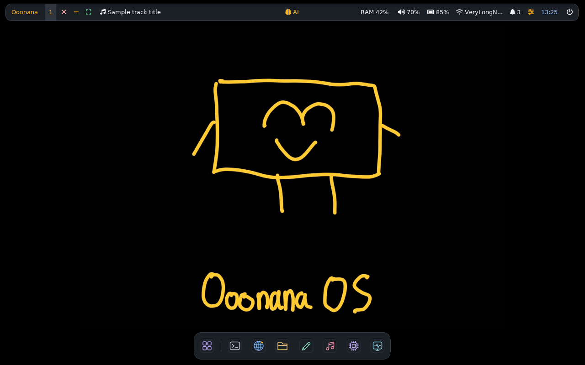
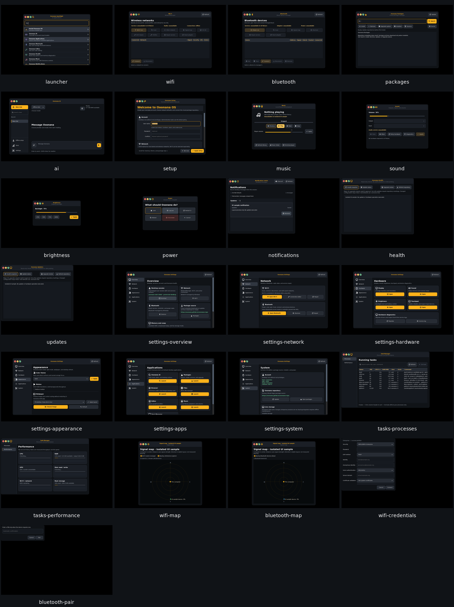
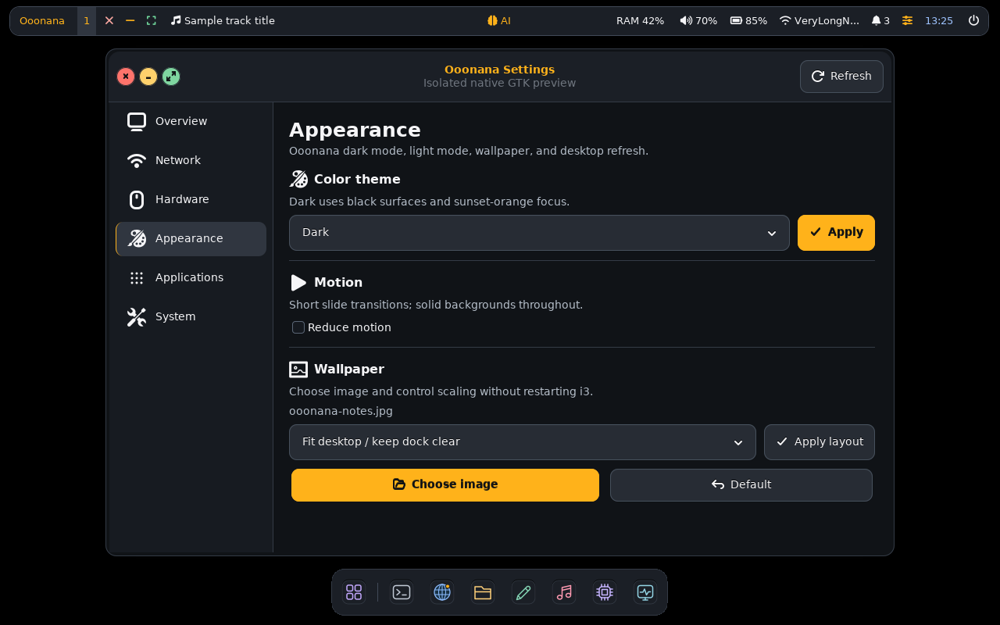

# Dock alignment and native app details - October 13

Core 0.10.0 candidate. Impeccable-guided refinement of existing native GTK3
surfaces, not a replacement theme. Original assets, opaque palette and actions
remain intact. Windows dock reference informs compact proportions and centered
icons, not asset redistribution or a new search bar.

## Changes

- Dock measures 60px high on the candidate display. Resting icons center within
  each tile on both axes. Running/minimized/count markers are pass-through
  overlays, so even a two-digit count cannot push icons upward. Launcher divider,
  32px desktop icons, 24px compact icons, 44px minimum targets, 2px eased hover
  lift and reduced-motion behavior stay consistent. Compact 320/480px fixtures
  retain unpinned-window access without overflow; omitted pins remain available
  through Applications.
- Shared native buttons gain 6px icon/text separation. Sidebar optical padding,
  1px selection marker, keyboard focus, entry hover, text selection, checkbox
  feedback and tooltip padding use existing opaque colors.
- Task Manager now honors reduced motion. Bounded process command reads are
  normalized to one line, preventing embedded newlines/tabs from expanding rows.
  Process identity, filtering, sorting and safe termination are unchanged.
- Added personal Windows conversion remains this machine's default cursor at
  21px with original proportions/hotspot. Normal ISO wrapper selects it when
  present; assets remain outside Git and personal-use only. Public builds retain
  separately drawn OoonanaTailless at 19px. Fixed stale 17px generated Xsettings
  value; existing account overrides are preserved.

## Native app coverage

Private UID1000, network-isolated Xvfb candidate at 1024x768 and 1280x800:

| Surface | Rendered coverage |
| --- | --- |
| Launcher | Real desktop entries, icons, search field and results |
| Settings | Overview, Network, Hardware, Appearance, Applications, System |
| Radios | Wi-Fi/Bluetooth unavailable states, both signal maps, enterprise credentials and pairing dialogs |
| Controls | Music stopped/unavailable, Sound unavailable, Brightness, Power |
| Packages/system | Packages, Health, Updates, first-boot Setup |
| AI | Native chat/composer/provider/memory shell; separate loading/error/cancel fixtures |
| Task Manager | Processes and Performance, compact rows and live private-process tests |
| Desktop | Dock, panel, wallpaper, tooltips and window controls |

Catalog renders 25 windows/pages/dialogs per resolution. Checks reject outer
window overflow and verify accessible close/minimize/fullscreen controls or
dialog Cancel/Confirm responses. Backend operations are mocked for catalog
captures; values are sample data, not hardware or installation certification.
Separate runtime checks cover actual source i3 actions, reduced motion,
focus-neutral hover, bounded previews, notification actions, launcher arrows,
Unicode Backspace/clipboard, and owned-process filter/sort/cancel/termination.
Real GTK button-state checks retain at least 4.5:1 enabled text contrast.

Owned evidence: `/var/tmp/ooonana-native-catalog-20261013.QDzi48qr` and
`/var/tmp/ooonana-native-confirm-20261013.Y6R2l2vt`. Initial wider compact-dock test
waited only for window width, reading child allocations too early; synchronization
now also waits for allocated target sizes. No product defect was hidden by
lowering the size assertion.

## Limits

No sound, model download, installation, physical hardware action, ISO build,
installed WSL migration or stable promotion. Yad installation flow, vendor
OpenVINO web UI, real Qt/Firefox pickers, physical display/input/session and USB
gates are not certified by this GTK catalog. Existing release/hardware checklist
remains in [deep-recheck-20261012.md](deep-recheck-20261012.md).
Fresh normal user ISO build must include these edits; no stale-stage resume.
