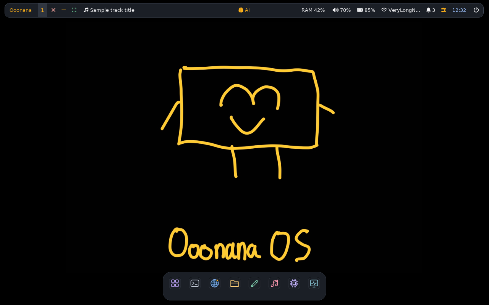
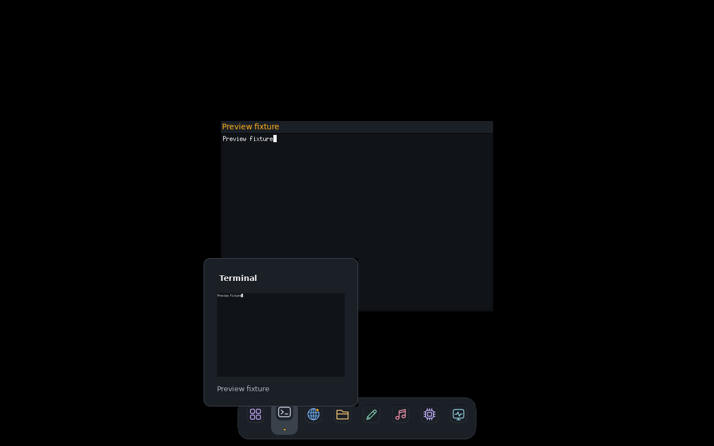
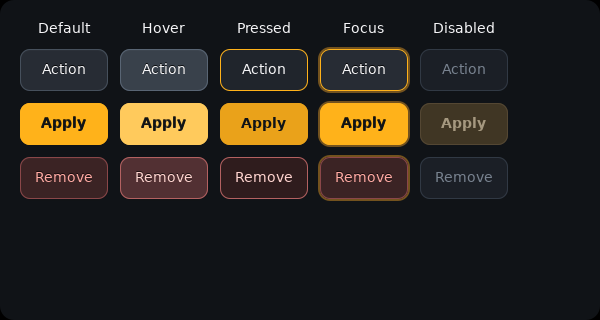

# Frontend micro-polish - 2026-10-13

Core 0.10.0 candidate, native GTK3/i3/Polybar. Narrow Impeccable refinement,
not a redesign. Original wallpaper, cursor, icon assets, opaque palette and
window-management behavior are unchanged.

## Repairs and small details

- Panel requested Font Awesome 6 while the coherent v3.24 payload ships 7.
  Fontconfig selected Brands for the Solid slot: several glyphs disappeared,
  music rendered incorrectly, and window actions were invisible. All panel
  font slots now name the shipped families. Runtime regression verifies actual
  Solid file selection and refuses dropped characters, not just config syntax.
- Regular status text is neutral instead of competing with orange brand/AI
  actions. Reduced status padding leaves room for restored icons; music stays
  left, AI centered, long network labels bounded.
- Dock focus gets a quiet filled tile. Running/minimized indicators are more
  legible. Tooltip headings are bold and left-aligned; captions use secondary
  text, aligned edges and tighter padding. Multiple-window counts and minimized
  descriptions are exposed without focusing/unminimizing anything.
- Shared buttons have distinct hover/pressed states while retaining semantic
  primary/destructive colors, disabled styles and keyboard focus rings.
  Circular native/third-party controls have matching pressed colors; sizes,
  clipping, hit regions and drag-through gaps remain unchanged.

## Evidence

Private, network-isolated, UID1000 candidate X11 probes: panel/dock at
1024x768 and 1280x800; native runtime, window controls, AI indicators/chat and
desktop interactions. Glyphs load from the real bundled Solid font; no unmatched
characters or panel overlap warnings. Long/minimized tooltip content stays
bounded; mapped previews stay at most 240x150, hidden windows are not captured.
Hover never steals focus or changes dock size; reduced-motion behavior remains.
Resolved GTK normal/hover/pressed/focus text contrast is at least 4.5:1 for
ordinary, primary and destructive buttons. Disabled buttons remain disabled.
Rootfs/package-factory/source checks cover generated panel/package propagation.

Owned evidence: `/var/tmp/ooonana-polish-baseline-20261013.Szw03xlM` and
`/var/tmp/ooonana-polish-confirm-20261013.j5rf2JsV`. Initial confirmation assertions
expected the font's alternate family name; corrected to verify the actual Solid
file. No production UI change was needed for that test-harness error.

## Limits and next steps

Sample status values are not hardware measurements. No sound was played.
Installed Ooonana WSL/stable 0.9.9 remain unchanged. No ISO built.
Fresh normal ISO build must include these edits; do not resume the prior failed
rootfs stage. Physical USB/WSLg, mixed DPI, Qt/Firefox pickers, IME and session
gates remain in the [existing checklist](deep-recheck-20261012.md).
No zero-bug or complete physical-release certification is claimed.
