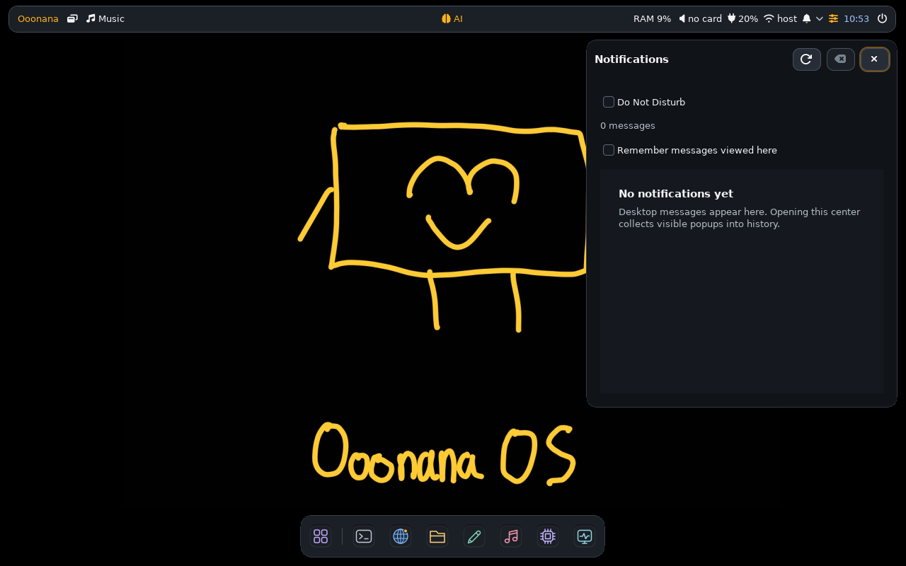

# Installed UI and candidate checkpoint — November 6, 2026

Core 0.10.0 candidate; stable unpromoted. Runtime source freeze:
`d9b4ae59f0df9798ae6e8a02db7902d07e74b92c`.

## Completed

- Nemo/cache fixes committed and pushed to both candidate branches.
  [GitHub CI](https://github.com/Ooonana/Ooonana-OS/actions/runs/42146185239) and
  [GitLab CI](https://gitlab.com/Ooonana/ooonana-repo/-/pipelines/3034611892)
  passed for that exact revision.
- Desktop profiles request GVfs metadata and Glycin/HEIF thumbnail helpers.
  Bundle 0.1.6 retains Flatpak/Nano/Node.js and pinned native controls. New core
  archive and wrapper metadata built; OpenVINO package preserved.
- Wallpaper actions replace Cinnamon-only helpers. Factory defaults disable
  automatic mounting/opening and autorun; explicit preferences take precedence.
  Quoted/Korean filename safety and silent failure feedback pass.
- Cache install/upgrade, failed-health rollback, SIGKILL/recovery and removal
  pass actual private transactions. Minimal no-Nemo schema compilation also
  passes. Earlier rootfs/factory/interruption and native helper loader checks
  remain valid; loader checks alone do not prove thumbnail output.
- Installed notifications: actions, history, panel badge, DND queue and daemon
  recovery passed. Installed flyout now also passes: frameless 440×520 at
  1280×800, actual Escape dismissal, rendered result reviewed. Original pause
  level restored; no unrelated messages cleared and no audio played.

## Storage blocker

Windows registration shows **Ubuntu on C:** and **Ooonana already on F:** at
`F:\Ooonana\WSL\Ooonana`. Neither distro was moved here. F: identifies as a
Generic xD/SD/M.S. USB storage device. Windows reports Online/Healthy, but reads
stalled with a sustained queue, zero observed read throughput and Linux I/O
pressure above 90 percent. Card, reader, connection and software causes remain
undetermined; the generic health result does not resolve the stall.

Both package copies share that physical device. Owned indexing jobs stopped.
No installed package transaction or generation promotion occurred. No repair,
forced dismount, WSL replacement or relocation attempted. Measured package
delta: 7,276,316 compressed bytes /18,536,665 unpacked bytes. C: free about
2.3 GiB; available host RAM about 2–3 GiB. Heavy viewer/GUI launches held.

Published and installed generation remains
`81a738401be5d57114240e673e38f03fb3b7afe8542957e2676add68234e95b1`
(718 packages /637 dependency nodes). New source is **not yet installed or
signed as a complete generation**. Previous completed passes remain completed.

## Remaining, in order

1. Restore reliable F: I/O. Finish signed generation/provenance/checksum/native
   closure verification; retain the old signed generation.
2. Install matching experimental candidate; verify protected files. Test actual
   Nemo folder-layout persistence, PNG/HEIF/AVIF thumbnails, context menus and
   wallpaper/settings paths. These gates remain open.
3. Finish bounded installed desktop/app acceptance. Physical cursor/DPI/device
   checks remain separate.
4. Actual Chromium PDF boot, keyboard/Backspace/focus, controls and measured
   command latency. Read-only inspection confirms the page-open boot script and
   blank command input; no viewer acceptance or PDF rebuild claimed.
5. Final image-specific guides/screenshots/release notes after testing. User
   builds the final ISO; latest source is not ISO-ready yet.

VM/physical tests remain held by user choice. Live cloud AI blocked by balance;
OpenVINO overhaul deferred. No models, audio playback, ISO, stable promotion or
trust enrollment. Key stays local; original-code/artwork license undecided.

## Cleanup and resume data

Selected project-owned C: temp folders total about 30 MiB of receipts, scripts
and captures; no new large confirmed junk found. Small private schema/ABI
fixtures cleaned by test finalizers. No further reclamation claimed. Preserve
history/models/keys and incomplete stages until their bytes are verified:

- F: `build/native-files-stage-20261105.awauc8pd`.
- Ooonana: `/var/lib/ooonana/candidate-files-20261106.g9s613_x` (unsigned).
- Ubuntu: `/var/tmp/ooonana-files-import-20261105.uuYSRB9x`.
- Receipts: `%LOCALAPPDATA%\Temp\ooonana-installed-acceptance-20261105`.
