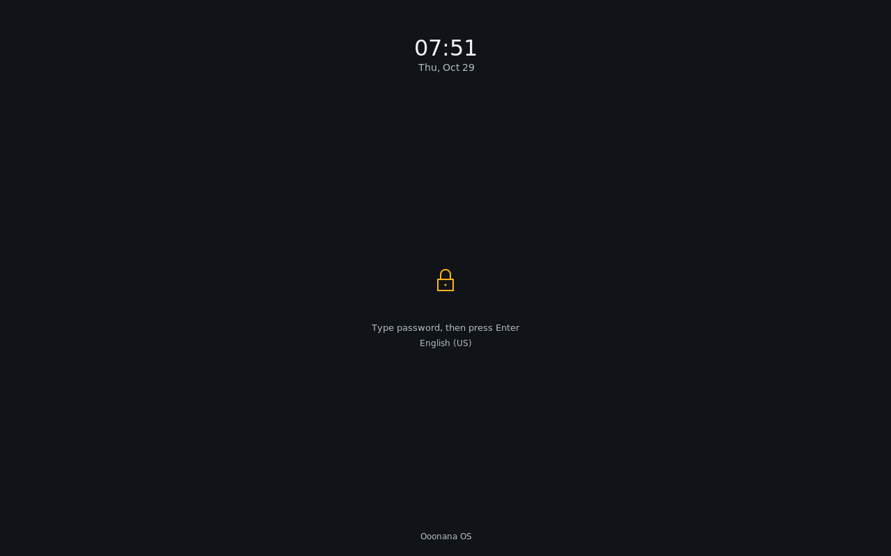
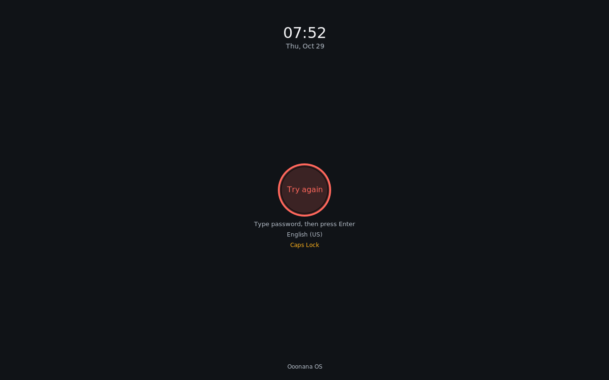
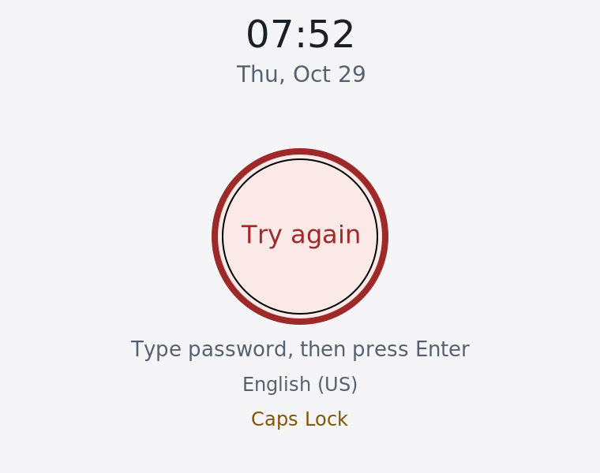
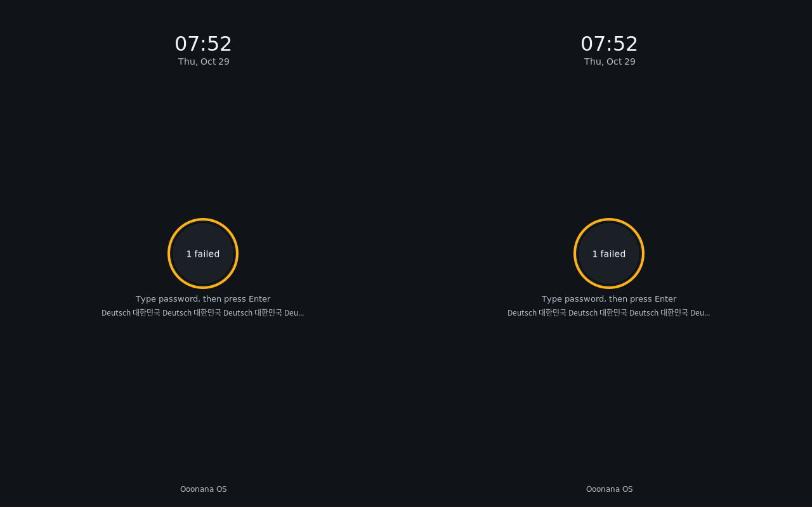
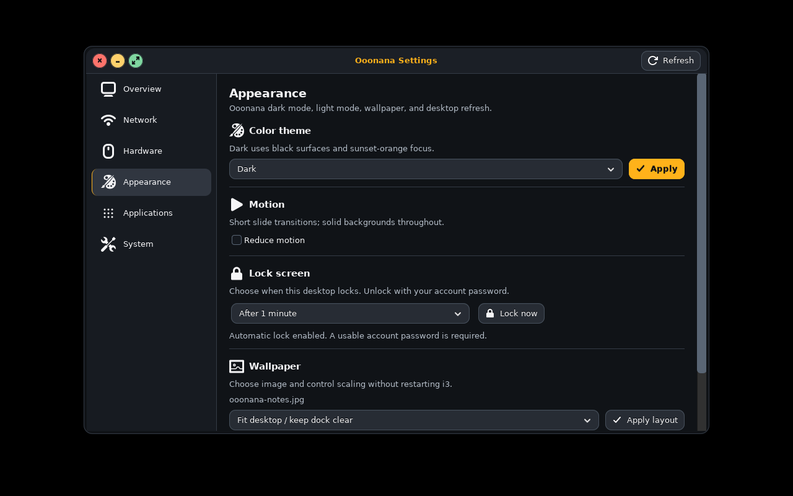
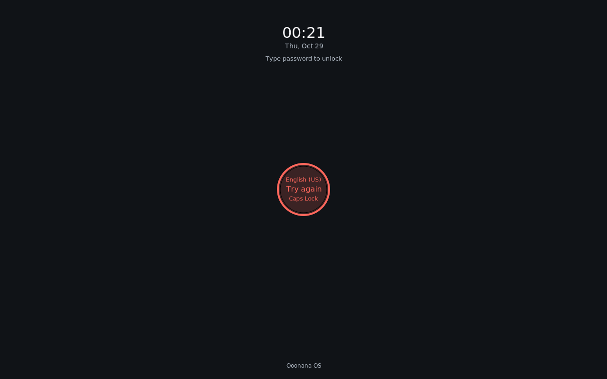
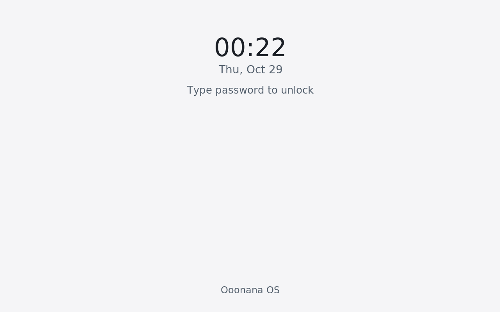

# Item 10.5: lock, sign-in and session review

October 29, 2026. Core 0.10.0 candidate; stable not promoted.

Source and disposable packaged-session work is completed below. Installed
Ooonana WSL, physical sign-in/wake, and the final release remain separate gates.
No active user desktop was locked. No host suspend/logout, audible test, ISO,
production signing, model download or remote publication was performed.

## Requested visual recheck

The first pass still crowded keyboard layout, password feedback and Caps Lock
inside one small circle. Its empty state also lacked a central lock cue.
This refinement separates their roles while preserving Ooonana's existing
opaque palette, compact typography and actual keyboard/PAM behavior:

- A small amber padlock marks the idle unlock area. Its instruction sits below:
  type the password, then press Enter.
- The native circle carries authentication feedback alone. Keyboard layout and
  Caps/Num Lock sit in separate readable rows; the modifier warning uses amber.
- Layout names use a bounded320px row with UTF-8-safe ellipsis. Font size stays
  readable. Branding yields on300px logical-height displays so it cannot crowd
  the modifier row.
- Keystroke feedback follows Ooonana amber. Ordinary Backspace uses neutral ink
  instead of an error flash. Real authentication failures remain red with text.

Native revision is now `2.16-r0.ooonana5`, staged without publication. Vendor
main authentication/input remains byte-for-byte unchanged after removing only
the previously reviewed clock-redraw additions. Earlier `.ooonana2` evidence
and screenshots below are preserved as history.

Rendered review caught a stray Cairo path from the date to the new idle icon.
The icon now starts its own path. A blank-gap pixel assertion guards normal
and2× renders; the retained faulty1× capture contains406 stray pixels in that
gap. The earlier `.ooonana3` functional pass did not close this visual defect.
An auxiliary old-binary replay stopped at harness preflight and is not counted;
its logs remain, alongside the actual captured-pixel evidence.

The layout probe also waits for real PAM's empty-password cooldown before
switching maps. It now verifies the long UTF-8 name reached the X11 server,
rather than treating an unchanged English layout during verification as proof.
The compiler's XKB dump then crashed in QA; readback now uses the same
libxkbcommon-X11 API as the locker. That verified378-byte fixture exposed missing
Korean glyphs in Cairo's default Latin face. CJK labels now select the existing
packaged Noto Sans CJK KR face. Latin sizing stays unchanged; no font download,
new runtime dependency or password-input change. A real Cairo glyph probe
rejects missing or repeated glyphs for four distinct Hangul syllables.

Final `.ooonana5` packaged receipt:
`/var/tmp/ooonana-installed-desktop-lock-20261029.3yGoKZLp`.
All **seven** affected gates pass on the same verified installed binary:
Graphite/Paper1×/2×, compact760×600 at2× in both themes, and extended dual-monitor
input/layout/Backspace/duplicate/minute-redraw checks. The 378-byte XKB name is
verified through the native API; four Korean glyph IDs are distinct/nonzero
(`49403,58199,51703,47976`). Authentication and the archived PAM policy remain
unchanged. Impeccable review includes actual final captures, not only source
or passing assertions. Earlier idle/suspend and real PAM proofs remain valid;
they are not claimed as fresh physical/installed-session tests.

Final binary SHA256:
`c1892a23cfb83cfc94ef330b3c02821d5d64ccd64ac16f4b7e1ddd7a2396d567`.
Final native archive SHA256:
`3c2742136b6ce1f7ec2f1040cc477044cebef6395deb878d7ee9fe387a25b56f`.
Native compilation still proves the vendor main authentication/input source
unchanged. Unpublished stage retains654 packages/612 dependency nodes. Installed
WSL, remote CI/push, production signing/publication and ISO remain held.

Final captures use the exact `.ooonana5` package. Compact Paper is an explicit
2× accessibility case; ordinary desktop text size has not increased.

Build/controller logs:
`C:\Users\7ryan\AppData\Local\Temp\ooonana-lock-refine-20261029`;
final native build:
`F:\Ooonana\ooonana-os\qa-i3lock-20261029-feedback-cjk`.
Keep intermediate failures and their receipts. In particular, the corrected
extended pass`qyWUOixt` proves the readback repair on `.ooonana4`; only the
later`3yGoKZLp` receipt also proves the final Korean glyph repair. Private GTK
captures retain the known Glycin sandbox warning; no installed decoder sandbox
certification is inferred.

## Interface and behavior

- Native i3lock keeps its real keyboard/pointer grabs and PAM authentication.
  Graphite/Paper use opaque backgrounds, restrained clock/date, compact unlock
  feedback, keyboard-layout/Caps Lock indicators and small Ooonana branding.
  Type anywhere to unlock; Escape clears a draft without unlocking. Backspace
  edits the password through the vendor input path. Passwords are not shown.
- The password instruction now remains visible at 400 logical pixels high
  (1280×800 display at2×). It stays above the unlock indicator rather than
  enlarging it or allowing text to collide. The initial compact-hint revision
  was `i3lock 2.16-r0.ooonana2`; vendor authentication/input source is unchanged
  apart from the existing opt-in clock redraw additions.
- Settings → Appearance → Lock screen provides Lock now and inactivity choices:
  Off, 1, 5, 10, 15 or 30 minutes. Default remains **Off**. Super+Ctrl+L locks the
  desktop. A live account without a usable password refuses locking and gives
  setup guidance; installed/custom PAM remains authoritative.
- Failed preference writes or guard starts leave visible feedback; failed
  starts restore the previous saved setting. Controls are disabled while their
  request is pending. Closing Settings ignores stale callbacks.
- The idle guard uses the actual X11 idle counter, checks at 5-second intervals,
  and holds one foreground locker until unlock. It leaves **no resident worker
  when Off**. Switching Off never releases an already active locker. A window
  manager restart is tolerated; a departed desktop ends the watcher.
- Power adds Suspend while keeping six primary controls. Restart i3 moves into
  More. Confirmations fit narrow/large-text displays, default to Cancel and
  close their parent menu before opening. Terminal/rofi fallbacks use the same
  guarded session helper.

Impeccable 4.8.0 guided the audit/hardening/polish pass against
[Ooonana's existing style](desktop-style.md). Actual GTK/i3 captures cover normal
Graphite and Paper at200% text on760×600, plus native locker1×/2× in both themes.
No copied Windows arrangement or larger default typography was introduced.

## Backend fixes and boundaries

1. **Captured-pipe lifetime:** vendor i3lock's background child inherited GUI
   stdout/stderr pipes. A caller could time out although the display was already
   locked. The wrapper now detaches non-TTY output streams before background
   exec; foreground behavior and fork-after-grab readiness remain intact.
2. **Duplicate locker:** a second invocation could wait for the first unlock,
   then display another password prompt. An owned, display-scoped file lock now
   survives vendor exec/fork until unlock. Duplicate requests return75 before
   starting another locker. Unsafe ownership, links and malformed arguments
   refuse before execution.
3. **Idle policy:** exact integer validation rejects bool/string/float values.
   One attempt occurs per idle period; new activity or a changed policy rearms
   it. Failure notifications are bounded and suppress sound. Enabled private
   watcher RSS was about 17 MiB; final packaged sampling recorded 0.01 CPU seconds
   over the one-minute wait. These are fixture measurements, not hardware
   idle-memory guarantees. Off avoids that resident cost.
4. **Suspend:** `ooonana-session --suspend` pins the current login1 bus owner,
   checks permission, confirms real locking, rechecks permission, then requests
   `Suspend(false)`. Missing, denied, challenged or inhibited service refuses.
   A permission change after locking leaves the session locked. There is no
   direct kernel fallback, password bypass or inhibitor override. The boolean
   and authorization states follow the official
   [login1 interface](https://www.freedesktop.org/software/systemd/man/latest/org.freedesktop.login1.html).
5. **Packaging:** core includes the new helpers/backend and an explicit
   `libxscrnsaver` dependency. Customized i3 configuration is preserved. New
   defaults/shortcut/startup line require merging `.ooonana-new` for an existing
   customized configuration; Settings can start the idle guard independently.

The current Ooonana custom-init image has **no running login1 provider**. Suspend
therefore reports unavailable there. The new request path is conditional
integration, not proof that this image can sleep/wake. Selecting/integrating a
real seat/session provider and testing physical suspend remains unfinished.

## Verification evidence

All X11 tests use a dedicated UID1000, owned Xvfb, disposable account data and
private namespaces. Fake login1 receives calls on a separate test bus and never
suspends any machine. Test signing keys are independent of the production key.

| Check | Result and preserved receipt |
| --- | --- |
| Wrapper, native patch/provenance, session ordering |17 unit cases pass; preferences and persistence-maintenance checks pass. Controller `final-units.stdout`/`.stderr` retain results. Three console-login prompt tests also pass. |
| Real PAM helper/custom policy | Wrong password rejected, correct password accepted; `pam_deny` honored, restored policy succeeds. `/var/tmp/ooonana-lock-pam-10-5-20261028.WotihZyB`. Original helper/shadow/policy hashes retained. |
| Kernel/getty/PAM sign-in | Three diskless QEMU cases: rejection then nonroot desktop-handoff marker; expired account denial; mandatory expired-password rotation, logout, old-password rejection and new-password success. `/var/tmp/ooonana-lock-auth-10-5-20261028.BJZuflWr`. |
| Real native input/clock | Wrong/empty input, Escape, Caps Lock, layout switch, Backspace, duplicate refusal; minute redraw preserves a partial password, then correct unlock. `/var/tmp/ooonana-lock-auth-10-5-20261028.OufVES36`. |
| Virtual display coverage | Two active640×800 RandR monitors across1280×800; per-monitor heading, opaque edges and no underlying magenta desktop pixels. Same `OufVES36` receipt. Physical mixed-DPI/hotplug is not inferred. |
| Idle and suspend protocol | Actual one-minute X11 inactivity locks; duplicate watcher prevention; Off leaves no worker and does not unlock. Real private DBus denies/challenges/inhibition, permission change, held grabs, `interactive=false`, missing-provider handling pass. `/var/tmp/ooonana-session-10-5-source-20261028.eUoPmDJN`. |
| GTK controls/layout | Normal and real200% text Settings/Power/storage/flyouts pass, including preference rollback and Cancel. `/var/tmp/ooonana-lock-ui-source-20261028.yACupzkD`. |
| Packaged integrated baseline |13 gates pass after actual private signed core reinstall, source/archive/installed byte comparison and custom-config preservation. `/var/tmp/ooonana-installed-desktop-lock-20261029.jwyCP1w2`. |
| Final compact-caption package |13 gates pass again on final core plus actual signed private native locker upgrade from `.ooonana1` to `.ooonana2`. Installed binary matches the verified archive; PAM policy remains identical. `/var/tmp/ooonana-installed-desktop-lock-20261029.iTeNE550`. Both themes/1×/2×, idle/protocol/GTK, extended input/dual-monitor/minute checks pass. |

Initial `.ooonana2` binary SHA256:
`9db006223397c2e240463308053238a0bf92eb78d2bc1b111e4eb5f85ffce5cc`.
Initial `.ooonana2` archive SHA256:
`f2b3fe23b6c694209645038a9a006856bda33f8daf4cf458e003e63dba0954cc`.
Unpublished stage passes 654-package/612-node dependency/provenance checks.
The production generation remains
`4bf64022f11e74d5b8d24ada04d2eebc703d8f1431045e7683343bdf5f243a2e`;
its clean source manifest still pins `c0be613`, not this unpromoted work.

Earlier failed attempts remain evidence:
missing `setxkbmap` was replaced with bundled `xkbcomp`; paint readiness now
waits for actual opaque pixels rather than a fixed half-second delay. The
captured-pipe and duplicate-launch failures above were fixed and retested.

Controller/build logs:
`C:\Users\7ryan\AppData\Local\Temp\ooonana-lock-10-5-controller-20261028`.
Native build: `F:\Ooonana\ooonana-os\qa-i3lock-20261029-compact-hint`.
Pinned compilation uses a read-only build image/private overlay, disables
network during compilation and records exact binary/input hashes. It does not
update either installed WSL distribution.

## Initial10.5 captures

Private disposable session, initial `.ooonana2` bytes. The native locker at2× is
an explicit accessibility variant; default desktop text remains unchanged.

## Still open

- Console getty/PAM sign-in remains the actual login interface. No graphical
  greeter was added. VM authentication/desktop-handoff fixtures do not prove
  complete installed graphical sign-in, expiry, unlock or logout acceptance.
- Integrate and verify an appropriate real login1/seat provider with Ooonana's
  init/authentication model before claiming suspend support. Test inhibitors,
  lid/wake, real output coverage after resume, and normal authenticated unlock.
- Installed user session/WSLg and physical displays: keyboard/layout changes,
  scaling, mixed DPI, hotplug, idle policy across session transitions and
  actual sign-in/logout remain pending. No host-wide power test substitutes.
- Publication/WSL sync, both remote CIs, production trust enrollment/stable
  promotion and a fresh user-built final ISO remain held. Local QA signatures
  do not establish release trust or public cursor-asset licensing.

The broader [release checklist](release-readiness.md) retains later work.
History, original screenshots, models, signing keys and recovery checkpoints
are preserved; private build/QA artifacts are not indiscriminately junk.
