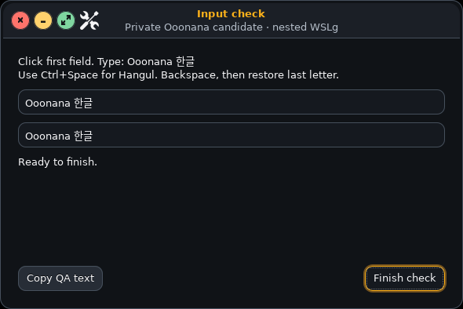

# Items1–15 follow-up — November4,2026

Core0.10.0 candidate; stable unpromoted. Completed1–10.5 software/private
checks remain completed. This pass addresses actual remaining software rather
than rerunning every passed screen. OpenVINO, audible tests and ISO creation
remain excluded. The user explicitly keeps VM checks pending.

## 12 — Installed nested input acceptance

The installed nested Ooonana desktop now has a complete manual receipt:
mouse, keyboard, Backspace, Hangul composition and clipboard paste all true.
The user completed the actual GTK form. Only booleans and the fixed QA text
are retained; arbitrary typed/clipboard content is not logged.

The first adapted probe omitted `GTK_IM_MODULE_FILE`, losing the per-user
Fcitx GTK cache setup from the original test. Its disabled Copy button also
unnecessarily coupled clipboard testing to composition. The probe now restores
the real IME environment; Copy works independently. Fcitx reports a connected
input context, and the refreshed end-to-end manual check passes. This was a
probe defect, not proof that all normal desktop applications lost Korean input.

Physical mixed-DPI, multiple displays and hotplug remain hardware acceptance.
Earlier normal/large-text and GTK/Qt/Firefox input passes remain valid.

## 13 — Custom-init session-provider integration

Full desktop/core dependencies now include pinned elogind and Polkit services,
alongside the existing matching libraries. No musl, vendor PAM, native window
manager, locker, Qt or OpenVINO payload is replaced by an upstream reimport.
The existing vendor `base-session` already has optional `pam_elogind.so`;
its authentication policy is preserved.

The new root-only `ooonana-session-services start` runs after system D-Bus and
before installed console login, with a25-second global startup bound. It
prepares unified cgroups without replacing legacy/admin mounts, creates a
nonprivileged Polkit identity if needed and activates/probes login1/Polkit
through D-Bus. Existing providers are probed without replacing their identity.
Frozen/replaced owners are refused. WSL skips physical power services.

APK import normalizes group ownership. Only the known root:root0750 local
Polkit rules directory is repaired to root:polkitd0750. Custom inaccessible
policy is preserved and refused, never made broadly writable/readable.
No blanket authorization rules are added.

Automatic provider lid/power-key/idle actions are disabled by the Ooonana
drop-in. Explicit Power→Suspend retains the existing confirmed PAM lock,
fresh permission recheck and inhibitor enforcement. Automatic lid sleep is
not certified or enabled by this pass; physical power/wake acceptance remains.

Nine startup/refusal/policy tests and four existing lock-before-sleep tests
pass. The real pinned elogind/loginctl/busctl executables report255.24; Polkit
127-r2 native CLI/loader and the actual PAM module link successfully in a
disposable extracted dependency root. That root is cleaned after retaining
receipts. No daemon boot, host lock, suspend or VM test is inferred from ABI
checks. Rootfs and package-factory regressions pass.

Upstream integration contracts: [elogind](https://github.com/elogind/elogind),
[pinned service packaging](https://raw.githubusercontent.com/alpinelinux/aports/3.24-stable/community/elogind/APKBUILD).

## Boundaries still open

- 11: real cloud streaming/cancel/recovery needs secure new-key confirmation;
 existing credentials are not silently reused.
- 13/15: actual provider/PAM registration, inhibitors, installed transitions and
 broader system/kernel upgrades require the held VM checks and real hardware.
- 14/15: radios, sound routes, backlight permissions, physical installation,
 persistence and power-loss cases need the appropriate running device.
- Graphical greeter remains a separate feature decision. Native lockscreen
 password field/masking/PAM work is already completed, not reopened.

Candidate packaging/publication receipt follows final source validation.
Private receipts remain under
`C:\Users\7ryan\AppData\Local\Temp\ooonana-release-17-21-20261103\`.
