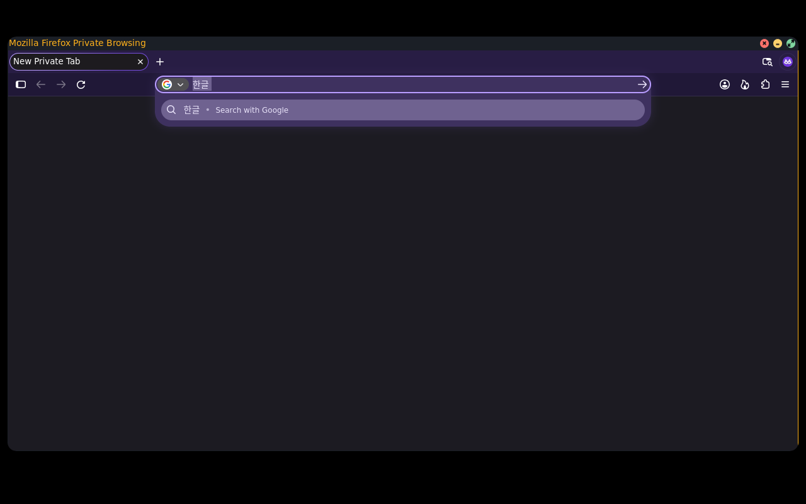

# Items 10–15 recheck — October 30, 2026

Core 0.10.0 remains a candidate. Installed Ooonana WSL sync, remote push/CI,
production signing/publication and ISO creation remain held. No audible test,
model download or physical disk operation was performed. Earlier completed
[native/password/session checks](ui-10-15-review-20261029.md) remain valid.

## Fresh checks

| Item | Fresh result | Still requires acceptance |
| --- | --- | --- |
| 10 Packages/Health/Updates | Normal/scaled Health and package UI; real signed fixture install/remove, configuration-preserving upgrade, interruption/recovery and failed-health rollback pass | Whole-system upgrade and fault tests on disposable installation |
| 10.5 Lockscreen | Normal Graphite and scaled Paper native field; mouse click retains draft/focus; empty and final-character Backspace; fixed mask; clear/error; actual PAM unlock pass | Installed login/wake; graphical sign-in remains unimplemented |
| 11 Task Manager / AI | Live private process sampling and detailed Task Manager UI pass; earlier 192-worker/termination/shortcut proofs retained | Physical counters and live cloud AI; new-key local save was declined |
| 12 Input/displays | Firefox 1.0.1→1.0.2 upgrade, sandbox Hangul/Backspace/private clipboard and Korean font coverage pass; native GTK/Qt input passes retained | Host WSLg and physical displays/hotplug; other sandboxed app input remains part of final acceptance |
| 13 Session | Session and scaled Power UI pass; earlier three real kernel/getty/PAM login/expiry/rotation cases retained | Installed transitions; current image needs a real login1/seat provider before suspend support can be claimed |
| 14 Hardware controls | Wireless and sound/brightness/music details pass normal/scaled cases, including permission/unavailable states | Physical radios, routing/device changes and backlight permissions; no sound played |
| 15 Installer/boot/power | Installer normal/scaled UI passes; earlier full GUI preview/auth/log/completion proof uses real PAM with an inert backend | Actual installation/persistence writes, final BIOS/UEFI/framebuffer/power tests |

The fresh baseline has 14 passing cases in
`/var/tmp/ooonana-installed-desktop-recheck-20261030.U5OI0Izj`.
Two additional packaged lock input-edge cases pass in
`/var/tmp/ooonana-installed-desktop-edges-20261030.HBcD5QDr`.
Impeccable 4.8.0 guided visual review of actual native field/error captures,
normal sound controls and scaled Paper Power. Existing compact opaque style
is retained; enlarged QA text is not a changed production default.

## Firefox input boundary

The actual Flatpak browser failed to activate Hangul while native GTK/Qt worked.
Diagnostic sandbox output showed the inherited `GTK_IM_MODULE_FILE` pointed at
a host-only cache naming musl modules. The runtime already includes its own
glibc Fcitx module. Launcher 1.0.2 removes only that host cache setting with
Flatpak's documented `--unset-env`; selected input provider remains intact.
No filesystem/session-bus grant, sandbox-disable flag or persistent override
was added. [Flatpak command reference](https://docs.flatpak.org/en/latest/flatpak-command-reference.html#flatpak-run)
and [Fcitx application integration](https://fcitx-im.org/wiki/How_does_an_application_talk_to_Fcitx)
describe the relevant boundaries.

Actual browser process inspection confirms the host cache is absent. The real
upgrade passes under QA repository signature verification. Browser renderer
seccomp filtering and `NoNewPrivs` remain active. Hangul composition produces
exactly `한글 ` after correcting a syllable with Backspace; private clipboard
readback matches. The same run passes portal picker cancel/open/readback and
minimize/restore/fullscreen/move/close. Receipt:
`/var/tmp/ooonana-firefox-input-20261030.y1Via7u1`.

Screenshot inspection then exposed missing Korean glyphs despite successful
composition. The font file was readable inside Flatpak, but its font index
omitted Korean. Host and cached runtime font roots both had epoch-zero mtimes;
the runtime accepted the wrong directory cache. Rebuilding host caches alone
did not repair it. Updating the host directory stamp before rebuilding did.

The full-rootfs builder now stamps the assembled font root before generating
caches. Native boot repairs an epoch-zero root once and forces cache refresh;
subsequent boots retain the existing-cache fast path. Three behavioral tests
cover repair-once, ordinary cached boot and missing-cache generation. Both CI
definitions include these tests, and the full rootfs regression passes.
No fonts were downloaded or copied into a browser profile. This uses Flatpak's
[existing read-only host font export](https://docs.flatpak.org/en/latest/desktop-integration.html#fonts).

Signed private core reinstall preserved the fixture's custom `rcS` and staged
the new factory file as `rcS.ooonana-new`. QA explicitly selected that factory
default only inside its owned candidate. Source/archive/installed bytes match;
the actual packaged function repairs the epoch and leaves the second call's
timestamp unchanged. Preserved custom boot configurations require review of
the pending default during eventual integration; no installed WSL config was
changed. Final core/font receipts are in
`/var/tmp/ooonana-firefox-source-20261030.7lJNXhuf` and
`/var/tmp/ooonana-firefox-source-20261030.FQtGmdQn`.

Normal Graphite input/window/picker and regular Paper at2× pass using the exact
packaged repair. Final normal capture/interaction receipt:
`/var/tmp/ooonana-firefox-input-20261030.n6IT80Ek`. Paper receipt:
`/var/tmp/ooonana-firefox-input-20261030.ALF5Xbqa`.
The probe requires runtime Korean font coverage and rejects empty compositor
captures. Its scaled color check now uses a device-aware inset: the old fixed
logical crop left only2×2 pixels while requiring12 matches. No production
control sizing changed. Earlier missing fixture launcher, install-versus-upgrade,
preserved-config and unsupported geometry attempts remain harness history;
they are not counted as product passes. The known upstream GTK chooser-close
warning still occurs and is neither fixed nor suppressed.

## Cleanup and remaining work

Read-only cleanup inspection identified a failed 2 GiB F: QA image and three
inactive native build-intermediate directories totalling 1.4 MiB. Automatic
approval review blocked deletion with “blocked by policy.” Nothing was deleted;
[exact manual commands and preserved evidence](cleanup-20261030.md) are provided.
Earlier history, models, build outputs and keys remain intact.

The cloud AI key decision, installed WSLg/session work, real hardware,
USB persistence/fault testing and final boot-image verification remain open.
Bootable PDF viewer acceptance is separate item 16, not included in this pass.
OpenVINO remains deferred. See [release readiness](release-readiness.md) for all
release gates; no stable/whole-goal completion is claimed.
