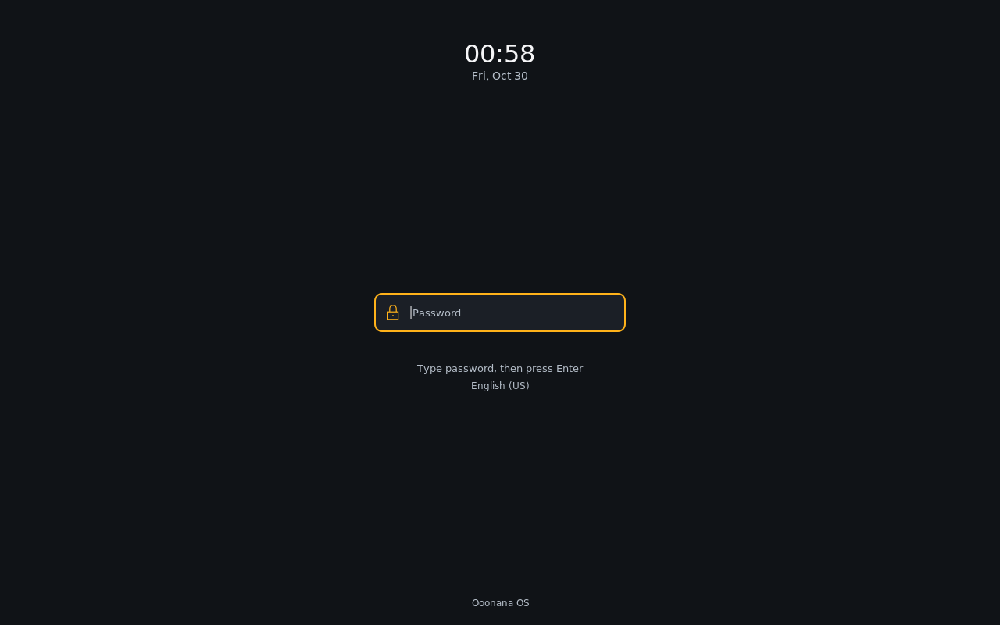
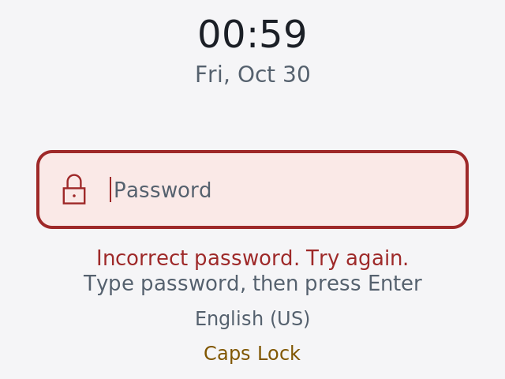
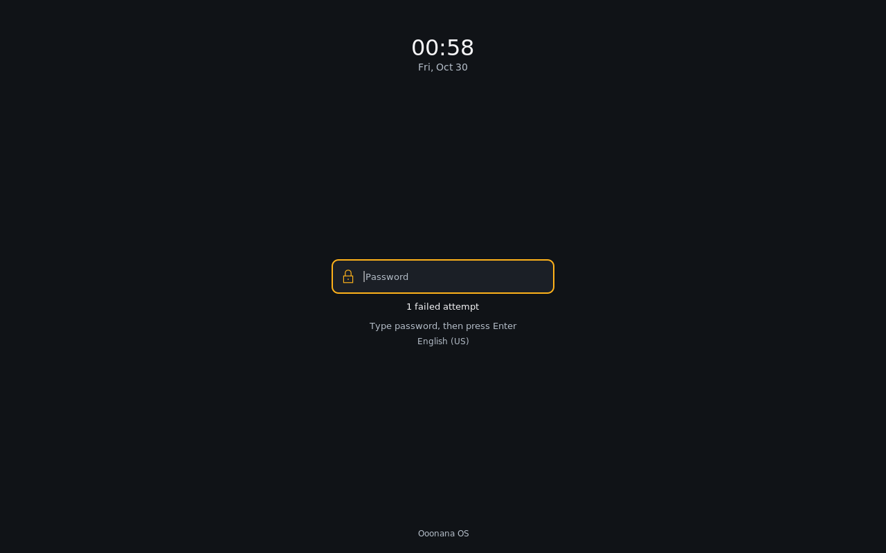

# Items 10–15: packaged candidate review

October 29, 2026. Core 0.10.0 candidate. Stable not promoted.

This pass uses disposable package installations, private X11 displays and
diskless QEMU guests. Installed Ooonana WSL, physical devices, production
signing, remote publication and ISO creation remain held. No sound played,
model downloaded, existing credential reused or new API key written.

## Password field: requested correction

The earlier native lockscreen accepted passwords but showed only an indicator.
It lacked the familiar input affordance the user requested. The new native
field remains visible before typing, with an opaque surface, amber focus
border, small lock icon, Password placeholder and caret. Typing shows a fixed
four-dot mask; it reveals neither characters nor password length. Clearing
restores the placeholder. Verification and wrong-password feedback occupy a
separate row. Caps Lock and the actual XKB layout keep their own rows.

This is presentation of i3lock's existing grabbed keyboard input, not an
unprotected GTK overlay or a replacement authentication mechanism. It reads
only the existing nonempty state. PAM, password-buffer handling and grabs
remain in the vendor main source. Compilation verifies that main source
restores byte-for-byte after removing only the existing minute-redraw hook.
The non-Ooonana indicator remains available outside the opt-in appearance.

Impeccable 4.8.0 guided the rendered review against Ooonana's existing compact,
opaque Graphite/Paper style. No larger default text, copied desktop arrangement
or password-reveal action was introduced. A newly covered 640×480 display at
2× exposed a second defect: the old 300-logical-pixel threshold hid all input
controls. The compact layout now retains the field and guidance down to 220
logical pixels high; the 640×480/2× acceptance case is 320×240 logical pixels.

Regression evidence retains the old missing-field failures, including a
separate initial harness geometry refusal that is not counted as a product
failure. The mask test types different draft lengths, compares actual field
pixels, clears input, then exercises real wrong-password rejection and correct
PAM unlock. Further cases retain duplicate-lock refusal, Backspace, clock
redraw without draft loss, CJK layout labels and two virtual monitor coverage.

Native revision is `2.16-r0.ooonana8`. Its compiled binary SHA256 is
`9e0a8f663d1f643b3dbf0da18cf5734a8da85f791ece43d182fc14af61765b31`;
archive SHA256 is
`632cbaf8e5f81305e05cdef37b81dc538db40d8ab4b07ce2c2bf9e3a1e740628`.
All nine final packaged lock gates pass in
`/var/tmp/ooonana-installed-desktop-lock-20261029.vY0a5nr1`:
normal Graphite/Paper,2× both themes,760×600/2× both themes,640×480/2× both
themes, plus extended keyboard/minute/dual-monitor checks. The earlier
`.ooonana6` seven-case and`.ooonana7` nine-case passes remain separate history.
Final review restored the existing failed-attempt count after cooldown; the
own launcher explicitly requests it. The regression rejects its disappearance
and waits for the actual idle palette before checking the counter row.

## What passed; what remains

| Item | Fresh private evidence | Remaining acceptance |
| --- | --- | --- |
| 10 Packages/Health/Updates | Real signed fixture install/remove, configuration-preserving upgrade, failed-health rollback, interruption, recovery and retry; real authorization; normal/large UI | Whole installed-system upgrade and physical persistence/power-loss tests |
| 10.5 Lockscreen | Visible native field, fixed mask, clear/error feedback, actual PAM; theme, scaling, compact and multi-monitor checks | Installed sign-in/wake; graphical sign-in is not implemented |
| 11 Task Manager | 192 owned live workers, actual process turnover/counters, sorting/filtering, PID-safe termination/cancel and Ctrl+Shift+Esc | Physical GPU/thermal/fan readings; live cloud AI |
| 12 Input | Actual Hangul composition and Backspace in GTK and Qt, private clipboard/Tab traversal, profile retention, normal/large text, real unlock with IME active | Host WSLg input/clipboard; Firefox Flatpak IME; mixed DPI, physical monitors/hotplug |
| 13 Session | Actual candidate PAM/login ELF closure in three diskless QEMU cases: normal login, expired account, forced password rotation/logout | Actual installed session transitions, login1/seat integration and physical suspend/wake |
| 14 Hardware controls | Normal/scaled wireless, sound/brightness/media control interfaces; earlier silent null-device routing/media evidence retained | Physical reconnect/pairing, adapters, backlight permission and route/device changes |
| 15 Installer/boot/power | Whole GUI preview/auth/log/completion lifecycle against an inert backend; real PAM; terminal wizard input/echo/signal tests | Real partition/install/persistence mutation, BIOS/UEFI/framebuffer and physical power transitions |

Task Manager's five real refresh samples had a median of approximately 77 ms
normally and 83 ms in the scaled case, with 202 process rows. Those are private
WSL namespace measurements, not physical idle-overhead guarantees. Only known
owned test children were terminated; unavailable hardware data stayed explicit.

Cloud AI remains pending because the user declined local saving of the newly
requested API key. No key was created, saved or substituted with the existing
key. OpenVINO's overhaul remains explicitly deferred.

## Korean input source and packaging

The candidate previously lacked a default Korean input engine. The desktop
session now starts Fcitx5 with Hangul and GTK3/Qt integrations. Use Ctrl+Space
inside an application to switch input. A fresh profile offers US keyboard and
Hangul; an existing profile or explicitly selected alternate IME is preserved.
Default installation publishes the profile atomically without replacing it.
Ordinary clipboard operation works without the extra clipboard-history addon.

The actual packaged session launcher is also exercised with input variables
removed from its incoming environment. It must configure the real i3 child;
the probe then performs actual GTK/Qt composition and PAM unlock. That deeper
check found unnecessary repeated daemon forks. Startup now reuses a healthy
bus owner and waits for readiness after a new fork. A successful fork alone
no longer claims the input service is ready; there is no `--replace` action.

The GTK module cache is generated per user rather than changing a global
registry. Session and D-Bus activation environments receive the matching
toolkit settings. Missing setup is logged without blocking desktop startup.
The optional advanced `fcitx5-configtool` is catalogued but not a default
dependency: its KDE configuration stack is unnecessary for ordinary typing.
No OpenVINO/model payload was added.

The first IME probe incorrectly required state 1/2 before any field had focus;
Fcitx legitimately returns 0 then. The corrected probe uses the
[upstream non-activating readiness query](https://github.com/fcitx/fcitx5/blob/5.1.19/src/tools/remote.cpp)
(`--check`). The next failure was a missing Qt
terminal in the preserved test root; the private test now installs its actual
catalogued package. Those failures remain recorded, not hidden as product fixes.

Seven new runtime packages supply the default IME stack. An isolated import
also catalogued optional configuration dependencies. Only previously absent
packages were merged; existing tested system/native Qt/PAM/i3 payloads were
not silently upgraded. The unpublished catalog now contains 705 packages and
624 default dependency nodes. Seven newly imported IME packages plus additional
previously optional toolkit dependencies account for the expanded closure.

Final actual-session input receipt:
`/var/tmp/ooonana-installed-desktop-lock-20261029.DS7Snqiq`.
Both normal/scaled cases pass after the readiness repair, with exact generated
session/installer/admin-helper source/archive/installed comparisons. Repeated
starts retain exactly one daemon, with clipboard history disabled. Sampled
RSS was20,996/20,972KiB; these are private-session samples, not physical idle
RAM guarantees. Earlier actual-session duplicate-fork failure`fhSHr30d` remains
recorded as superseded evidence.

## Installer lifecycle boundary

The whole installer GUI runs unprivileged. Each preview/execution authenticates
through actual sudo/PAM using a disposable account. The elevated command is
replaced only inside the device-free mount namespace by a sentinel-guarded
backend accepting one nonexistent QA target. No real installer disk operation
is invoked. Tests cover blocked preview, Enter never approving installation
from preview text, cancellation, explicit approval, hiding the log while work
continues, success, failure and default refusal of a fallback shell. Target
password spaces survive stdin transport and do not appear in retained logs.
Both normal Graphite and 760×600 Paper at 200% text pass.

## Receipts and retained limitations

- Baseline 10–15: `/var/tmp/ooonana-installed-desktop-lock-20261029.kjgpghNi`;
  its Task Manager fixture failure is superseded by the focused pass below.
- Live Task Manager: `/var/tmp/ooonana-installed-desktop-lock-20261029.7JX22KUv`.
- Initial complete GTK/Qt IME: `/var/tmp/ooonana-installed-desktop-lock-20261029.Hcn6Wmwp`.
- Installer lifecycle: `/var/tmp/ooonana-installed-desktop-lock-20261029.RlHz9e0l`.
- Three real PAM/getty VM cases: `/var/tmp/ooonana-session-10-15.m8amcdq9`.
- Final frozen native lock run: `/var/tmp/ooonana-installed-desktop-lock-20261029.MhT9Gcat`.
- Final native8 lock run: `/var/tmp/ooonana-installed-desktop-lock-20261029.vY0a5nr1`.
- Matching native8 actual-session IME/unlock: `/var/tmp/ooonana-installed-desktop-lock-20261029.G6398CzC`.
- Controller logs: `C:\Users\7ryan\AppData\Local\Temp\ooonana-ui-10-15-20261029`.

Focused units pass: input profile/provider/readiness handling (6), session policy (4),
terminal installer input/echo restoration (7), native patch/provenance (4),
session working directory (2), Xsettings/style ownership (6).
Persistence-maintenance and shell/Python source checks also pass.

The earlier wrapper`plAgYhim` was invalidated by editing a running shell test
launcher. Its individual captures/logs remain, but it is not final acceptance.
That owned namespace was stopped; the complete frozen-file retake above passed.

Private GTK captures retain the known Glycin sandbox warning; no installed
decoder-sandbox acceptance is inferred. The GTK chooser-close upstream warning
remains separately documented. Current custom init still lacks a running
login1/seat provider: Suspend refuses safely rather than bypassing locking.
Full physical installation and power tests remain manual release gates.
