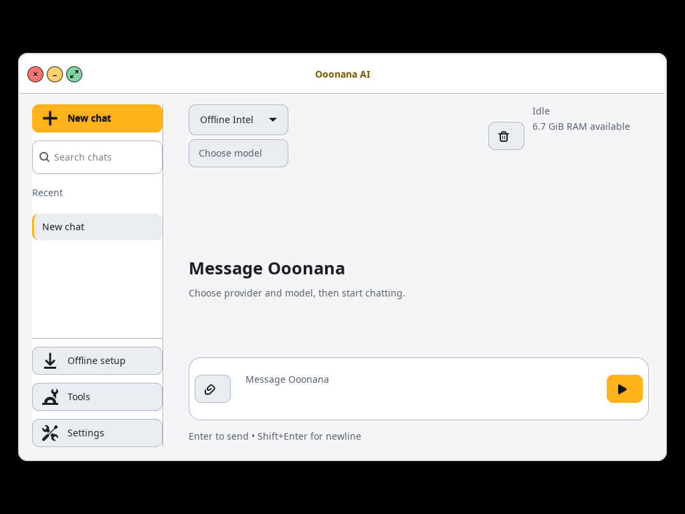
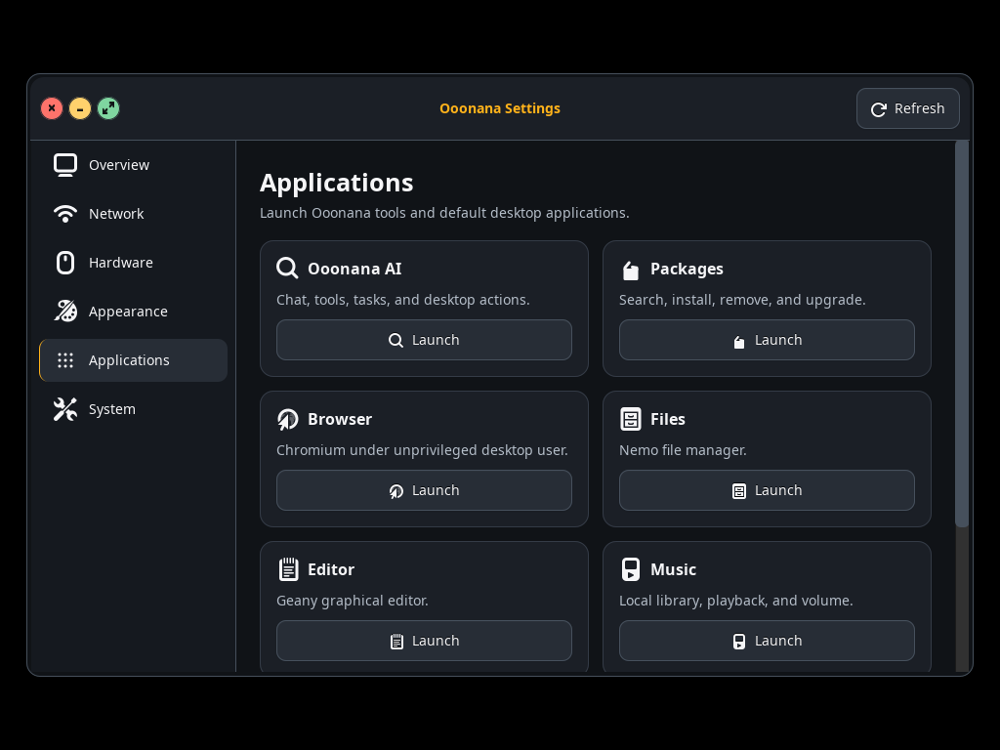
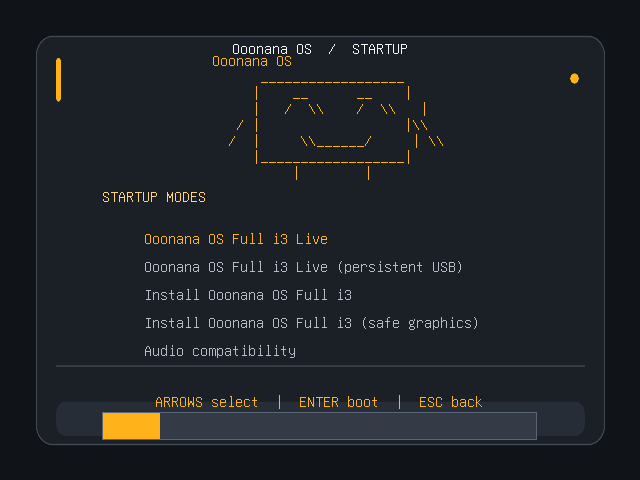

# October 15 broader UI recheck

Second bounded Impeccable pass covers previously missed pages and states,
then confirms the earlier fixes. Opaque graphite/amber identity preserved.

## Confirmed defects fixed

- **Light-mode contrast:** global GTK chrome changed to paper, but native
  headings, cards, chat composer and status colors stayed dark-theme-only.
  Added coherent paper surfaces and readable semantic text colors to shared
  native UI and AI chat. Reapplying appearance reuses the shared CSS provider.
- **Light-mode detail states:** selected tabs, hovered menus and toolbar focus
  now use readable text/focus amber, separate from bright action fills.
- **Applications page:** seven equally important Launch actions no longer all
  shout in primary orange. Actions and layout are unchanged.
- **Form accessibility:** Setup and Wi-Fi fields now have explicit accessible
  names and relationships to their visible labels.
- **QA blind spot:** sample capture isolation discarded selected GTK settings,
  so earlier light previews silently showed dark/default styling. Capture now
  copies only GTK presentation files into private writable test state. Catalog
  and Settings/Power fixtures accept private output folders instead of requiring
  a global `/qa` directory.

## Checks completed

- **25 native windows/pages in both dark and light**, at 1024×768: Launcher,
  Wi-Fi/Bluetooth, Packages, AI, Setup, Music, Sound, Brightness, Power,
  Notifications, Health/Updates, both signal maps, enterprise credentials,
  pairing dialog, all six Settings pages and both Task Manager tabs. Window
  bounds and accessible window controls passed. Backends mocked/read-only.
- Resolved GTK text/surface contrast passed for ten common/chat roles in both
  appearances; Setup and Wi-Fi accessible names verified. New regression
  fixture is available through the isolated candidate GUI runner.
- Real GTK CSS/state tests passed with generated light-theme user CSS loaded.
- Settings application completion/failure/rollback, stale async replies,
  wallpaper path, Power default-Cancel, failure recovery and unavailable-lock
  refusal passed. No real power command or account modification executed.
- Dock icon centering, compact layout/other-app slot, hover without focus
  theft, preview bounds and Reduce Motion passed on owned Xvfb/i3 windows.
- Native close/minimize/fullscreen against owned i3 windows passed again.
- Launcher search/navigation and Task Manager owned-child termination checks
  passed; no unrelated process terminated.
- Settings appearance also rendered at 125% text scale within 1024×768.
- Actual production GRUB main menu and audio submenu rendered in a disposable
  EFI VM at 640×480. No ISO or real kernel boot, disk install or audio output.
- Earlier Geany/profile protection, window-list/panel-layout arithmetic,
  GUI-preferences and native-source fixtures passed again.

Screenshots use isolated representative UI state, not physical hardware proof.

## Limits

This is not proof that every hardware/display/session combination works.
Physical mixed-DPI/multi-monitor hotplug, WSLg clipboard/Korean composition,
PDF manual viewer metrics, Firefox first-run/portal picker and installed Qt
dialogs remain separate gates. Existing WSLg Files full-repaint workaround is
unchanged. Reopen other applications after changing appearance if their existing
custom content has not refreshed. No models downloaded or sound played.

Packaged UI changes require refreshed signed candidate inputs and a fresh
user-built ISO. Old completed ISO cannot be resumed to add them. Stable remains
0.9.9; candidate core remains 0.10.0; signing enrollment remains deferred.
