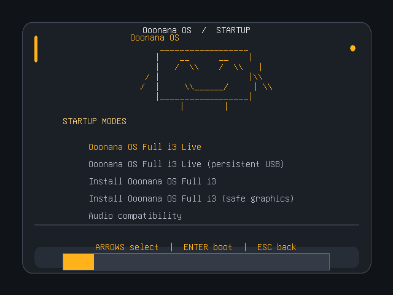
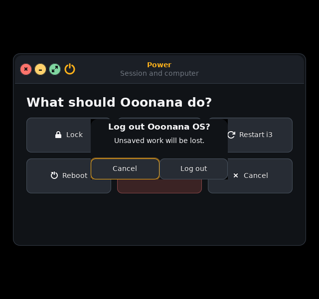

# Startup, Power and Settings recheck - October 14

Core 0.10.0 candidate. Impeccable-guided detail pass preserves opaque theme,
original logo, wallpaper, cursor and desktop/window-management behavior.

## Fixed

- Actual GRUB EFI rendering reproduced logo/menu overlap at 640x480. Logo rows
  now use relative origin and 16px spacing; menu/header/footer regions fit small
  displays. Removed decorative divider that crossed the logo when stretched.
  Countdown, keyboard selection and audio submenu remain visible. Production
  framebuffer selection, boot flags, persistence identity, entry ordering and
  installer smoke defaults are unchanged.
- Power never substitutes display blanking for authentication. Missing/failed
  `i3lock` reports failure. Logout now requires review, like reboot/shutdown;
  Cancel is default. Pending requests disable duplicate actions; failed commands
  re-enable controls and report failure. Closing the window prevents late UI
  callbacks from touching destroyed widgets. No actual host power/lock action
  was executed during QA.
- Settings no longer reports wallpaper/theme success just because a process
  started. Appearance actions serialize, show pending/result states and update
  filename/full-path tooltip only after success. Failed wallpaper changes keep
  prior display choice. Theme preference uses atomic replacement, explicit
  requested command environment and rollback on failure; a concurrent changed
  choice is not blindly overwritten. This is not an all-files theme transaction.
- Memory status moved off the GTK thread. Stale refresh results and callbacks
  after window destruction are ignored. Worker/service-repair errors are handled
  by exit status rather than guessed from words in output.

## Evidence

Native tests passed at 640x600 and 1280x800: appearance pending/failure/success,
theme rollback with and without previous preference, explicit theme override,
wallpaper failure/success/duplicate suppression, asynchronous memory/stale
results, late callbacks, Power Cancel/Confirm/duplicate rejection and lock
failure. Every destructive/backend operation in these probes is mocked.
25 native windows/pages/dialogs, native runtime/contrast, panel, dock and real
source i3 window controls passed separately. Generated rootfs/package factory,
native source and GRUB config/theme regressions passed.

EFI-only disposable GRUB fixture embeds current generated menu/theme in standalone
loader, no ISO or Linux boot. QA-only video mode is 640x480 or 1280x800; timer
extended to 60 seconds for capture, then keyboard navigation interrupts it.
Actual main menu/audio submenu were inspected. Wide capture preceded final
16px menu adjustment and divider removal; final 640px captures verify repairs.
Early probe problems were UTF-8 shell quoting/virtual FAT bootstrap issues in
the test harness, not evidence of a production boot failure.

Owned evidence: `/var/tmp/ooonana-ui-structure-20261014.HFAXs9kG`, GRUB
`/var/tmp/ooonana-grub-ui-baseline-20261014e`,
`/var/tmp/ooonana-grub-ui-confirm-20261014`, and
`/var/tmp/ooonana-grub-ui-release-20261014`. Configs/logs/PNGs retained.

## Cleanup and limits

Removed 131,071,541 bytes (about 125 MiB) of confirmed current-turn copied EFI,
OVMF/font payloads, dummy staging trees and duplicate raw framebuffer files.
All logs, screenshots and generated config evidence retained. Payloads rebuild
from source fixture. C/F source history, model folders, backups, releases,
signed generations, build/kernel caches and installed distros untouched.
No confirmed additional F: junk removed; unknown/protected files left alone.
Deleting WSL files does not guarantee immediate physical VHD space reclamation;
no disk compaction performed.

No sound, real power action, physical USB/display/session check, installed WSL
migration or ISO build. Native shared dark presentation remains unchanged;
this pass verifies theme command/preferences, not complete light-style coverage.
Physical boot/login/lock/logout and other existing hardware/input/Qt/Firefox/
vendor-AI gates remain in [deep-recheck-20261012.md](deep-recheck-20261012.md).
Fresh normal user ISO build must include these edits; no stale-stage resume.
