# Whole-OS UI review

Goal: inspect and improve the whole Ooonana OS UI, especially small details.
This goal remains **active**. A passing catalog is not whole-OS completion.
Preserve opaque graphite/amber, paper light mode, rounded controls and current
mascot/cursor identity. Do not build an ISO or play sound during review.

October 16 scope update: user deferred OpenVINO until its major upstream update
is finished. Do not change/setup/test that integration or download models.
Generic native Ooonana AI, cloud-provider UI fixtures and other Qt apps remain
in scope. Earlier OpenVINO evidence below is historical, not a fresh validation.

## Coverage ledger

| Surface / paths | Current evidence | Work still required |
| --- | --- | --- |
| Control proportions | Shared native/generated GTK and native chat actions measured; unchanged type; targeted 100/125/200% scaling | Other app-specific Qt controls, panel/card/dock content proportions; no blind blanket shrink |
| Desktop wallpaper, cursor, native icons, theme | Earlier committed captures; current source inventory | Fresh composited desktop, cursor hotspot/scale, icon consistency and selection states |
| Panel / music / AI / notifications / tray | Source Polybar/wallpaper/dock at 640×600 and 1280×800; long Wi-Fi/media sample, no overlap/missing glyphs | Real empty/playing/paused media transitions, expanded notification integration and middle widths |
| Dock | Centered icons, bounded previews/tooltips, compact grouping, 44px targets and unchanged hover focus; follow-up action/keyboard checks below | Edge placement and actual session/display integration |
| Native Launcher | Long names bounded with full tooltips; visible no-match/empty recovery, launch rejection, arrows, Unicode Backspace/clipboard pass | Real application launch and installed keyboard/IME integration |
| Wi-Fi / Bluetooth | Managed i3 populated lists and hidden/personal/TLS/PIN dialogs fit 640×600; bounded names, list room, More keyboard/Escape and secret labels pass | Every advanced security/IPv4/proxy/certificate picker, service failure/lifecycle, sustained activity feedback and physical radios |
| Settings: all six pages | Compact page picker, bounded/selectable source values, visible keyboard focus, managed wallpaper/log dialogs, repair/update retry and motion rollback; 100/125/200% text checks below | Real installed-session preference/authentication paths and external file/device failures |
| Setup | Native compact overflow fixed; static fields labelled; validation, default-Back review, mocked pending/failure/late completion tested | Complete real setup/persistence and scaled-text interaction path |
| Sound / brightness / music | Long selected device/track names bounded; full-name tooltips, music error/retry/closed-callback behavior; no audio playback | Empty device lists, permission errors, actual route/mute/volume semantics and keyboard |
| Power | Native default-Cancel, duplicate refusal, error/retry, failed lock refusal pass with mocked commands | Actual isolated lock/logout/suspend and unavailable capabilities |
| Notifications | Private real Dunst history/DND/remove/clear; long grouped messages/full expansion, unchanged refresh focus, failure persistence, unavailable/unknown DND and privacy UI checks | Archived/live mixtures under service restarts, changed-record keyboard/scroll integration, actual session notifications |
| Packages | Default-Cancel install/remove/upgrade preview; failed/empty plans cannot apply; mutating close guard and parent-dialog lifecycle pass | Actual privileged transaction/authentication UX on disposable installation |
| Health / Updates | Readable snapshot, exact raw/copy, honest attention/malformed states; metadata Cancel/approved admin dispatch pass | Actual installed-session service/repository failures and authentication UX |
| Wi-Fi / Bluetooth signal maps | 658×750 overflow fixed; populated/empty/light/dark native candidate render, bounded labels, full-name tooltips and accessibility checks pass | Real data refresh/focus integration and physical radio/session behavior |
| Task Manager | Real owned process filter/sort/sample/cancel/SIGTERM/removal pass; both tabs fit; plots follow theme | Crowded values, selection races and actual hardware/GPU graphs |
| Native AI / model UI | Generic native chat compact layout, bounded headings, no-match search, draft attachment, safe Delete, status failure/stale/closed callbacks and streaming/copy/cancel fixtures pass | Real cloud-provider session, long-running transcript navigation; OpenVINO GUI/runtime/offline checks deferred by user October 16 |
| Installer GUI / text wizard | 720×724 form overflow fixed; real themed YAD form fits 640×600 and 1280×800, scrollable fields/visible Cancel + Review; no install executed | Keyboard through all fields, preview/log/blocked UI, text wizard and actual storage summary; no physical install |
| Shared dialogs / menus / tooltips | Short/unbroken and long diagnostic text fit; secret input labelled/focused, password spaces retained, Cancel verified | Remaining file pickers, menus, escape/return and scaled text |
| Third-party apps | Real Geany dark/light source profile + file picker and controls pass; Chromium sandbox/frame/actions pass. Nemo requires WSL/Xvfb full-redraw/redirection adaptation | Qt/Firefox current-source integrated rerun, menu/dialog variants, actual physical compositor and live WSLg |
| Window manager | Native minimize/fullscreen/close and native/third-party transient decoration checks pass | Drag/resize, tiling/tabs, workspaces, focus/session/display transitions |
| GRUB: live / audio submenu | Most recent mascot patch has 640×480 and 1280×800 real EFI captures | Compare current output; installed/minimal boot menus remain separate review targets |
| Boot / shutdown / reboot / persistent setup | Most recent wordmark/prompt source and PTY captures | Error/serial/reduced motion, install paths and real framebuffer handoff; physical USB tests separate |
| Bootable PDF UI | Previous source/VM fixtures; browser viewer requires manual check | Viewer rendering, keyboard/Backspace, focus, responsive controls and perceived command delay |
| Accessibility / input / displays / session | Initial accessible controls and theme captures only | Text scale, keyboard/focus, clipboard, Korean composition, WSLg input, multi-monitor/DPI/hotplug, login/lock/logout/suspend/resume |

Windows Computer Use failed during initialization with “failed to write kernel
assets … path specified (os error 3)”. No fallback Windows automation used.
Linux Xvfb fixtures remain available; live WSLg behavior is not certified.
Previously denied local-PDF browser navigation is not retried or bypassed.

## Current batch evidence

- Clean starting source: `f5fb618`.
- Private QA root: `/var/tmp/ooonana-whole-ui-20261015.n7zRUus3`.
- Baseline catalog: 25 pages at 1024×768 dark passed bounds; both 640×600 themes
  exposed Packages, Health, Updates and both signal-map overflows.
- Impeccable bounded pass: one initial batch, one confirmation batch; no repeated
  cosmetic loops. Functional regressions are repaired and retested separately.
- New focused tests use mocked queues and owned windows only: pending/disabled
  controls, duplicate action refusal, error/retry styling, reduced-motion timer
  suppression, ignored late callbacks and default-Cancel metadata confirmation.
- Plot tests check text/data contrast, bounded nonoverlapping labels, full-name
  tooltip/accessibility text, empty state and the real painted chart background.
- This evidence does not prove real hardware, physical USB recovery or every
  application action. Remaining rows stay in scope rather than being marked done.

## Batch 1 results

- All **25 named pages** pass window bounds at 640×600 in dark and light;
  1024×768 dark and 1024×768 light at **125% text** also pass. These are 100
  initial-state checks, not 100 distinct interaction flows.
- Action wrapping is explicitly scoped. A shared one-column experiment made
  Wi-Fi/Sound too tall; regression captures caught it, original defaults were
  restored, and the entire catalog passed again.
- Real Ooonana Alpine v3.24 GTK libraries passed the focused detail fixture in
  private mount/PID/network namespaces, UID1000, dark and light. The keyboard
  fixture gives its owned X11 window actual focus before walking all six action
  buttons; no extra FlowBox wrapper Tab stops. This is not WSLg keyboard proof.
- Signal-map compass letters removed because layout angles are not measured
  bearings. Existing explanatory copy and stable node placement remain. Names
  ellipsize by rendered width, avoid other labels, and remain available through
  hover/keyboard tooltips and accessibility descriptions. Singular/plural counts
  no longer use `(s)` placeholders. Empty maps explain how to populate them.
- Task Manager and map plots share opaque semantic colors. Text/data contrast
  checked without GTK, and real candidate chart pixels confirm theme background.
- Existing native source regressions pass; new tests are available through
  `OOONANA_GUI_ONLY=ui-details-runtime`. `OOONANA_GUI_THEME=light` now explicitly
  selects candidate appearance rather than silently testing dark only.
- Confirmation artifacts: `repair-dark-small`, `repair-light-small`,
  `repair-dark-desktop`, `repair-light-scaled`, `candidate-details`,
  `candidate-details-light`, and `candidate-keyboard-focused` under the QA root.
  Candidate image-loader sandbox warnings were retained; no browser sandbox or
  host security setting was disabled.

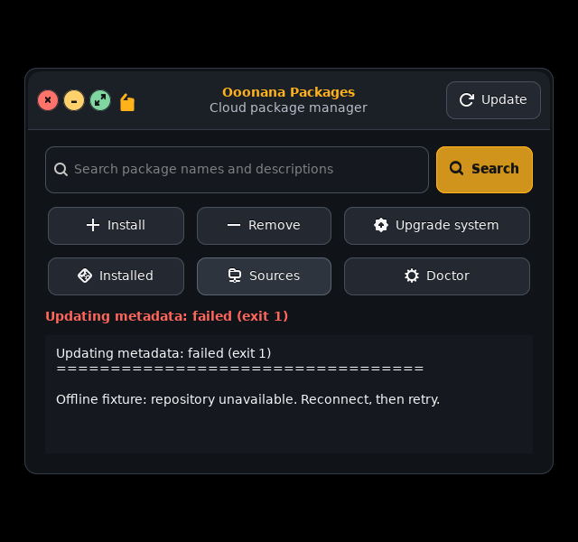

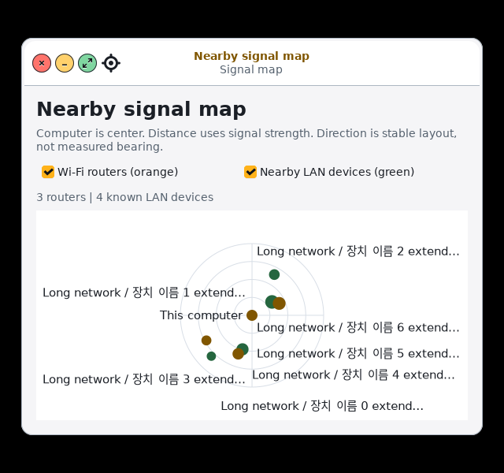

Both captures use mocked data. This batch is source work pending runtime-package
publication; do not rebuild an ISO yet merely to pick up half-finished whole-OS
review work. Goal continues with the remaining ledger rows.

## Batch 2: long content and incomplete task states

- Real candidate baseline exposed Sound at **2132px wide** from long device
  names and Music at **777px high** from repeated track metadata. Labels now
  ellipsize without discarding full tooltip/accessibility text. Music actions
  wrap, Play/Pause icons agree with state, MPD failures remain failures rather
  than empty-library success, retry restores controls and closed callbacks stop.
- Spotlight now distinguishes an empty catalog from no search matches and
  gives recovery guidance. Names/descriptions stay bounded, visible result
  rows remain mapped after clearing search, and launch errors retain retry.
- Secret prompts have explicit accessible names, input focus and password
  input purpose. Leading/trailing password spaces are no longer stripped.
  Short/unbroken and long diagnostic-dialog captures fit the compact display.
- Installer's real initial YAD form was **720×724** on 640×600: lower fields
  and buttons were off-screen. The form now scrolls inside monitor-bounded
  dimensions; Mode stays initially visible and Cancel/Review remain reachable.
  Preview/log windows also use bounded dimensions. Fields, parsing and storage
  safety checks are unchanged. This fixture executes only the form, not the
  installer, a storage probe or an install command.
- Candidate Setup's **676px** footer overflow was missed by the Ubuntu-host
  baseline. Footer now bounds its hint. Static-network labels, default-Back
  review, duplicate refusal, disabled pending fields, Reduce Motion, failure
  retry and ignored late completion have native GTK tests with deferred workers.
- Source-generated theme/editor wrappers now run in the third-party fixtures.
  Bare-profile Geany captures were not evidence of the Ooonana editor palette.
  Real Geany source profiles and actual cancel/open file pickers pass in both
  appearances. User editor profiles are never overwritten by this fixture.
- Themed Nemo exposed a nested Xrender paint issue: IPC/actions and colored
  titlebar controls could pass while client areas stayed blank. The probe now
  requires painted blue folders from its owned Adwaita fixture. No-compositor
  and full-redraw **with redirection retained** variants paint correctly.
  A CLI-only flag was insufficient in this fixture. WSL adapter derives a
  separate config with both optimizations off, only for the known packaged
  desktop invocation. Physical defaults, packaged config, custom wrappers and
  custom local configs remain untouched. Actual physical GPU/session QA remains.
- Candidate image-loader sandbox warnings and optional Nemo thumbnailer/action
  warnings remain in logs. No browser sandbox was disabled, no sound played,
  no model downloaded and no disk formatted. This batch still awaits signed
  runtime publication after whole-OS source review.

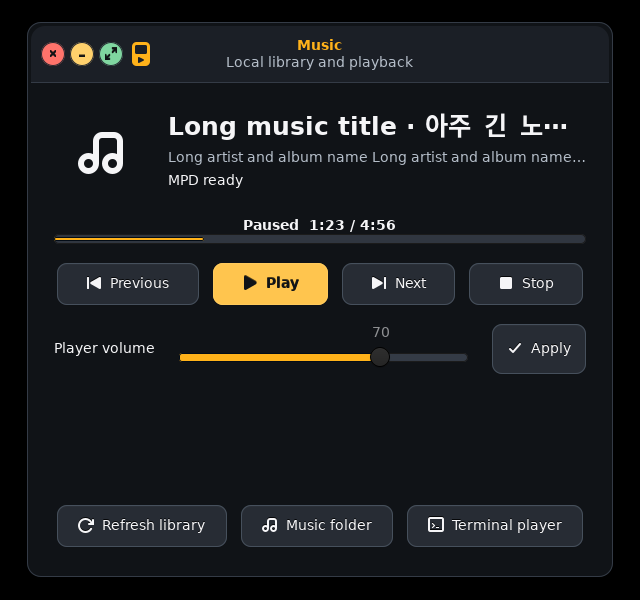

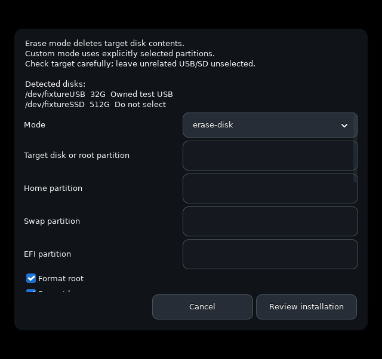

Current private evidence lives under the same QA root: `batch2-before-*`,
`batch2-content-functional-*`, `batch2-integrated-*`, `batch2-setup-functional`,
`batch2-nemo-always-redirect` and `batch2-catalog-final-*`. Earlier failed and
superseded fixture captures remain as history, not current UI certification.

Final batch regression: all **25 pages pass on actual candidate GTK** at
640×600 in both appearances. Extended content/setup/prompt interaction checks,
native source tests, installer tests and WSL-adapter guard tests pass. Installed
Ooonana WSL received only the local compositor/launcher adaptation; existing
packaged compositor config hash stayed unchanged. This applies on the next GUI
launch; no running desktop or WSL instance was restarted. New application UI
source remains pending signed runtime-package publication.

Preceding batch source `57b2cde` passed
[GitHub regression](https://github.com/Ooonana/Ooonana-OS/actions/runs/38693731125)
and [GitLab smoke](https://gitlab.com/Ooonana/ooonana-repo/-/pipelines/2949578827).
That earlier CI success covers Batch 1 only. Batch 2 plus its updated setup
ordering fixture (`c2d42a7`) subsequently passed
[GitHub](https://github.com/Ooonana/Ooonana-OS/actions/runs/38697082040) and
[GitLab](https://gitlab.com/Ooonana/ooonana-repo/-/pipelines/2949670485).

## Batch 3: usable wireless lists and stable notifications

- Tested real Ooonana candidate GTK **with owned i3**, not only WM-free page
  captures. Baseline Wi-Fi had room for one row and credentials requested a
  623px frame on a 600px display. Lower dialog buttons were clipped. Shared
  dialog sizing now reserves WM space; personal, hidden-network, enterprise TLS
  and Bluetooth PIN fixtures fit the managed small display.
- Secondary tools moved under native **More** popovers; no actions removed.
  Keyboard Space opens them, Escape closes after the native transition, and
  focus returns to More. Network/device lists retain at least three-row space.
  Compact layouts prioritize names; adapter/AP counts and Bluetooth address
  columns return at wider sizes and remain in selected details/tooltips.
- Password/PIN fields have secret input purpose and accessible names. Hidden
  network input receives focus. Busy Wi-Fi disables overlapping UI actions.
  Physical connection, pairing and firmware operations were never invoked.
- Notification center removes duplicate heading chrome. Long subjects are
  bounded, and long/multiline bodies have short previews with **Show full
  message** retaining the parser's existing full 4096-character message limit.
  Remove stays near the subject rather than below an arbitrarily tall body.
- Unchanged refreshes no longer rebuild every message or discard keyboard
  focus. A read completing after the user moves focus does not steal it back.
  Duplicate actions are refused; action errors survive the follow-up refresh.
  Unknown DND status is disabled rather than presented as false. Service failure
  has its own recovery state instead of falsely claiming normal empty history.
- Privacy toggle reflects stored state when saving fails; preference failure
  remains visible. Opt-out's request to clear saved history was checked through
  a fake state object. No user history was deleted by these fixtures. Refresh
  timer is removed when the center closes.
- Focus fixture first settles focus-in reads before trying to focus Remove;
  a disabled control is not keyboard evidence. Popover dismissal waits for its
  native transition rather than treating an intermediate visible frame as a bug.
- New `wireless-notification-ui` gate passes at 640×600 in both appearances and
  1280×800 dark. Separate private **real Dunst** action regression passes too.
  Native catalog/regression results and package publication are recorded below
  when complete, not inferred from these narrower interactions.
- Final native catalog passes all 25 pages at 640×600 in dark/light, and source
  native/backend regressions pass. Separate 1024×768 fixture verifies unknown
  DND retains its last value while disabled, with a recovery explanation.

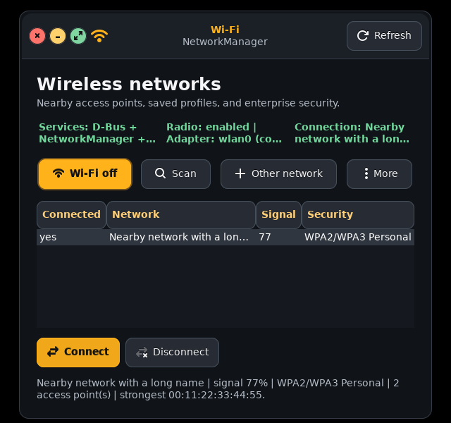

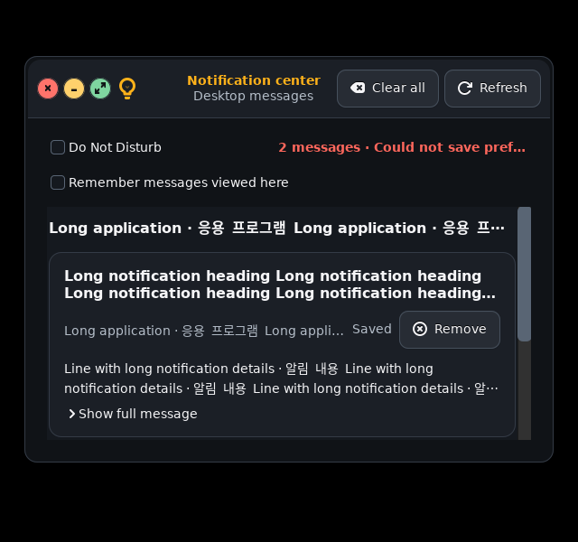

Evidence: `batch3-wireless-notification-before`, `batch3-gate-*` and
`batch3-catalog-light-resumed` under the existing private QA root. Earlier
confirmation/focus fixtures remain diagnostic history. Image-loader sandbox
warnings remain logged; no browser sandbox or host security setting changed.

## Published checkpoint after Batch 3

This supersedes earlier “source pending publication” notes, not the coverage
ledger's remaining work. Whole-OS review stays active.

- Source `265eb57c226113e9a8653108f33b61dae72a07d6` pushed to both branches.
  [GitHub regression](https://github.com/Ooonana/Ooonana-OS/actions/runs/38727193585)
  and [GitLab smoke](https://gitlab.com/Ooonana/ooonana-repo/-/pipelines/2950609245)
  passed.
- Clean source-only manifest, no bundled models, coherent Alpine v3.24 inputs;
  signed **654 packages / 612 dependency nodes** validated and atomically
  published to the local candidate repository. Generation:
  `9d355bc29e79694f5d36d989856bd543fbaeac8825022a6414a1d5fb1540a312`.
  Prior generation/checksum manifest unchanged. Private signing key stays local;
  wider client enrollment and stable promotion remain deferred.
- Ooonana WSL native signed snapshot:
  `/var/lib/ooonana/candidate-ui-whole-20261015.46QKweEA`.
  Existing trusted public-key digest matched; detached signature and every
  manifest checksum passed before installation. Core/runtime were reinstalled
  separately through native CLI transactions, with all update checkpoints kept;
  both package verification and both health hooks passed.
- Installed common, Wi-Fi, Bluetooth, Notifications, Setup and controls source
  hashes match current repository files. Actual installed GTK modules import.
  Cloud source now points at the verified native snapshot and existing trusted
  key. Local WSL compositor/launcher adaptation refreshed after the transaction.
  Previous native snapshot unchanged; previous source config retained in logs.
- Logs: `/var/tmp/ooonana-ui-sync-20261015.WL1JZjn4` inside Ooonana WSL. First
  preflight stopped because minimal userland lacks `cmp`; no transaction had
  started. Resumed trust comparison used pinned public-key SHA256, followed by
  the same detached signature/full checksum validation. No checks bypassed.
- Ubuntu/Ooonana disk locations unchanged. No models downloaded, audio played,
  running GUI/WSL forcibly restarted, physical storage modified or ISO built.
  Existing ISO does not acquire these changes through resume. Fresh manual ISO
  build belongs after the remaining source/UI work, not this partial checkpoint.

GUI launch after closing the older nested desktop:

```powershell
wsl -d Ooonana --exec /usr/local/bin/start-ooonana-i3 --nested
```

This is a launch command, not proof of WSLg mouse, keyboard, IME or clipboard.
Current source application improvements are installed; live-input/physical
gates still need their own evidence.

## Batch 4: package change review and readable Health

- Install, Remove and Upgrade first request a dry-run plan. Native review keeps
  the full plan scrollable, defaults to Cancel, and names the explicit action.
  Failed/empty previews never apply; no-upgrades avoids an unnecessary approval.
  Final transaction still rechecks dependencies and major-upgrade policy.
- Package IDs reject option-like/multiple/overlong input. Duplicate requests are
  refused. Normal close waits during a mutation, but read-only previews can
  close. Destroying the parent also destroys its review without submitting work.
- Health defaults to a structured report with section hierarchy, binary memory
  units and explicit physical zram consumption versus logical capacity. Raw
  output and Copy retain the exact diagnostic payload, including unknown fields.
  A successful probe is not a declaration that physical hardware works.
- Unready services, incomplete memory and restart requirements produce attention
  states. Unrecognized successful output stays a warning/raw report, not green
  success. Secondary tools and policy disclosure leave useful report space on
  640×600. Metadata confirmation defaults to Cancel; approval uses admin helper.
- Private native GTK/i3 checks pass compact dark/light and desktop light, including
  real isolated read-only backend schema, copy fidelity, reduced motion, rejected
  previews, approval/cancel, lifecycle and error recovery. Source native tests
  and pure malformed/extreme-value report tests pass. No real package mutation,
  radio operation or sound playback was performed by these interaction fixtures.

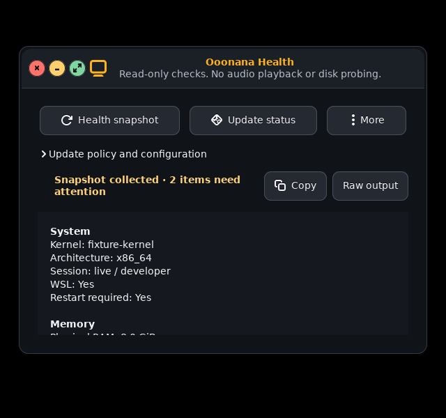

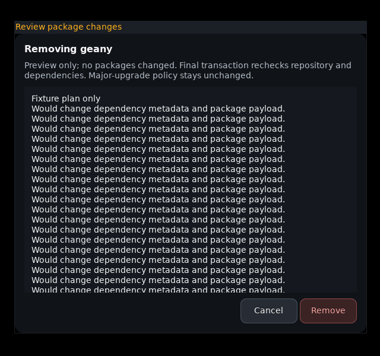

Evidence: `batch4-close-parent`, `batch4-gate-*` and
`batch4-layout-functional-*` under the existing QA root. This batch is source
work pending the next signed runtime publication; Batch 3 remains the installed
checkpoint until that publication is recorded.

## Batch 5: compact dock groups and keyboard actions

- Compact dock hides selected pins to preserve 44px targets. Its Other button
  previously displayed those sessions but the command helper excluded every
  pinned app. Both open and right-click now pass the actually visible pin set;
  hidden-pin sessions remain restorable and actionable.
- `Super+Ctrl+D` opens a themed keyboard dock picker with app names, running
  counts and minimized counts. Selection reaches the same session/window actions
  as right-click. Keyboard popups identify their input source and select the
  first enabled item; pointer dock still never accepts or steals focus.
- Cancelled/failed rofi output cannot select a window from stale stdout. Invalid
  visible-pin arguments are rejected. Unit fixtures cover both command dispatch
  and minimized compact overflow, with no real user windows touched.
- Real owned i3 windows pass selection among two terminal sessions, minimize,
  restore, fullscreen/restore and target-only close. Real rofi-to-GTK keyboard
  path reaches Close; Escape cancels both stages without closing any app.
  Compact dark 640×600 and light 1024×768 confirmations pass.
- Old preserved QA root had common rofi data but lacked `rofi-x11-wayland`.
  Current signed repository and full-desktop profile already contain both; no
  release-package regression inferred. Runner installs the X11 payload only in
  a disposable overlay. Native popup tests wait for mapping rather than assuming
  that a CLI exit means the GTK child has finished starting.

Evidence: `batch5-dock-keyboard-mapped`, `batch5-dock-confirm-*`. Real-session
display hotplug/WSLg input still needs separate evidence. Batch 4/5 source edits
remain pending the next signed runtime refresh; no ISO built.

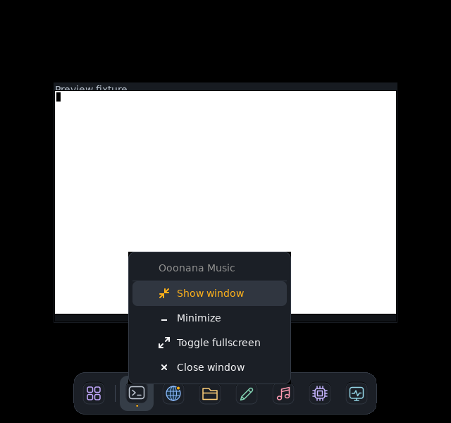

## Published checkpoint after Batch 5

Supersedes the preceding Batch 4/5 source-pending notes. Whole-OS review remains
active; software coverage is not physical/session certification.

- Source `49748aa8a04d80ac78b2c4de73e48d03e6f4393a` pushed to both branches.
  [GitHub regression](https://github.com/Ooonana/Ooonana-OS/actions/runs/38732716980)
  and [GitLab smoke](https://gitlab.com/Ooonana/ooonana-repo/-/pipelines/2950779363)
  passed. Native package/health, content/detail and source regressions also pass.
- Clean source-only manifest, no bundled weights, coherent Alpine v3.24 inputs;
  signed local repository validates **654 packages / 612 dependency nodes**.
  New generation:
  `3bbaadda499b28f7f8e885fed33690f1b446a7832bc722dacd1b781eb69fb782`.
  Prior generation checksum manifest unchanged; no stable promotion/enrollment.
- Native WSL snapshot:
  `/var/lib/ooonana/candidate-package-dock-20261015.xr0wY3b1`.
  Pinned public-key hash, detached signature, all 1302 checksums and clean
  source revision passed before native CLI transactions. Both core/runtime
  reinstall, verification and explicit health hooks pass. All rollback
  checkpoints and the prior source config remain.
- Installed Packages, Health/summary, dock, action popup, window helper and i3
  config hashes match source. Actual installed GTK imports pass unprivileged.
  Existing trusted cloud source points at the new native snapshot. WSL-local
  launcher/compositor adaptation refreshed; no forced desktop/WSL restart.
- Logs: `/var/tmp/ooonana-package-dock-sync-20261015.3Kj6Vc2S` in Ooonana.
  First transfer preflight found the optional F: mount absent, before transfer
  or installation. Mount existence is now checked in that transfer step.
  Ubuntu/Ooonana disks stay put. No model download, sound, physical disk change
  or ISO construction. Fresh ISO remains user's later step after UI review.

## Batch 6: proportional controls and Settings details (October 16)

User requested less oversized objects relative to text and asked to try UI/UX
Pro Max alongside Impeccable. Existing opaque Graphite/Paper identity stays.
Impeccable guided bounded refinement; UI/UX Pro Max's focus/semantic guidance
informed interaction checks. Its desktop-size search had no verified GTK match;
off-topic mobile guidance was rejected, not treated as a desktop size standard.

Actual candidate GTK measurements at normal text scale:

| Control | Native before → after | Generated GTK theme before → after |
| --- | --- | --- |
| Button | 42 → 32 px | 42 → 32 px |
| Entry | 52 → 32 px | 50 → 32 px |
| Dropdown | 46 → 33 px | 42 → 33 px |

Text line remains 17px. Font declarations remain Sans 10.5 for native apps and
Sans 10 for the generated user profile. Removed excess padding/inherited
minimum height, not text size. Native helper actions now fit their labels
(sample Apply: 86px wide including icon), while editable fields can still expand.
Font scaling grows the controls naturally: 200% native text line 33px gives
45px buttons/entries and a 49px dropdown. Existing window-control sizes, dock
targets, toolbar-specific styling and contrast roles remain unchanged.

Settings baseline exposed clipped managed picker/log windows, extremely tall
source values, misleading BlueZ-running output after a failed query, duplicate
service repairs/metadata requests, a failed motion preference staying selected,
and a delayed package dialog after Settings closed. Repairs:

- Narrow windows use an accessible native page picker; larger windows retain
  sidebar navigation. Returning to wide layout shows every row. Settings actions
  wrap without forcing three columns. Theme/layout fields have accessible names
  and cannot change while an appearance operation is pending.
- Source/status values have bounded lines, full selectable text, tooltips and
  accessible descriptions. Repository configuration is neutral, not proof of
  repository health. Native focus adjustments scroll the focused value into view.
- Wallpaper uses native GtkFileChooserWidget inside a monitor-bounded modal
  shell: fixed reachable Cancel/Apply, explicit scrollbars, default Cancel,
  proper image filtering/selection and parent-close cleanup. No custom filesystem
  browser or disk installer was introduced.
- Service log wraps inside bounded native dialog, has Copy log and closes with
  its parent. Repair/Reprobe buttons share a pending guard and retry feedback.
  Bluetooth query failure no longer claims BlueZ is running.
- Failed motion saving restores its checkbox; failed theme/wallpaper operations
  preserve saved state. Metadata action explicitly says Refresh metadata; success
  says no packages installed, failures retain retry, late callbacks stay silent.

Native private i3/GTK evidence: `batch6-settings-before`, `batch6-density-before`,
`batch6-focus-width-*`, `batch6-final-*` under the existing QA root. Proportion
checks cover native/generated themes and 100/125/200% text; Settings checks cover
real keyboard page navigation, full focused-value visibility, Cancel/selection,
copy, duplicate refusal, failures/retry and parent destruction. Actual Geany
picker/window controls also pass with the new generated theme. All commands
that would change packages/services/wallpaper in these interaction fixtures are
mocked; no sound, model download, physical disk writes or ISO build.

Final shared-style regression: all **25 native pages** pass at 640×600 in both
appearances after content-fit actions. Package/Health, shared detail, native
window controls, editor/profile and installer source regressions pass. Those
catalog captures are normal-text initial states; 200% interaction evidence is
the targeted Settings/proportion fixture, not a claim about every app at 200%.

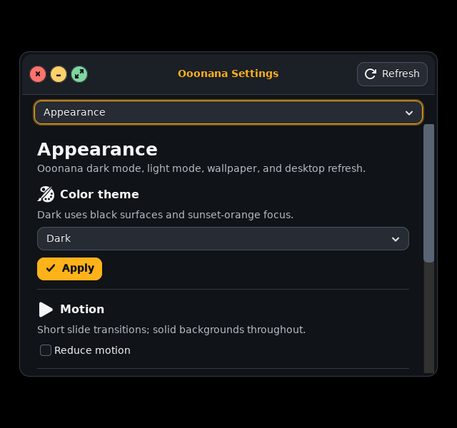

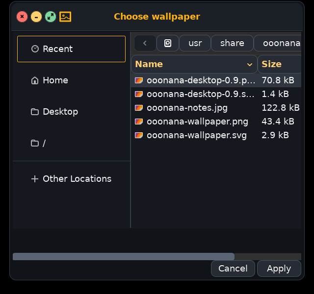

This batch is source work pending the next signed runtime refresh. Batch 5
remains the installed checkpoint until a later publication record supersedes it.

## Published checkpoint after Batch 6

Supersedes the preceding source-pending note, not the remaining whole-OS work.

- Source `8cc3b177e8ceba40f47c7215df0b074991ad975a` pushed to both branches;
  [GitHub regression](https://github.com/Ooonana/Ooonana-OS/actions/runs/38824635241)
  and [GitLab smoke](https://gitlab.com/Ooonana/ooonana-repo/-/pipelines/2953124816)
  passed.
- Clean source-only manifest, no bundled models, coherent Alpine v3.24 inputs;
  signed **654-package / 612-dependency-node** generation validated/published:
  `c518fe57962e40589f80a2c53c4f158fcdca4cc3568c5b913c0059fbe3600733`.
  Prior generation checksum manifest unchanged. Signing key remains local;
  stable promotion and broader enrollment remain deferred.
- Ooonana WSL snapshot:
  `/var/lib/ooonana/candidate-proportions-20261016.5Udsm91e`.
  Pinned key hashes, detached signature, all 1302 checksums and source manifest
  verified before native CLI dry-runs/reinstalls. Both core/runtime verification
  and explicit health hooks pass; all rollback checkpoints remain.
- Installed common, Settings, Packages and i3 config hashes match source. Actual
  dark/light CSS parsing and GTK imports pass as UID1000; ordinary unprivileged
  package search returns installed Geany. Cloud source points at the new signed
  native snapshot. WSL-local compositor/launcher adaptation refreshed without
  restarting a running desktop, WSL or Windows.
- Logs: `/var/tmp/ooonana-proportions-sync-20261016.BOFyrrjd` inside Ooonana.
  Ubuntu stays on C:, Ooonana stays at its existing F: location. No sound,
  model download, physical media modification or ISO construction. Relaunch old
  desktop/apps for current code/generated theme; existing ISO remains unchanged.

## Batch 7: generic native chat details; OpenVINO deferred

- Impeccable refinement preserves fonts, opaque Graphite/Paper and amber. UI/UX
  Pro Max's verified cross-platform Empty States result informs search recovery;
  GTK has no supported stack result, so actual desktop geometry supplies sizing.
- Native chat sidebar/composer actions now follow shared control density rather
  than oversized per-app padding. Compact navigation shows chats/tools separately
  from the conversation instead of pushing both beyond the screen. Empty-chat
  spacing/composer height leave useful conversation room.
- Long speaker/code-language captions ellipsize with full tooltip/accessibility
  descriptions. Message/code contents stay selectable/copyable and unchanged.
- Search explains no matches and clearing restores saved chats. Delete defaults
  to Cancel. Attachment uses bounded native chooser with fixed actions, default
  Cancel, managed parent lifecycle and UTF-8 text inserted into editable draft;
  no automatic request submission.
- Provider/model query failures remain unavailable rather than inventing a
  successful selection; retry recovers, stale responses cannot overwrite newer
  status and callbacks ignore closed windows. Offline-specific methods unchanged.
- Private UID1000 real GTK/i3 fixture passes dark/light at 640×600 and 1280×800;
  targeted 1024×768 checks pass 125% light and 200% dark. Existing native chat
  streaming, Enter/Shift+Enter, full code copy, owned-child cancellation and UTF-8
  split-stream regression passes. All providers/status actions mocked; no engine
  setup, OpenVINO tests, downloads, user history changes or audio.
- QA: `batch7-ai-baseline`, `batch7-ai-verified-*`, `batch7-ai-chat-regression`
  under the existing QA root. Initial fixture cleanup caused a GTK garbage-
  collection crash after checks; removing redundant toplevel destruction and
  draining queued GTK events made the process exit cleanly. Failed logs retained.

This source batch awaits signed runtime publication; Batch 6 remains installed
until a later checkpoint supersedes it. Whole-OS review remains active.

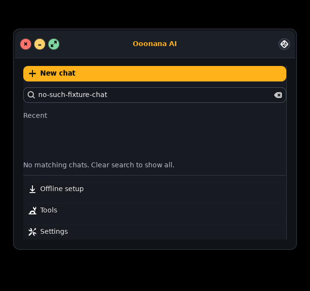

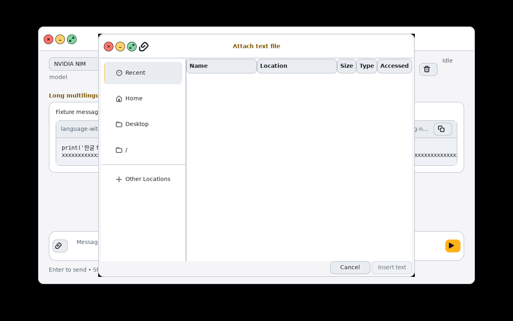
