# Whole-OS UI review

Goal: inspect and improve the whole Ooonana OS UI, especially small details.
This goal remains **active**. A passing catalog is not whole-OS completion.
Preserve opaque graphite/amber, paper light mode, rounded controls and current
mascot/cursor identity. Do not build an ISO or play sound during review.

October 16 scope update: user deferred OpenVINO until its major upstream update
is finished. Do not change/setup/test that integration or download models.
Generic native Ooonana AI, cloud-provider UI fixtures and other Qt apps remain
in scope. Earlier OpenVINO evidence below is historical, not a fresh validation.

## Coverage ledger

| Surface / paths | Current evidence | Work still required |
| --- | --- | --- |
| Control proportions | Shared/native GTK 10pt typography and chat actions measured; targeted 100/125/200% scaling; Task Manager headers/values follow text metrics | Other app-specific Qt controls, panel/card/dock content proportions; no blind blanket shrink |
| Desktop wallpaper, cursor, native icons, theme | Earlier committed captures; current source inventory | Fresh composited desktop, cursor hotspot/scale, icon consistency and selection states |
| Panel / music / AI / notifications / tray | Actual source Polybar/wallpaper/dock; wide CJK labels and full counters at 640/760/900/1000/1024/1100/1280px; missing-glyph and actual AI-centering checks; compact Task View; actual private MPD empty/play/pause/volume/next/stop/loss/recovery | Actual installed tray/service integration and physical/live-session states; null-output QA does not prove hardware audio |
| Dock | Flat centered icons; actual app/transient grouping, exact MRU restore, direct actions, Pin/Unpin, real held-drag reorder within left-pinned/right-running sections, saved layout/relaunch and readonly retry pass both themes normal/200% text; overflow idle-pin options, edge tooltips and actual 1×/2× device checks pass; signed candidate/native bytes synchronized | Actual installed interactive-session/display integration, physical mixed DPI/hotplug; multi-output visibility currently pure/derived guards |
| Native Launcher | Long names/tooltips, no-match/empty recovery, launch rejection, arrows, Unicode Backspace/clipboard; real desktop-entry/Return/focus handoff to native Settings and preferred themed terminal/editor/files pass; immediate filter/selection and exact-name ranking repair observed wrong-app launch | Browser/hardware-wrapper variants, actual installed-session keyboard/IME and desktop integration |
| Wi-Fi / Bluetooth | Managed lists/hidden/personal/TLS/PIN forms; advanced fields, bounded certificate pickers, inline validation, progress/reduced motion, service gating, duplicate/closed refusal and safe Reset/Remove pass both themes through 200% text | Actual installed authentication, advanced network activation, physical reconnect/pairing and changed-adapter integration |
| Settings: all six pages | Compact page picker, bounded/selectable sources, managed dialogs, repair/update retry; actual private 0600 preference writes, reopen, read-only rollback and retry through 200% text | Actual installed-session theme/wallpaper/authentication paths, other external file/device failures |
| Setup | Compact/200% scrolling and stacked labels; focused inline validation, secret-preserving drafts, full source/routing review, default Back, reduced motion, pending/reentrant and closed-parent refusal checked both themes | Complete installed privileged setup/persistence and actual authentication/network failures; CLI backend preflight is not certified by UI validation |
| Sound / brightness / music | Verified readiness, selected-identity audio/backlight commands, unknown/empty/permission states, persistent inline retry, serialized actions, preserved drafts, stale-poll/closed refusal; keyboard and both themes through 200% text pass silent fixtures | Actual installed route/mute/volume and playback semantics, changed-device integration and real hardware; no sound playback |
| Power | Compact40px actions/44px at real200% text; natural-height window; Enter Cancel/Escape; visibly mapped native confirmation; duplicate refusal, error/retry, failed lock and late-callback refusal pass under private i3 in both themes | Actual lock/logout/power actions, unavailable capabilities and installed-session integration remain unverified; no real power command executed |
| Notifications | Private real Dunst history/DND/remove/clear; changed-record nested keyboard focus/visible reading anchor; storage fault/retry; unchanged five-second timer DND/loss/restart recovery without focus/manual refresh; reused IDs and privacy checks | Actual installed-session notifications and integrated panel/session behavior |
| Packages | Default-Cancel preview, failed/empty plan refusal, mutating close guard; actual sudo/askpass cancellation/retry restores controls under private harmless-command policy | Actual privileged package transactions and successful authentication on disposable installation |
| Health / Updates | Readable snapshot/raw/copy, honest attention/malformed states; actual isolated report and sudo/askpass cancellation restore controls | Actual installed-session service/repository failures, successful authentication and metadata transactions |
| Wi-Fi / Bluetooth signal maps | 658×750 overflow fixed; populated/empty/light/dark native candidate render, bounded labels, full-name tooltips and accessibility checks pass | Real data refresh/focus integration and physical radio/session behavior |
| Task Manager | Real owned process termination regression; crowded metrics, compact navigation, keyboard/copy, filter counts, stable refresh/selection, PID reuse and parent-close confirmation checked; unavailable counters never show stale graphs | Actual hardware/GPU readings, large real /proc sampling latency and installed-session shortcut launch |
| Native AI / model UI | Generic native chat compact layout, bounded headings, no-match search, draft attachment, safe Delete, status failure/stale/closed callbacks and streaming/copy/cancel fixtures pass | Real cloud-provider session, long-running transcript navigation; OpenVINO GUI/runtime/offline checks deferred by user October 16 |
| Installer GUI / text wizard | Real font-metric 100/200% form/review/blocked fit 640×600 both themes; all 16 fields keyboard-walked, exact disk/password mapping and safe Cancel checked; disk details scroll inside form | Actual privileged preview/log lifecycle, text wizard and physical storage summary/install; bare UI fixtures never install |
| Shared dialogs / menus / tooltips | Font-metric-bounded short errors and scrollable diagnostics; actual Settings storage faults through 200%; real askpass labelled/focused, Escape/close/blank/Enter and pipe-only secrets checked | Remaining file pickers/menus and installed-session integration |
| Third-party apps | Real Geany dark/light source profile + file picker and controls pass; Chromium sandbox/frame/actions pass. Qt6/QTerminal dark/light100%/200% per-app scaling, six Preferences pages, font/portal image picker focus, cancel/select/reopen, post-return bounds and exact pending path pass. Real source session prefix establishes Home cwd. Firefox dark QA onboarding, portal open/cancel, exact rendered-content read and window actions pass | Other Qt apps, whole-desktop/mixed-DPI portal scaling; Firefox light/scaling/installed-session integration, actual physical compositor and live WSLg |
| Window manager | Native/XTerm modifier drag/resize, all number/move workspace keys, cycling, click focus, tile/tab/stack, resize mode, fullscreen, exact-session restore and unfocused close pass in private compositor; actual 1×/2× third-party titlebar alignment and X11 Minimize/Close clicks pass | Real WSLg/physical compositor, multi-display and complete session lifecycle transitions |
| GRUB: live / audio submenu | Shared live/installed branding, compact audio labels; actual EFI 640×480/1280×800, missing-font/mark fallback and unchanged kernel arguments checked. Minimal contrast repaired | Physical BIOS/UEFI, corrupted-media/runtime graphics failure and actual installed boot |
| Boot / shutdown / reboot / persistent setup | Private PTY boot/save/setup; consecutive warning retention, normal console ordering, serial/ambiguous/motion-off/small-console and exact existing waits pass | Real framebuffer/kernel-message handoff, physical shutdown/recovery and complete persistent-setup interaction |
| Bootable PDF UI | Previous source/VM fixtures; browser viewer requires manual check | Viewer rendering, keyboard/Backspace, focus, responsive controls and perceived command delay |
| Accessibility / input / displays / session | Initial accessible controls and theme captures only | Text scale, keyboard/focus, clipboard, Korean composition, WSLg input, multi-monitor/DPI/hotplug, login/lock/logout/suspend/resume |

Windows Computer Use failed during initialization with “failed to write kernel
assets … path specified (os error 3)”. No fallback Windows automation used.
Linux Xvfb fixtures remain available; live WSLg behavior is not certified.
Previously denied local-PDF browser navigation is not retried or bypassed.
October 17 updated Computer Use runtime was retried through its documented
`@oai/sky` initialization; the same kernel-assets error 3 occurred before any
app input. No Windows automation workaround or security setting change used.

## Current batch evidence

- Clean starting source: `f5fb618`.
- Private QA root: `/var/tmp/ooonana-whole-ui-20261015.n7zRUus3`.
- Baseline catalog: 25 pages at 1024×768 dark passed bounds; both 640×600 themes
  exposed Packages, Health, Updates and both signal-map overflows.
- Impeccable bounded pass: one initial batch, one confirmation batch; no repeated
  cosmetic loops. Functional regressions are repaired and retested separately.
- New focused tests use mocked queues and owned windows only: pending/disabled
  controls, duplicate action refusal, error/retry styling, reduced-motion timer
  suppression, ignored late callbacks and default-Cancel metadata confirmation.
- Plot tests check text/data contrast, bounded nonoverlapping labels, full-name
  tooltip/accessibility text, empty state and the real painted chart background.
- This evidence does not prove real hardware, physical USB recovery or every
  application action. Remaining rows stay in scope rather than being marked done.

## Batch 1 results

- All **25 named pages** pass window bounds at 640×600 in dark and light;
  1024×768 dark and 1024×768 light at **125% text** also pass. These are 100
  initial-state checks, not 100 distinct interaction flows.
- Action wrapping is explicitly scoped. A shared one-column experiment made
  Wi-Fi/Sound too tall; regression captures caught it, original defaults were
  restored, and the entire catalog passed again.
- Real Ooonana Alpine v3.24 GTK libraries passed the focused detail fixture in
  private mount/PID/network namespaces, UID1000, dark and light. The keyboard
  fixture gives its owned X11 window actual focus before walking all six action
  buttons; no extra FlowBox wrapper Tab stops. This is not WSLg keyboard proof.
- Signal-map compass letters removed because layout angles are not measured
  bearings. Existing explanatory copy and stable node placement remain. Names
  ellipsize by rendered width, avoid other labels, and remain available through
  hover/keyboard tooltips and accessibility descriptions. Singular/plural counts
  no longer use `(s)` placeholders. Empty maps explain how to populate them.
- Task Manager and map plots share opaque semantic colors. Text/data contrast
  checked without GTK, and real candidate chart pixels confirm theme background.
- Existing native source regressions pass; new tests are available through
  `OOONANA_GUI_ONLY=ui-details-runtime`. `OOONANA_GUI_THEME=light` now explicitly
  selects candidate appearance rather than silently testing dark only.
- Confirmation artifacts: `repair-dark-small`, `repair-light-small`,
  `repair-dark-desktop`, `repair-light-scaled`, `candidate-details`,
  `candidate-details-light`, and `candidate-keyboard-focused` under the QA root.
  Candidate image-loader sandbox warnings were retained; no browser sandbox or
  host security setting was disabled.


Both captures use mocked data. This batch is source work pending runtime-package
publication; do not rebuild an ISO yet merely to pick up half-finished whole-OS
review work. Goal continues with the remaining ledger rows.

## Batch 2: long content and incomplete task states

- Real candidate baseline exposed Sound at **2132px wide** from long device
  names and Music at **777px high** from repeated track metadata. Labels now
  ellipsize without discarding full tooltip/accessibility text. Music actions
  wrap, Play/Pause icons agree with state, MPD failures remain failures rather
  than empty-library success, retry restores controls and closed callbacks stop.
- Spotlight now distinguishes an empty catalog from no search matches and
  gives recovery guidance. Names/descriptions stay bounded, visible result
  rows remain mapped after clearing search, and launch errors retain retry.
- Secret prompts have explicit accessible names, input focus and password
  input purpose. Leading/trailing password spaces are no longer stripped.
  Short/unbroken and long diagnostic-dialog captures fit the compact display.
- Installer's real initial YAD form was **720×724** on 640×600: lower fields
  and buttons were off-screen. The form now scrolls inside monitor-bounded
  dimensions; Mode stays initially visible and Cancel/Review remain reachable.
  Preview/log windows also use bounded dimensions. Fields, parsing and storage
  safety checks are unchanged. This fixture executes only the form, not the
  installer, a storage probe or an install command.
- Candidate Setup's **676px** footer overflow was missed by the Ubuntu-host
  baseline. Footer now bounds its hint. Static-network labels, default-Back
  review, duplicate refusal, disabled pending fields, Reduce Motion, failure
  retry and ignored late completion have native GTK tests with deferred workers.
- Source-generated theme/editor wrappers now run in the third-party fixtures.
  Bare-profile Geany captures were not evidence of the Ooonana editor palette.
  Real Geany source profiles and actual cancel/open file pickers pass in both
  appearances. User editor profiles are never overwritten by this fixture.
- Themed Nemo exposed a nested Xrender paint issue: IPC/actions and colored
  titlebar controls could pass while client areas stayed blank. The probe now
  requires painted blue folders from its owned Adwaita fixture. No-compositor
  and full-redraw **with redirection retained** variants paint correctly.
  A CLI-only flag was insufficient in this fixture. WSL adapter derives a
  separate config with both optimizations off, only for the known packaged
  desktop invocation. Physical defaults, packaged config, custom wrappers and
  custom local configs remain untouched. Actual physical GPU/session QA remains.
- Candidate image-loader sandbox warnings and optional Nemo thumbnailer/action
  warnings remain in logs. No browser sandbox was disabled, no sound played,
  no model downloaded and no disk formatted. This batch still awaits signed
  runtime publication after whole-OS source review.


Current private evidence lives under the same QA root: `batch2-before-*`,
`batch2-content-functional-*`, `batch2-integrated-*`, `batch2-setup-functional`,
`batch2-nemo-always-redirect` and `batch2-catalog-final-*`. Earlier failed and
superseded fixture captures remain as history, not current UI certification.

Final batch regression: all **25 pages pass on actual candidate GTK** at
640×600 in both appearances. Extended content/setup/prompt interaction checks,
native source tests, installer tests and WSL-adapter guard tests pass. Installed
Ooonana WSL received only the local compositor/launcher adaptation; existing
packaged compositor config hash stayed unchanged. This applies on the next GUI
launch; no running desktop or WSL instance was restarted. New application UI
source remains pending signed runtime-package publication.

Preceding batch source `57b2cde` passed
[GitHub regression](https://github.com/Ooonana/Ooonana-OS/actions/runs/38693731125)
and [GitLab smoke](https://gitlab.com/Ooonana/ooonana-repo/-/pipelines/2949578827).
That earlier CI success covers Batch 1 only. Batch 2 plus its updated setup
ordering fixture (`c2d42a7`) subsequently passed
[GitHub](https://github.com/Ooonana/Ooonana-OS/actions/runs/38697082040) and
[GitLab](https://gitlab.com/Ooonana/ooonana-repo/-/pipelines/2949670485).

## Batch 3: usable wireless lists and stable notifications

- Tested real Ooonana candidate GTK **with owned i3**, not only WM-free page
  captures. Baseline Wi-Fi had room for one row and credentials requested a
  623px frame on a 600px display. Lower dialog buttons were clipped. Shared
  dialog sizing now reserves WM space; personal, hidden-network, enterprise TLS
  and Bluetooth PIN fixtures fit the managed small display.
- Secondary tools moved under native **More** popovers; no actions removed.
  Keyboard Space opens them, Escape closes after the native transition, and
  focus returns to More. Network/device lists retain at least three-row space.
  Compact layouts prioritize names; adapter/AP counts and Bluetooth address
  columns return at wider sizes and remain in selected details/tooltips.
- Password/PIN fields have secret input purpose and accessible names. Hidden
  network input receives focus. Busy Wi-Fi disables overlapping UI actions.
  Physical connection, pairing and firmware operations were never invoked.
- Notification center removes duplicate heading chrome. Long subjects are
  bounded, and long/multiline bodies have short previews with **Show full
  message** retaining the parser's existing full 4096-character message limit.
  Remove stays near the subject rather than below an arbitrarily tall body.
- Unchanged refreshes no longer rebuild every message or discard keyboard
  focus. A read completing after the user moves focus does not steal it back.
  Duplicate actions are refused; action errors survive the follow-up refresh.
  Unknown DND status is disabled rather than presented as false. Service failure
  has its own recovery state instead of falsely claiming normal empty history.
- Privacy toggle reflects stored state when saving fails; preference failure
  remains visible. Opt-out's request to clear saved history was checked through
  a fake state object. No user history was deleted by these fixtures. Refresh
  timer is removed when the center closes.
- Focus fixture first settles focus-in reads before trying to focus Remove;
  a disabled control is not keyboard evidence. Popover dismissal waits for its
  native transition rather than treating an intermediate visible frame as a bug.
- New `wireless-notification-ui` gate passes at 640×600 in both appearances and
  1280×800 dark. Separate private **real Dunst** action regression passes too.
  Native catalog/regression results and package publication are recorded below
  when complete, not inferred from these narrower interactions.
- Final native catalog passes all 25 pages at 640×600 in dark/light, and source
  native/backend regressions pass. Separate 1024×768 fixture verifies unknown
  DND retains its last value while disabled, with a recovery explanation.


Evidence: `batch3-wireless-notification-before`, `batch3-gate-*` and
`batch3-catalog-light-resumed` under the existing private QA root. Earlier
confirmation/focus fixtures remain diagnostic history. Image-loader sandbox
warnings remain logged; no browser sandbox or host security setting changed.

## Published checkpoint after Batch 3

This supersedes earlier “source pending publication” notes, not the coverage
ledger's remaining work. Whole-OS review stays active.

- Source `265eb57c226113e9a8653108f33b61dae72a07d6` pushed to both branches.
  [GitHub regression](https://github.com/Ooonana/Ooonana-OS/actions/runs/38727193585)
  and [GitLab smoke](https://gitlab.com/Ooonana/ooonana-repo/-/pipelines/2950609245)
  passed.
- Clean source-only manifest, no bundled models, coherent Alpine v3.24 inputs;
  signed **654 packages / 612 dependency nodes** validated and atomically
  published to the local candidate repository. Generation:
  `9d355bc29e79694f5d36d989856bd543fbaeac8825022a6414a1d5fb1540a312`.
  Prior generation/checksum manifest unchanged. Private signing key stays local;
  wider client enrollment and stable promotion remain deferred.
- Ooonana WSL native signed snapshot:
  `/var/lib/ooonana/candidate-ui-whole-20261015.46QKweEA`.
  Existing trusted public-key digest matched; detached signature and every
  manifest checksum passed before installation. Core/runtime were reinstalled
  separately through native CLI transactions, with all update checkpoints kept;
  both package verification and both health hooks passed.
- Installed common, Wi-Fi, Bluetooth, Notifications, Setup and controls source
  hashes match current repository files. Actual installed GTK modules import.
  Cloud source now points at the verified native snapshot and existing trusted
  key. Local WSL compositor/launcher adaptation refreshed after the transaction.
  Previous native snapshot unchanged; previous source config retained in logs.
- Logs: `/var/tmp/ooonana-ui-sync-20261015.WL1JZjn4` inside Ooonana WSL. First
  preflight stopped because minimal userland lacks `cmp`; no transaction had
  started. Resumed trust comparison used pinned public-key SHA256, followed by
  the same detached signature/full checksum validation. No checks bypassed.
- Ubuntu/Ooonana disk locations unchanged. No models downloaded, audio played,
  running GUI/WSL forcibly restarted, physical storage modified or ISO built.
  Existing ISO does not acquire these changes through resume. Fresh manual ISO
  build belongs after the remaining source/UI work, not this partial checkpoint.

GUI launch after closing the older nested desktop:

```powershell
wsl -d Ooonana --exec /usr/local/bin/start-ooonana-i3 --nested
```

This is a launch command, not proof of WSLg mouse, keyboard, IME or clipboard.
Current source application improvements are installed; live-input/physical
gates still need their own evidence.

## Batch 4: package change review and readable Health

- Install, Remove and Upgrade first request a dry-run plan. Native review keeps
  the full plan scrollable, defaults to Cancel, and names the explicit action.
  Failed/empty previews never apply; no-upgrades avoids an unnecessary approval.
  Final transaction still rechecks dependencies and major-upgrade policy.
- Package IDs reject option-like/multiple/overlong input. Duplicate requests are
  refused. Normal close waits during a mutation, but read-only previews can
  close. Destroying the parent also destroys its review without submitting work.
- Health defaults to a structured report with section hierarchy, binary memory
  units and explicit physical zram consumption versus logical capacity. Raw
  output and Copy retain the exact diagnostic payload, including unknown fields.
  A successful probe is not a declaration that physical hardware works.
- Unready services, incomplete memory and restart requirements produce attention
  states. Unrecognized successful output stays a warning/raw report, not green
  success. Secondary tools and policy disclosure leave useful report space on
  640×600. Metadata confirmation defaults to Cancel; approval uses admin helper.
- Private native GTK/i3 checks pass compact dark/light and desktop light, including
  real isolated read-only backend schema, copy fidelity, reduced motion, rejected
  previews, approval/cancel, lifecycle and error recovery. Source native tests
  and pure malformed/extreme-value report tests pass. No real package mutation,
  radio operation or sound playback was performed by these interaction fixtures.


Evidence: `batch4-close-parent`, `batch4-gate-*` and
`batch4-layout-functional-*` under the existing QA root. This batch is source
work pending the next signed runtime publication; Batch 3 remains the installed
checkpoint until that publication is recorded.

## Batch 5: compact dock groups and keyboard actions

- Compact dock hides selected pins to preserve 44px targets. Its Other button
  previously displayed those sessions but the command helper excluded every
  pinned app. Both open and right-click now pass the actually visible pin set;
  hidden-pin sessions remain restorable and actionable.
- `Super+Ctrl+D` opens a themed keyboard dock picker with app names, running
  counts and minimized counts. Selection reaches the same session/window actions
  as right-click. Keyboard popups identify their input source and select the
  first enabled item; pointer dock still never accepts or steals focus.
- Cancelled/failed rofi output cannot select a window from stale stdout. Invalid
  visible-pin arguments are rejected. Unit fixtures cover both command dispatch
  and minimized compact overflow, with no real user windows touched.
- Real owned i3 windows pass selection among two terminal sessions, minimize,
  restore, fullscreen/restore and target-only close. Real rofi-to-GTK keyboard
  path reaches Close; Escape cancels both stages without closing any app.
  Compact dark 640×600 and light 1024×768 confirmations pass.
- Old preserved QA root had common rofi data but lacked `rofi-x11-wayland`.
  Current signed repository and full-desktop profile already contain both; no
  release-package regression inferred. Runner installs the X11 payload only in
  a disposable overlay. Native popup tests wait for mapping rather than assuming
  that a CLI exit means the GTK child has finished starting.

Evidence: `batch5-dock-keyboard-mapped`, `batch5-dock-confirm-*`. Real-session
display hotplug/WSLg input still needs separate evidence. Batch 4/5 source edits
remain pending the next signed runtime refresh; no ISO built.


## Published checkpoint after Batch 5

Supersedes the preceding Batch 4/5 source-pending notes. Whole-OS review remains
active; software coverage is not physical/session certification.

- Source `49748aa8a04d80ac78b2c4de73e48d03e6f4393a` pushed to both branches.
  [GitHub regression](https://github.com/Ooonana/Ooonana-OS/actions/runs/38732716980)
  and [GitLab smoke](https://gitlab.com/Ooonana/ooonana-repo/-/pipelines/2950779363)
  passed. Native package/health, content/detail and source regressions also pass.
- Clean source-only manifest, no bundled weights, coherent Alpine v3.24 inputs;
  signed local repository validates **654 packages / 612 dependency nodes**.
  New generation:
  `3bbaadda499b28f7f8e885fed33690f1b446a7832bc722dacd1b781eb69fb782`.
  Prior generation checksum manifest unchanged; no stable promotion/enrollment.
- Native WSL snapshot:
  `/var/lib/ooonana/candidate-package-dock-20261015.xr0wY3b1`.
  Pinned public-key hash, detached signature, all 1302 checksums and clean
  source revision passed before native CLI transactions. Both core/runtime
  reinstall, verification and explicit health hooks pass. All rollback
  checkpoints and the prior source config remain.
- Installed Packages, Health/summary, dock, action popup, window helper and i3
  config hashes match source. Actual installed GTK imports pass unprivileged.
  Existing trusted cloud source points at the new native snapshot. WSL-local
  launcher/compositor adaptation refreshed; no forced desktop/WSL restart.
- Logs: `/var/tmp/ooonana-package-dock-sync-20261015.3Kj6Vc2S` in Ooonana.
  First transfer preflight found the optional F: mount absent, before transfer
  or installation. Mount existence is now checked in that transfer step.
  Ubuntu/Ooonana disks stay put. No model download, sound, physical disk change
  or ISO construction. Fresh ISO remains user's later step after UI review.

## Batch 6: proportional controls and Settings details (October 16)

User requested less oversized objects relative to text and asked to try UI/UX
Pro Max alongside Impeccable. Existing opaque Graphite/Paper identity stays.
Impeccable guided bounded refinement; UI/UX Pro Max's focus/semantic guidance
informed interaction checks. Its desktop-size search had no verified GTK match;
off-topic mobile guidance was rejected, not treated as a desktop size standard.

Actual candidate GTK measurements at normal text scale:

| Control | Native before → after | Generated GTK theme before → after |
| --- | --- | --- |
| Button | 42 → 32 px | 42 → 32 px |
| Entry | 52 → 32 px | 50 → 32 px |
| Dropdown | 46 → 33 px | 42 → 33 px |

Text line remains 17px. Font declarations remain Sans 10.5 for native apps and
Sans 10 for the generated user profile. Removed excess padding/inherited
minimum height, not text size. Native helper actions now fit their labels
(sample Apply: 86px wide including icon), while editable fields can still expand.
Font scaling grows the controls naturally: 200% native text line 33px gives
45px buttons/entries and a 49px dropdown. Existing window-control sizes, dock
targets, toolbar-specific styling and contrast roles remain unchanged.

Settings baseline exposed clipped managed picker/log windows, extremely tall
source values, misleading BlueZ-running output after a failed query, duplicate
service repairs/metadata requests, a failed motion preference staying selected,
and a delayed package dialog after Settings closed. Repairs:

- Narrow windows use an accessible native page picker; larger windows retain
  sidebar navigation. Returning to wide layout shows every row. Settings actions
  wrap without forcing three columns. Theme/layout fields have accessible names
  and cannot change while an appearance operation is pending.
- Source/status values have bounded lines, full selectable text, tooltips and
  accessible descriptions. Repository configuration is neutral, not proof of
  repository health. Native focus adjustments scroll the focused value into view.
- Wallpaper uses native GtkFileChooserWidget inside a monitor-bounded modal
  shell: fixed reachable Cancel/Apply, explicit scrollbars, default Cancel,
  proper image filtering/selection and parent-close cleanup. No custom filesystem
  browser or disk installer was introduced.
- Service log wraps inside bounded native dialog, has Copy log and closes with
  its parent. Repair/Reprobe buttons share a pending guard and retry feedback.
  Bluetooth query failure no longer claims BlueZ is running.
- Failed motion saving restores its checkbox; failed theme/wallpaper operations
  preserve saved state. Metadata action explicitly says Refresh metadata; success
  says no packages installed, failures retain retry, late callbacks stay silent.

Native private i3/GTK evidence: `batch6-settings-before`, `batch6-density-before`,
`batch6-focus-width-*`, `batch6-final-*` under the existing QA root. Proportion
checks cover native/generated themes and 100/125/200% text; Settings checks cover
real keyboard page navigation, full focused-value visibility, Cancel/selection,
copy, duplicate refusal, failures/retry and parent destruction. Actual Geany
picker/window controls also pass with the new generated theme. All commands
that would change packages/services/wallpaper in these interaction fixtures are
mocked; no sound, model download, physical disk writes or ISO build.

Final shared-style regression: all **25 native pages** pass at 640×600 in both
appearances after content-fit actions. Package/Health, shared detail, native
window controls, editor/profile and installer source regressions pass. Those
catalog captures are normal-text initial states; 200% interaction evidence is
the targeted Settings/proportion fixture, not a claim about every app at 200%.


This batch is source work pending the next signed runtime refresh. Batch 5
remains the installed checkpoint until a later publication record supersedes it.

## Published checkpoint after Batch 6

Supersedes the preceding source-pending note, not the remaining whole-OS work.

- Source `8cc3b177e8ceba40f47c7215df0b074991ad975a` pushed to both branches;
  [GitHub regression](https://github.com/Ooonana/Ooonana-OS/actions/runs/38824635241)
  and [GitLab smoke](https://gitlab.com/Ooonana/ooonana-repo/-/pipelines/2953124816)
  passed.
- Clean source-only manifest, no bundled models, coherent Alpine v3.24 inputs;
  signed **654-package / 612-dependency-node** generation validated/published:
  `c518fe57962e40589f80a2c53c4f158fcdca4cc3568c5b913c0059fbe3600733`.
  Prior generation checksum manifest unchanged. Signing key remains local;
  stable promotion and broader enrollment remain deferred.
- Ooonana WSL snapshot:
  `/var/lib/ooonana/candidate-proportions-20261016.5Udsm91e`.
  Pinned key hashes, detached signature, all 1302 checksums and source manifest
  verified before native CLI dry-runs/reinstalls. Both core/runtime verification
  and explicit health hooks pass; all rollback checkpoints remain.
- Installed common, Settings, Packages and i3 config hashes match source. Actual
  dark/light CSS parsing and GTK imports pass as UID1000; ordinary unprivileged
  package search returns installed Geany. Cloud source points at the new signed
  native snapshot. WSL-local compositor/launcher adaptation refreshed without
  restarting a running desktop, WSL or Windows.
- Logs: `/var/tmp/ooonana-proportions-sync-20261016.BOFyrrjd` inside Ooonana.
  Ubuntu stays on C:, Ooonana stays at its existing F: location. No sound,
  model download, physical media modification or ISO construction. Relaunch old
  desktop/apps for current code/generated theme; existing ISO remains unchanged.

## Batch 7: generic native chat details; OpenVINO deferred

- Impeccable refinement preserves fonts, opaque Graphite/Paper and amber. UI/UX
  Pro Max's verified cross-platform Empty States result informs search recovery;
  GTK has no supported stack result, so actual desktop geometry supplies sizing.
- Native chat sidebar/composer actions now follow shared control density rather
  than oversized per-app padding. Compact navigation shows chats/tools separately
  from the conversation instead of pushing both beyond the screen. Empty-chat
  spacing/composer height leave useful conversation room.
- Long speaker/code-language captions ellipsize with full tooltip/accessibility
  descriptions. Message/code contents stay selectable/copyable and unchanged.
- Search explains no matches and clearing restores saved chats. Delete defaults
  to Cancel. Attachment uses bounded native chooser with fixed actions, default
  Cancel, managed parent lifecycle and UTF-8 text inserted into editable draft;
  no automatic request submission.
- Provider/model query failures remain unavailable rather than inventing a
  successful selection; retry recovers, stale responses cannot overwrite newer
  status and callbacks ignore closed windows. Offline-specific methods unchanged.
- Private UID1000 real GTK/i3 fixture passes dark/light at 640×600 and 1280×800;
  targeted 1024×768 checks pass 125% light and 200% dark. Existing native chat
  streaming, Enter/Shift+Enter, full code copy, owned-child cancellation and UTF-8
  split-stream regression passes. All providers/status actions mocked; no engine
  setup, OpenVINO tests, downloads, user history changes or audio.
- QA: `batch7-ai-baseline`, `batch7-ai-verified-*`, `batch7-ai-chat-regression`
  under the existing QA root. Initial fixture cleanup caused a GTK garbage-
  collection crash after checks; removing redundant toplevel destruction and
  draining queued GTK events made the process exit cleanly. Failed logs retained.

This source batch awaits signed runtime publication; Batch 6 remains installed
until a later checkpoint supersedes it. Whole-OS review remains active.


## Batch 8: smaller native type, no width-triggered AI zoom

User requests smaller text after Batch 7. Large 200% stress screenshots are not
default configuration. A separate actual wide-window baseline also confirms an
unwanted 14.5pt automatic AI enlargement; that rule is removed, not replaced
with forced DPI or disabled accessibility scaling.

- Native body 10.5→10pt, matching generated desktop GTK; page headings 19→16pt,
  card headings 12→11pt, hero 24→20pt, launcher search 16→14pt. Control targets,
  user text scaling, font family, palette and native roles stay intact.
- Impeccable preserves incumbent identity. UI/UX Pro Max's Typography / Font
  Size Scale result supports coherent hierarchy; its mobile 16px floor does not
  apply to native desktop. ui-styling contributes hierarchy/shared-token
  principles only: GTK is not shadcn/Tailwind, no web stack or dependency added.
- Generic catalog fixtures now select mocked NIM rather than OpenVINO. No
  offline integration/runtime/model tests resumed.

Confirmation passes all 25 native pages at 640×600 in both appearances, resolved
text/surface contrast in both, native/generated 10pt control proportions, wide
AI at 1600×900 and compact AI at 640×600. Targeted AI/control checks still pass
200% user text scale. QA directories `batch8-type-before-wide` and
`batch8-confirm-*` retain measurements, captures and logs. The baseline resize
needed fixture-only recentering; off-screen baseline geometry is not a claimed
product bug. Earlier screenshots/unchanged-type statements are historical to
their named batch. Signed runtime refresh remains pending.


## Published checkpoint after Batches 7 and 8

Supersedes preceding pending-publication notes, not remaining whole-OS work.

- Source `f39e99bc63ad6f7098ef9bc5ec53d1eea45144c1` pushed to GitHub/GitLab;
  [GitHub regression](https://github.com/Ooonana/Ooonana-OS/actions/runs/38827783754)
  and [GitLab smoke](https://gitlab.com/Ooonana/ooonana-repo/-/pipelines/2953185769)
  passed. Clean source-only manifest; coherent v3.24 inputs, no models bundled.
- Signed 654-package/612-dependency-node generation:
  `a23b66494a11b1381da781f2a666712658b9b9c01efa210c2f3c4a475c570054`.
  Previous generation checksum manifest remains unchanged. Private key local;
  stable promotion and enrollment deferred.
- Ooonana WSL snapshot:
  `/var/lib/ooonana/candidate-native-chat-20261016.YCqjSPA4`.
  Pinned keys, signature, all 1302 checksums and exact clean-source revision
  verified before native core/runtime dry-runs, reinstalls, verification and
  health hooks. All checkpoints retained; configured file source updated.
- Installed common/chat/app/i3 hashes match source. Actual GTK imports and both
  CSS variants parse as UID1000, native typography is 10pt with no wide zoom;
  unprivileged package search succeeds. WSL-local adapter refreshed, not restarted.
- Logs: `/var/tmp/ooonana-native-chat-sync-20261016.vSKi62N9` in Ooonana.
  No OpenVINO integration changes, runtime/model downloads, sound playback,
  physical disk changes, WSL disk relocation or ISO build. Relaunch apps for
  updated code/text; broader UI and interactive-session ledger stays active.

## Batch 9: Task Manager detail and lifecycle checks

- Compact page picker replaces sidebar; keyboard Home/End tested. Performance
  changes to one column where needed. Sensor/status values stay within three
  lines, selectable with full tooltip/accessibility text. Native 10pt retained.
- Name/user/command columns ellipsize instead of swallowing numeric columns;
  default widths use actual text metrics so 200% headers/PIDs/RAM stay readable.
  Compact row tooltips summarize identity; actual Ctrl+C provides full
  identity/command access without a screen-filling popup. Keyboard tooltips are
  display-bounded at normal/200% text, with full accessibility descriptions.
- Search states show matching/total counts and actionable no-match text. Row
  updates are incremental, preserving selected PID/start-time and scroll. Reused
  identities clear selection; owner changes recalculate permission feedback.
- End task defaults to Cancel, blocks duplicate/refresh re-enabling, retains the
  originally confirmed identity and closes with parent. Native process-control
  backend still revalidates identity; no broader termination authority added.
- Missing CPU/RAM/disk/storage counters have honest unavailable states. No valid
  disk device no longer reports measured zero. Missing samples clear old graphs
  and hide meaningless percentage bars; recovery begins fresh samples.
- Private GTK/i3 checks pass dark/light compact/desktop and targeted 200% text.
  Actual keyboard navigation/clipboard, cancel/reused identity/parent close,
  stable scroll, ownership-change refusal and measured numeric widths tested
  with mocked sensors/processes. Initial raw multiline tooltip overflow was
  caught by actual keyboard invocation, replaced with a compact summary and
  retested in `batch9-task-tooltip-final-*`.
  Existing owned-child SIGTERM/removal and shared chart regression pass; separate
  identity-bound process-control/IPC test passes. No real hardware stress.
- QA `batch9-task-before`, `batch9-task-confirm-*`, `batch9-task-keyboard-*` and
  `batch9-task-regression-*` under existing root. Baseline parent destruction
  stranded confirmation until timeout; later keyboard test needed its own window
  mapped before sending keys. Failed evidence retained, not counted as passes.


## Batch 10: real window interaction paths

- All 20 workspace select/move keys were absent. Source now provides Super+1…9/0
  and Super+Shift+1…9/0 (0 means workspace 10), plus Super+Ctrl+Left/Right cycling.
- Real pointer test found a separate production bug: bare `move` / `resize`
  mouse commands overrode native handling and raised i3 error bars. Removed
  invalid overrides; existing `floating_modifier $mod` supplies the intended
  [native drag/resize behavior](https://i3wm.org/docs/userguide.html#floating_modifier).
  Branding regression previously required the bad lines; now rejects them and
  checks all workspace bindings instead. Configuration parsing alone missed this.
- Private UID1000 i3/XRender checks pass both themes: every number/move key,
  cycling, actual native/XTerm modifier pointer drag/resize, hover without focus
  theft, tile/tab/stack and keyboard resize-mode exit, fullscreen/restore, hidden
  client fullscreen, exact original client restore with two minimized sessions,
  unfocused overlay close and Alt+F4. Overlay targets follow visible tabs,
  workspaces and final geometry; no detached fullscreen controls or i3 errors.
- Native window-controls regression also passes. Test-only XRender full-redraw
  policy handles WSL/Xvfb; not physical GPU/animation-performance certification.
  XTerms here are interaction fixtures, not evidence of application color/profile
  consistency. No real user session, disk, radio or audio action.
- QA `batch10-workspace-before`, `batch10-workspace-confirm-*`,
  `batch10-workspace-final-*`, `batch10-native-and-thirdparty-*` and
  `batch10-window-controls-regression`. Pointer fixture timing and nonexistent
  i3 `pid` field corrected before final confirmation. Baseline/red-bar evidence
  remains; successful runs reject i3 command-error messages explicitly.


These source batches await signed publication. Previous Batches 7/8 remain the
installed checkpoint until a publication record supersedes it. Broader review
stays active; physical/WSLg/displays/boot/PDF and other ledger gaps remain.

## Published checkpoint after Batches 9 and 10

Supersedes preceding pending-publication note; broader ledger remains active.

- Source `b6f186f872ac5f0ec864aae5a97e5ec6e1fecc67` on both remotes;
  [GitHub regression](https://github.com/Ooonana/Ooonana-OS/actions/runs/38853580245)
  and [GitLab smoke](https://gitlab.com/Ooonana/ooonana-repo/-/pipelines/2953727515)
  passed. Clean source-only manifest, coherent v3.24 inputs, no bundled models.
- Signed 654-package/612-dependency-node generation:
  `cdfa85aabf54ab923f879028fb215481ca4e83e2da8c0aae147622c9fc3a54bd`.
  Prior generation checksum manifest remains unchanged. Keys stay local; stable
  promotion/enrollment deferred.
- Ooonana WSL native snapshot:
  `/var/lib/ooonana/candidate-tasks-workspaces-20261016.WBpyPnQO`.
  Pinned key hashes, detached signature, all 1302 checksums and exact clean
  source manifest verified before core/runtime dry-runs/reinstalls. Both package
  verifications and health hooks pass; rollback checkpoints retained.
- Installed Task Manager/i3 config hashes match source. Actual GTK imports and
  both CSS variants parse as UID1000; ordinary package search succeeds. Configured
  local repository source and WSL adapter refreshed without GUI/WSL restart.
- Logs: `/var/tmp/ooonana-tasks-workspaces-sync-20261016.CFPSdFRR` in Ooonana.
  Relaunch desktop/apps for code and bindings. No OpenVINO work/model download,
  sound playback, physical-media changes, disk relocation or ISO construction.
  C: approximately 1.1 GiB free during sync; further heavy QA/builds need space.

## Smaller-heading refinement

- User still finds text oversized. Shared page/hero/search roles now use
  14/18/12pt instead of 16/20/14pt. Body remains 10pt and card titles 11pt;
  user DPI, focus rings, control targets, fonts and color identity stay intact.
  Search padding changes 10×14px to 8×12px to retain proportions.
- Impeccable typography guidance, ui-styling shared-role consistency and
  ui-ux-pro-max's verified Typography / Font Size Scale guidance informed this
  bounded adjustment. No web stack or new font dependency added to GTK.
- Private `control-density-ui` passes both themes at 100% and 200%, resolving
  exact role sizes from actual GTK and checking unchanged DPI/control overhead.
  Actual compact Task Manager interaction regression passes both themes.
  Final type detector reports no findings. Representative normal/200% captures
  inspected; large stress text remains intentional accessibility scaling.
- QA: `/var/tmp/ooonana-typography-20261016.AUwWADL4` in Ubuntu.
  Existing wireless baseline work stays separate and unfinished. No physical
  radio action, OpenVINO/model work, sound, disk relocation or ISO construction.
- Source refinement not yet incorporated into signed candidate or installed
  Ooonana WSL. Earlier publication record describes the preceding checkpoint,
  not this patch. Broader coverage ledger remains active.

## Batch 11: wireless details and lifecycle

- Reproduced overlapping startup/refresh/action dispatch, controls re-enabled
  while pending, selection overwriting progress, stale callbacks reopening UI
  and a Bluetooth callback touching a destroyed tree. Shared lifecycle now guards
  these paths, removes progress timers on idle/close and honors reduced motion.
  Repair stays available when services fail; radio/device actions reflect actual
  controller/service state. List refresh retains selected SSID/device identity.
- Reset and Bluetooth Remove use bounded parent-owned confirmations with default
  Cancel and close refusal. Remove no longer silently forgets a saved pairing.
  Pair/manual/credentials dialogs are destroyed with their parent. Wi-Fi
  disconnect lookup moves off the GTK thread; existing backend authority,
  activation, retry and secret transport remain unchanged.
- All seven security selections/four enterprise EAP visibility combinations
  checked. IPv4 interface/gateway/DNS and required proxy input receive inline,
  secret-preserving errors with focused, fully visible fields. Custom CA/client
  certificate/private-key selection uses native local-only file chooser content
  in a bounded scrollable shell; Cancel preserves the prior file.
- Large-text form labels stack. Bluetooth secondary selected-device actions
  stay under Device actions rather than growing the window. Scrollable main
  content, titlebar-aware height reserve and one-time post-map placement clamp
  fix real 640×600 overflow/negative initial CSD position. Later manual movement
  is not continuously constrained.
- Private actual UID1000 GTK/i3 checks pass dark/light at normal and 200% text:
  advanced values/focus, picker/reset/remove Cancel, service failure/recovery,
  repeated actions, reduced motion, late completion and confirmation parent
  close. Existing wireless/notification menu-keyboard regression passes both
  themes. Shared busy/error/plot/dialog and scaled Settings regression pass both
  themes; complete native source/backend regression passes. Final detector empty.
- QA under `/var/tmp/ooonana-whole-ui-20261015.n7zRUus3`: initial failing
  `batch11-wireless-baseline`, subsequent confirmation evidence, final
  `batch11-wireless-placement-*`, `batch11-wireless-bounds-*` and
  `batch11-shared-placement-*`. Failed captures retained, not counted as passes.
  Existing wireless fixture was corrected to model native adapters explicitly;
  installed WSL host-radio protections were not disabled.
- Source batch awaits signed candidate/WSL publication. No live radio changes,
  sound playback, OpenVINO integration/model download, physical storage changes,
  WSL relocation or ISO build. Broad review and physical/session gates remain.


## Published checkpoint after Batch 11

Supersedes preceding pending-publication notes for smaller headings and Batch 11.
Broader UI coverage remains active, not certified complete.

- Source `617dabef8e9da3252111e38b76e6f4c2bf2608e5` is on both remotes;
  [GitHub regression](https://github.com/Ooonana/Ooonana-OS/actions/runs/38989705803)
  and [GitLab smoke](https://gitlab.com/Ooonana/ooonana-repo/-/pipelines/2957559272)
  passed. Clean source-only manifest, coherent v3.24 base, no bundled models.
- Signed 654-package/612-dependency-node generation:
  `6bf47130fc3e1fa0d5ac5dc10445d1f11dfaf4fdb24735e3a9014320ecf2076a`.
  Previous `cdfa85a…` checksum manifest remains
  `acbe575cfa2a65d1b0fdf319f32a39c01ec4136c102fddfb039e6b18b37d11cb`.
  Private key local; stable promotion/signing enrollment still deferred.
- Native Ooonana WSL snapshot:
  `/var/lib/ooonana/candidate-wireless-ui-20261017.XIV7pHV5`.
  Pinned public-key hashes, detached signature, all 1302 checksums and exact
  clean source revision verified before separate core/runtime dry-runs,
  reinstalls, package verification and explicit health hooks. All checkpoints
  retained. First transfer attempt found absent Ubuntu F: mount and extracted
  nothing; explicit-mount retry passed complete signature/checksum validation.
- Installed common/Wi-Fi/Bluetooth/shared-wireless module hashes match source.
  Actual GTK imports and both style variants parse as UID1000; compact heading
  roles and shared lifecycle inheritance verified. Nonroot Geany search passes.
  Default package metadata cache refreshed and core runtime resolves to the new
  local cloud snapshot. WSL adapter refreshed without GUI/WSL restart.
- Logs: `/var/tmp/ooonana-wireless-ui-sync-20261017.Ox1fMm9X` in Ooonana.
  Build stage/transfer retained under F: `build/ui-wireless-stage-20261017.ayfWOZ4z`
  and `build/ui-wireless-transfer-20261017.SEp6Wai6.tar`. No model download,
  sound, live-radio/device change, physical-disk operation, WSL relocation or ISO
  construction. Relaunch desktop/apps; physical/session/display gates remain.

## Batch 12: Sound, Brightness and Music details

- Baseline silent fixtures reproduced enabled startup writes, overlapping
  actions, old-default volume shown for a newly selected output, mute targeting
  the moving default, absent-device brightness guesses, unlabeled sliders and
  music polls re-enabling pending playback/overwriting drafts. These were
  actual fixture failures, not physical hardware findings.
- Shared control lifecycle now gates startup/actions, keeps progress and inline
  errors persistent, respects reduced motion and ignores closed callbacks.
  Compact More menus fit content; Sound and Brightness secondary tools no
  longer force oversized rows. Native scrollable content keeps focused footer
  actions reachable at 200% text. Labels, selected names, errors and full-value
  tooltips remain accessible; text scale and opaque theme are unchanged.
- Sound captures selected output/input identities and does not use a changing
  default for mute. Selection-specific reads reject stale results; device-list
  permission failures remain errors instead of being called missing hardware.
  Unknown volume/mute never presents guessed state as verified. Partial route
  failures preserve input and tell users to Refresh/check routing or retry.
  Existing ALSA/Pulse readiness and explicit Repair behavior are retained.
- Brightness verifies the backlight class and exact device before enabling
  Apply. Keyboard LED results are rejected; zero current brightness is reported
  honestly with recovery through the existing 1–100% selectable range.
  No unavailable device receives a guessed 75% write.
- Music gates startup/actions, separates pending epochs from periodic reads,
  retains uncommitted volume and persistent errors, and offers Refresh library
  for service retry rather than promising automatic restart. Decorative art
  and action spacing are smaller without reducing body text or focus targets.
- Final private UID1000 GTK/i3 fixtures pass dark/light at 640×600, 100/200%
  text. They cover keyboard arrows/menu Space/Escape, selected-target binding,
  unknown/input-only/empty/permission states, draft retention, repeated actions,
  stale reads and late parent close. Commands are queued/mocked and unexpected
  actual command launches fail the fixture. No playback, actual route/mute or
  brightness write occurred. Installed brightnessctl help was read-only.
- Full native/backend source regression, shared content and wireless menu
  regressions pass. All 25 native catalog pages pass both appearances at
  640×600. The first final-copy rerun lacked its output directory and failed
  before GTK; creating that owned QA directory made the same probe pass.
- Evidence in Ubuntu: `ooonana-controls-baseline-20261017.mVNwBcdS` (expected
  failures), `ooonana-controls-release-20261017.f1uYMOYW` (four control variants
  and shared wireless regression), `ooonana-controls-catalog-20261017.zO4M8bZB`
  (25-page both-theme catalog), and `ooonana-controls-copy-20261017.AFeunWFQ`
  under `/var/tmp`. Earlier confirmation outputs remain diagnostic history.
- Source/signed-candidate/WSL publication pending. Cleanup inventory identifies
  duplicate agent staging/transfers and ignored bytecode only; no cleanup has
  yet occurred. Published generations, rollback checkpoints, ISO/resume media,
  models, signing keys and evidence/history are excluded. Broad review continues.


## Published checkpoint and cleanup after Batch 12

Supersedes Batch 12 pending-publication/cleanup notes above. Whole-OS UI review
remains active; signed candidate and installed Ooonana WSL now include this batch.

- Source `9d02988ed3f42e5bd7fe2166914ecd970621d0c8` pushed to both remotes;
  [GitHub regression](https://github.com/Ooonana/Ooonana-OS/actions/runs/38991693350)
  and [GitLab smoke](https://gitlab.com/Ooonana/ooonana-repo/-/pipelines/2957617970)
  pass. Clean source-only manifest: v3.24, no bundled models.
- Signed local 654-package/612-dependency-node generation:
  `8cc58fc2caf8b8b7fd600bfe8925fa9fa4d5fadd2116bd315374953a9b61a2b3`.
  Publication validates hashes, index/closure and detached signature before
  promoting CURRENT. Previous `6bf47130…` SHA256SUMS remains
  `6f185bb9461443447bf7288cf75f84a34ac6e9c4d32bb15f5cec8ff2be3c4a97`.
  Signing key stays local; no enrollment or stable-channel promotion.
- First native Ooonana startup returned
  `Wsl/Service/CreateInstance/ERROR_TIMEOUT` before executing the preparation
  script. After filesystem operations settled, a read-only startup retry
  succeeded without forced GUI/WSL restart. Signed native snapshot:
  `/var/lib/ooonana/candidate-controls-ui-20261017.KPwtkH7z`.
  Pinned key, detached signature, all 1302 checksums and exact clean source
  manifest verified before separate core/runtime dry-runs, reinstalls,
  package verification and explicit health hooks; all checkpoints retained.
- Installed common/controls hashes match source. Actual GTK imports and both
  CSS variants parse as UID1000; nonroot Geany query and metadata-only update
  pass. Default cache contains 654 packages from two sources and core/runtime
  resolves to the new local cloud snapshot, not stale builtin metadata. WSL
  adapter refreshed after install, without launching/restarting GUI. Logs:
  `/var/tmp/ooonana-controls-ui-sync-20261017.xHtnm1XP` in Ooonana.
  These checks do not certify live WSLg pointer/IME/session behavior.
- Cleanup targets were agent-owned duplicates, with matching retained signed
  generations, exact validated absolute paths and no unknown/reparse children.
  Seven old `build/ui-*-stage-*` copies and six named transfer archives removed.
  Transfers total 4,321,280 bytes; five ignored project bytecode files total
  69,929 bytes. Final controls staging copy also removed after matching the
  verified new generation: eight stage copies removed in total. Logical
  sizes of hardlinked stages are not counted as physical space reclaimed.
  OneDrive cloud placeholders initially tripped an overstrict parent check;
  that attempt deleted nothing. Exact nonlinked bytecode files were subsequently
  removed without changing cloud directories or unrelated files.
- All signed generations, native rollback snapshots, Git/diagnostic/screenshot
  history, ISO/resume media, WSL disks, models and keys retained. OpenVINO subtree
  untouched. New stage/public metadata can be regenerated; no material user
  data was deleted. C: about 1.55 GiB, F: about 25.09 GiB free during publication;
  these concurrent-work snapshots are not a claimed net-reclaimed amount.
- Review resumed: actual private Polybar/dock/wallpaper at 1024×768 passes both
  appearances with long sample Wi-Fi/media. Scoped panel reload, sibling
  preservation, owned-child recovery and UTF-8 media truncation regressions pass.
  Evidence: `/var/tmp/ooonana-panel-resume-20261017.AspRnmNt` in Ubuntu. No
  real playback/radio action. Real empty/playing/paused service transitions,
  physical/WSLg/input/display gates and remaining coverage rows still open.

## Batch 13: Setup form and review

- Fresh baseline exposed whole-form/review overflow at 200%, validation that
  did not focus its field, an orphan review and a closed-parent approval that
  still queued administrative work. Tests queue workers and reject command
  execution; no account/network/password/disk changes were made.
- Welcome now scrolls with the form, leaving room for Account at normal small
  size. Wide labels stack by measured text, checkbox text wraps, fields follow
  focus adjustments and initial placement uses shared titlebar-aware bounds.
  Existing typography, themes, targets and mascot/cursor remain unchanged.
- Inline validation retains password spaces/drafts, identifies/focuses the
  offending field and checks IPv4/prefix/gateway/DNS plus repository input.
  This is UI feedback, not a claim of a new server-side/CLI security boundary.
  The authoritative setup CLI and password stdin transport are unchanged.
- Scrollable parent-owned review includes exact manual routing, source URI,
  theme, capped RAM policy and existing disk-swap choice. Password is reported
  only as supplied/not supplied. Back remains default; reentrant Apply and
  any approval after parent close cannot dispatch. Partial backend failure
  remains visible with drafts and retry, instead of implying rollback.
- Private actual UID1000 GTK/i3 passes dark/light at 640×600, 100/200% text:
  every field's visible focus, invalid entries, DNS normalization, secret
  retention, complete review, Back, pending/duplicate refusal, reduced motion,
  failure recovery and parent-close. Prior content/dialog regression passes
  both themes; full native source/backend suite passes. No physical/session
  or real privileged transaction is certified by these mocked results.
- Ubuntu evidence: `/var/tmp/ooonana-setup-baseline-20261017.CuR92Nvh`
  (expected failures) and `/var/tmp/ooonana-setup-confirm-20261017.Rc2GznpK`
  (confirmation and regressions). Candidate/WSL publication pending for this
  patch; Batch 12 publication above remains the previous runtime checkpoint.
- First GitHub run on `e58642b` failed because its AST-isolated backend test
  still mocked the old MessageDialog and omitted review state. Updated that
  fixture for the real Dialog/lifecycle instead of weakening production guards.
  Local backend regression passes, including setup completion only after
  successful password change and exact preservation of password spaces via
  stdin. No fixture dispatches a real privileged setup command.


## Published checkpoint after Batch 13

Supersedes Batch 13 pending-publication notes. Whole-OS review remains active.

- Source `a57c0cb2f56fdb8cd00dbc800c7d77ba1cda9e1f` is on both remotes;
  [GitHub regression](https://github.com/Ooonana/Ooonana-OS/actions/runs/39022235329)
  and [GitLab smoke](https://gitlab.com/Ooonana/ooonana-repo/-/pipelines/2958238333)
  pass after repairing the stale backend test mock, without weakening guards.
- Clean source-only, v3.24, model-free 654-package/612-node generation:
  `6515c1e66d0770af57ddc3544ba2446d91a4492108cbb4d73d7fc4412fc4bf80`.
  Signature, archive/index checksums and closure pass before atomic promotion.
  Prior `8cc58fc2…` SHA256SUMS stays
  `035cbef3d30d3143c68c94f16367160ef9cfb240ed8bb8b56d844ef8b91cf51e`.
- Native snapshot `/var/lib/ooonana/candidate-setup-ui-20261017.YZrR8O7r`:
  pinned trust key/signature, all 1302 checksums and source manifest verified
  before core/runtime dry-runs, reinstalls, package checks and health hooks.
  Common/Setup/Controls hashes match source; actual UID1000 GTK imports/CSS,
  nonroot package search and default cloud metadata cache pass. Adapter updated
  without forced GUI/WSL restart; all rollback checkpoints retained. Logs:
  `/var/tmp/ooonana-setup-ui-sync-20261017.GjKQWl8X` in Ooonana.
- Slow agent-owned staging loop was identified by exact command and Codex parent,
  stopped with terminal confirmation, then its same scratch tree was completed
  using verified native hard links. No active repo or user process was stopped.
  Final staging copy and five-file temporary payload were removed only after
  verified publication; generation, source, evidence and native snapshots stay.
  No key upload/enrollment, stable promotion, model download, playback, physical
  disk operation or ISO build. Live Windows/WSLg/input/display gates remain.

## Batch 14: Installer fit and retained presentation preferences

- 200% means an isolated accessibility stress fixture, not a new shipped scale.
  Default body remains 10pt at 100%; no global font/control enlargement.
  Impeccable guided bounded layout/interaction repair; UI Styling and UI/UX Pro
  Max guided keyboard focus, proportional controls and reduced-motion handling,
  adapted to existing GTK/YAD rather than adding a web framework.
- Probe now checks effective rendered font pixels, not just a requested DPI.
  An earlier nominal 200% fixture was actually 96 DPI/17px. Corrected private
  GDK font override produces 192 DPI/32px and exposed real overflow. GTK/GDK
  versions are explicitly selected before measuring monitor workarea/glyphs.
- Installer wraps warning/review text by measured font, uses shorter meaningful
  labels and keeps all detected disk details in a selectable scrolling row.
  No automatic target is selected. Review buttons remain visible on small
  screens; Cancel is explicit default. Enter in read-only review does not
  approve installation, Escape cancels. Log copy now explains hiding does not
  cancel work; fallback shell defaults No. Log directories use private mktemp.
- Read-only row is deliberately excluded from semantic field numbering. A
  counted control separator replaces pipe splitting, preserving a password
  containing `|` plus leading/trailing spaces; malformed output is refused
  before backend dispatch. Long/punctuated disk labels remain literal display
  data, not YAD field/tooltips markup. No real device was enumerated in QA.
- Theme apply now merges its own presentation keys while retaining saved font,
  DPI, icon choice, unknown settings/comments/sections and file modes. GTK and
  XSettings get matching retained font/DPI. Invalid settings or linked targets
  are retained with a non-secret diagnostic. Both outputs are prepared/fsynced
  before individual replacement; this is not an atomic two-file transaction.
  Existing reduced-motion preference also reaches third-party GTK animation
  settings on theme apply. Existing 180ms color feedback stays; no entrance
  choreography, transparency or idle animation loop was introduced.
- Eight private-file regressions pass: defaults/idempotency, preference/mode
  preservation, XSettings defaults, duplicate keys, reduced motion, invalid
  settings, links and preparation failure with temp cleanup. Full native source,
  full-rootfs generation and backend service/setup regressions pass.
- Actual owned UID1000 GTK/YAD/i3 at 640×600 passes both appearances at 100/200%:
  form bounds, all 16 field values, password spaces/pipe, final review/blocked
  bounds and keyboard cancellation. No install/dry-run/admin/disk command is
  executed. Evidence in Ubuntu:
  `/var/tmp/ooonana-installer-confirmed-20261017.ufLf1fgk`.
  Source changes still await signed candidate publication and installed WSL
  refresh; Batch 13 remains last published checkpoint. Whole-OS review stays
  active; real installation, text wizard and live session gates remain open.


## Batch 15: Terminal installer input and completion

- Isolated baseline reproduced secret trimming plus an injected leading newline,
  forced reboot/poweroff on EOF or unknown input, and ignored reboot failure.
  Tests extract only individual functions, mock every power command and never
  execute installer/device enumeration. These findings are not a hardware test.
- Hidden password entry now uses exact line input, sends prompt/newline only
  to terminal output and restores saved TTY state, rather than blindly enabling
  echo. EOF fails safely. Actual private PTY tests cover native Backspace, spaces,
  no password echo and state restoration after SIGTERM to the owned test session.
- Completion distinguishes explicit Enter/reboot from EOF/stay/typos. Only the
  existing orderly privileged `bunana --restart` path is used; no forced reboot
  or fallback poweroff. Restart failure remains visible/nonzero. Waiting copy
  points to the real log instead of printing all six supposed phases before
  installation begins. No new animation or text enlargement was added.
- Seven focused shell/PTY regressions pass, plus native source and full-rootfs
  generation regression. Generated-wizard assertions now require safe completion
  and reject force flags, rather than requiring the retired standalone sync.
  Full interactive text-wizard/install lifecycle, actual log streaming and real
  installed reboot remain separate gates. GUI source `6263ec9` is pushed to both
  remotes; [GitHub checks pass](https://github.com/Ooonana/Ooonana-OS/actions/runs/39089217414).
  Signed candidate and installed WSL refresh for Batches 14–15 remain pending.

## Published checkpoint after Batches 14-15

Supersedes pending-publication notes for installer/presentation changes above.

- Source `806606627db790eddf2a504fbb1e7cacb5a82de7` is on both remotes;
  [GitHub](https://github.com/Ooonana/Ooonana-OS/actions/runs/39089480931) and
  [GitLab](https://gitlab.com/Ooonana/ooonana-repo/-/pipelines/2959504799) pass.
- Signed local generation
  `5eaba3fa8900ea4c10ee9a21b9f932df80d8a44828d025ffe2f536eb2ef53ec8`
  has 654 packages/612 dependency nodes, clean exact source manifest, v3.24
  userland and no bundled models. Native release gate/all 1302 checksums pass;
  publisher re-verifies before promotion. Prior `6515c1e6…` SHA256SUMS remains
  `3842d516802db4886e029518cd4c2725eda6d720773848612ab1f27c35d0147b`.
- Native snapshot `/var/lib/ooonana/candidate-installer-ui-20261018.gwiXK7io`
  uses fast native hardlink staging, not a second large F: transfer. Exact
  current public key pins/signature verified before separate runtime/core
  dry-runs, reinstalls, verification and explicit health hooks; backups retained.
  Theme/YAD/wizard installed bytes exactly match source. OpenVINO installed
  metadata checksum is unchanged; no engine/model work was performed.
- Actual UID1000 GTK imports/CSS and Geany query pass. Cloud source points to
  new native snapshot; default metadata update passes (654 packages/two sources).
  A stricter all-source probe refused unsigned packaged builtin metadata;
  normal policy was not changed/weakened, and cloud retains its pinned key.
  Adapter refreshed after installation without launching/restarting GUI. Logs:
  `/var/tmp/ooonana-installer-ui-sync-20261018.EmYLoNQ5` in Ooonana.
- Removed only redundant Ubuntu package-build copy after all 658 files matched
  retained signed generation: 779,948 logical bytes, regenerable artifacts.
  No F: staging copy was needed. Source bytecode scan found no removable output;
  screenshots/logs, signed generations, rollback history, models, keys, ISO and
  WSL disks retained. No global restart, audio playback or ISO build.

## Batch 16: Minimal and installed GRUB evidence

- Extended existing EFI-only renderer with minimal/installed variants. Installed
  case extracts pure config writers, never sources/runs installer. Kernel files
  are harmless placeholders and never booted; no ISO or disk installer is built.
- Baseline minimal theme left menu item colors unspecified: actual EFI showed
  nearly black ordinary and selected text against black. Set explicit readable
  graphite/paper-text roles, amber selection, 16px Unifont rows and clear key
  hints. Boot arguments, installer defaults and countdown behavior unchanged.
  No larger font or additional boot animation introduced.
- Actual 640×480/1280×800 minimal captures pass normal/selected role-pixel checks,
  plus generated-config regression. Installed menu/audio submenu at both sizes
  are readable in existing text fallback. That is not a polished installed theme
  or physical boot certification; branded installed menu remains open.
- Ubuntu baseline: `/var/tmp/ooonana-grub-ui-other-20261018.xtaZP1RU`.
  Confirmation: `/var/tmp/ooonana-grub-ui-minimal-verified-20261018.RiMlxkj6`.
  This minimal-ISO builder change does not alter installed WSL/core payload;
  previous signed runtime checkpoint remains exact source `8066066`. Future
  fresh minimal builds use this source; whole-OS review stays active.


## Batch 17: Consistent installed boot branding

- Installed root previously wrote an unused minimal theme and always displayed
  generic GRUB. It now stages the same canonical `grub.theme`, official mark and
  background as live media, with readable compact audio labels. Shared asset
  replaces the old inline live-theme duplicate; existing live layout unchanged.
- Rootfs and core package explicitly include branding PNGs. Installed full-i3
  already has GRUB's 2.14 `Unifont Regular 16`; no new package/font download.
  Installer copies that target-owned font to `fonts/ooonana.pf2`, leaving custom
  `fonts/unicode.pf2` untouched. Text size stays 16px in GRUB; desktop stays 10pt.
- Graphical theme requires all target assets plus font and successful font load/
  graphics setup. Missing font/mark keeps readable console/serial menu. No boot
  entry/default/timeout/kernel argument change; no installer/disk/power operation
  executed during QA. Four writer regressions cover completeness, missing assets,
  custom font retention and exact normal/audio kernel arguments.
- Actual private EFI main/audio menu captures pass 640×480 and 1280×800, with
  selected/normal role pixels verified. Missing font and mark fallback pass both
  sizes. Renderer now gives VGA explicit preferred size: relying only on GRUB's
  gfxmode falsely assumed text fallback changed firmware framebuffer mode.
  Live main/audio regression passes both sizes. Tests use host GRUB 2.12/OVMF,
  not a physical installed GRUB 2.14 boot certification.
- Ubuntu evidence: `/var/tmp/ooonana-grub-ui-installed-confirm-20261018.o9aczJ2P`
  (complete); `/var/tmp/ooonana-grub-ui-installed-recovery-20261018.FjjNHddn`
  (fallback/live); `/var/tmp/ooonana-grub-ui-owned-font-20261018.9785yGQ7`
  (final namespaced-font main/audio and missing-font recovery).
- Installer, full-ISO fixture, rootfs/branding, native UI and backend/initramfs
  regressions pass. Source still awaits signed package/WSL refresh for this batch.


## Batch 18: Console motion and visible warnings

- Baseline private PTY showed second warning overwriting first. Status redraws
  now save/restore cursor and attributes instead of rewinding diagnostic output;
  end clears both status rows without moving warning position. A held live
  shutdown ends cosmetic feedback before showing failure/recovery text. Storage,
  stop-writer ordering, waits and fail-closed shutdown loop remain unchanged.
- Previous any-serial-argument check suppressed animation on ordinary desktop
  boots (`ttyS0` first, `tty0` last). Now standard one-console-per-type ordering
  is handled; serial-last, unknown/duplicate console types, motion-off and small/
  unavailable VT stay plain text. This follows the documented normal ordering;
  duplicate types are deliberately treated as ambiguous, not guessed.
  [Kernel console ordering](https://docs.kernel.org/admin-guide/serial-console.html).
- No worker, trap, input read, disk write or artificial waiting added to the
  console helper. Existing pulse only runs during existing waits. Real private
  xterm/PTY confirmation shows both fixture warnings visible; shell/BusyBox
  tests cover console/motion/geometry gates, cursor preservation, exact waits and
  disappearing-device refusal. Backend and live-initramfs regressions pass.
- Ubuntu baseline `/var/tmp/ooonana-console-ui-baseline-20261018.RQjYveQB` and
  confirmation `/var/tmp/ooonana-console-ui-confirm-20261018.usBkpv6G` retain
  boot/closing/save/warnings/persistence-prompt captures. These are not physical
  framebuffer, asynchronous kernel-printk or power-loss certification.
  Source publication/installed WSL refresh pending; broader review stays active.


## Published checkpoint after Batches 17-18

Supersedes pending-publication notes immediately above. Whole-OS review remains active.

- Source `9930c089d562f2dc670f35b348e6d3a8b4d08b09` pushed to both remotes;
  [GitHub regression](https://github.com/Ooonana/Ooonana-OS/actions/runs/39091329011)
  and [GitLab smoke](https://gitlab.com/Ooonana/ooonana-repo/-/pipelines/2959538917)
  pass. Core archive contains current shared theme and both branding PNGs.
- Signed 654-package/612-node generation
  `1a0c0a9b91244d6e105e2c0aeeec8468240903218f4f112d529a9d8ae8284ba6`
  verifies exact clean source manifest, v3.24 base, no bundled models, all 1302
  checksums and trust pins. Publisher verifies before/after staging and promotes
  only completed generation. Prior `5eaba3fa…` SHA256SUMS stays
  `7370ebcdd14a1d7bd3ceb198f2626b3c9ea6432f5856ad3604cca8a5f90d428b`.
- Native snapshot `/var/lib/ooonana/candidate-boot-ui-20261018.gcCsxf1K` passed
  signature/key verification before separate core/runtime dry-runs, transactions,
  file verification and explicit health hooks. Installed installer, console
  helper, shared theme and PNG hashes exactly match source. OpenVINO installed
  metadata checksum unchanged; no runtime/model work. Actual UID1000 GTK/CSS and
  Geany query pass; default metadata cache resolves new local cloud snapshot.
  Adapter refreshed after install, without starting/restarting GUI or WSL.
  Logs: `/var/tmp/ooonana-boot-ui-sync-20261018.HndY06Nd` in Ooonana.
- Removed only Ubuntu package-build duplicate after all 658 files matched
  retained generation: 784,431 logical bytes, regenerable. No source bytecode,
  partial files or leftover F: publication staging found in scoped scan. All
  screenshots/logs, generations/checkpoints, models, keys, ISO/resume files and
  WSL disks retained. Ubuntu manifest proof:
  `/var/tmp/ooonana-boot-ui-publication-20261018.5EHMoWzN`.
- No actual disk install, host power operation, sound, model download or release
  ISO build. No stable promotion or trust enrollment. Remaining coverage ledger,
  especially third-party dialogs, live session/display/input and physical boot,
  is not marked complete by this checkpoint.

## Batch 19: Qt appearance and first-run proportions

- Baseline actual Qt6/QTerminal at 1024×768 showed light menus/confirmation in
  dark mode, a fixed 500px single tab and 12pt terminal default. Both appearances
  were inspected; initial light exit-dialog paint stalled under XDamage. IPC
  success alone was not counted as painted UI success.
- Selected appearance now reaches GSettings/Settings portal. Qt's packaged
  `xdgdesktopportal` plugin is selected only when present and no custom
  `QT_QPA_PLATFORMTHEME` exists. User override is shell-quoted, never evaluated
  unescaped. Existing widgets/styles, fonts/DPI and custom platform themes stay.
  This follows upstream [Qt portal color-scheme handling](https://github.com/qt/qtbase/blob/6.11/src/plugins/platformthemes/xdgdesktopportal/qxdgdesktopportaltheme.cpp)
  and the [GTK portal's GSettings source](https://github.com/flatpak/xdg-desktop-portal-gtk/blob/main/src/settings.c),
  rather than trying to theme Qt using GTK CSS.
- Fresh QTerminal configurations use opaque Graphite/Paper palettes, 11pt
  monospace, 6px text margin, hidden single-tab strip and natural multi-tab
  widths. No saved configuration is changed, including on theme toggles.
  Linked file/directory refusal, exclusive concurrent-safe creation, mode 0600,
  temporary cleanup, safe override export and readable normal ANSI colors have
  thirteen combined preference/palette regression tests. No global scale
  increase, Qt stylesheet, extra runtime dependency or default sound added.
- One confirmation batch, both appearances at normal 100%/1024×768, uses the
  existing private WSL/Xvfb full-redraw/redirection adaptation, not a physical
  compositor change. Both actual minimize/restore, fullscreen/restore, movement,
  close, bounded/focused exit dialog, Escape cancel and explicit confirmation
  pass. Source staging includes the exact current two palettes; retained lower
  candidate and installed Ooonana WSL are not modified.
- Baseline: `/var/tmp/ooonana-qt-ui-baseline-20261018.jlEkuXfa`.
  Confirmation: `/var/tmp/ooonana-qt-ui-confirm-20261018.fc0Qe9aY`.
  Native, rootfs and package-factory regressions pass, including exact palette
  bytes in built rootfs and core archive. Logs:
  `/var/tmp/ooonana-qt-{native,rootfs,factory}-regression-20261018.log`.
- Trusted cached repository signature, exact pinned key and all checksums pass
  before use. No runtime/model download. Firefox reuses only the existing
  disposable QA Flatpak home; fresh isolated profile has diagnostic preferences
  off. Real UID1000 renderer seccomp=2/no-new-privs=1 and painted frame pass.
  First-run Terms still blocks Ctrl+O: picker remains unverified, no Terms
  accepted in this batch. Fresh capture/log:
  `/var/tmp/ooonana-firefox-ui-20261018.I9z01qzx`.
- Windows currently sees Realtek reader but no SD disk/F:. No formatting,
  repair, letter reassignment, media writes, Ooonana WSL startup or host/WSL
  restart. Cached/source work continues; signed repository publication and
  installed WSL refresh of this batch await media availability. Prior generation
  is preserved, not assumed accessible/healthy. No release ISO built.
- Removed only this batch's five completed, unmounted disposable package
  overlays: 432,846,104 logical bytes (about 413 MiB), regenerable from retained
  verified cache. Screenshots, logs, cached repo/rootfs, Firefox QA home, user
  history/models/keys, generations and WSL disks retained. This does not claim
  immediate Windows free-space gain or a WSL disk compaction.


## Published checkpoint after Batch 19

Supersedes Batch 19's F:-unavailable/publication-pending notes. Whole-OS goal
remains active; no general SD-card health or hardware certification implied.

- Runtime source `f30dc7cf082de46f10a178e15811880d098b36e1` passes
  [GitHub regression](https://github.com/Ooonana/Ooonana-OS/actions/runs/39096763946)
  and [GitLab smoke](https://gitlab.com/Ooonana/ooonana-repo/-/pipelines/2959663303).
  Signed local generation:
  `4245766927382e2806c6891ee027acd37d6e2761e4331ed3458a2b7946797454`.
  Clean source manifest records 299 source files, v3.24 base and no bundled
  models. All 1302 checksum entries, signature/trust pin and 654-package/612-node
  dependency closure pass. Prior `1a0c0a9b…` SHA256SUMS remains
  `cb03326f21e1e42add0b3ee5e0a71f10642176abb449d3112def20dfa70bdde5`.
- Native Ooonana snapshot:
  `/var/lib/ooonana/candidate-qt-ui-20261018.oR1CSwmD`.
  Logs: `/var/tmp/ooonana-qt-ui-sync-20261018.A3bFKYC7`.
  All checksums/signature verified before sequential core/runtime dry-runs,
  reinstalls, file verification and explicit health hooks. Exact installed
  helper/palette hashes pass; OpenVINO installed metadata stays unchanged.
  A post-install comparison command lacked `cmp`; continuation used SHA256
  against the already verified install, without rerunning transactions.
  Default cloud metadata now uses this retained native snapshot (654 packages,
  two sources). Adapter refreshed without GUI/WSL restart or disk relocation.
- Actual UID1000 imports/parses installed GTK/control CSS in both appearances;
  fresh private GTK settings remain Sans 10. Nonroot Geany metadata query passes.
  `/var/tmp/ooonana-qt-user-20261018.Q1V4887U` (Ooonana). This is not an
  interactive WSLg mouse/keyboard or real display check.
- Firefox QA inspection discovered its diagnostic checkbox remained checked
  despite seeded diagnostic prefs. New opt-in QA flow visibly unchecks it
  before explicit Continue; no preference-based Terms bypass. Human's earlier
  disposable-profile-only consent applies; actual user profile/defaults remain
  untouched, network is isolated, renderer seccomp=2/no-new-privs=1 persists.
  Initial/expanded/off captures and consent log:
  `/var/tmp/ooonana-firefox-qa-consent-20261018.UHHFV6AX` (Ubuntu).
- Actual portal is floating/focused/bounded at 1024×768 and Escape cancels.
  Its action is Select, not Geany's Open; corrected QA mnemonic. Home-runtime
  baseline selection showed Firefox's read-permission error. Documents portal lists the exact owned
  fixture with read/write permissions; native root/by-app FUSE views and
  `flatpak enter` reads succeed. Namespace entry is diagnostic, not proof of the
  browser's seccomp-restricted operation. Canonical `/run/user/1000` resolves
  the actual read error: diagnostic screenshots already show a loaded document,
  but the old filename-in-WM-title assertion falsely failed private Firefox.
  This distinction was established by inspecting rendered evidence, not by
  accepting an earlier narrow failing proxy as the product result.
  Diagnostic evidence: `/var/tmp/ooonana-firefox-documents-20261018.MCWnzVQd`.
  Upstream [FileChooser](https://flatpak.github.io/xdg-desktop-portal/docs/doc-org.freedesktop.portal.FileChooser.html)
  and [Documents](https://flatpak.github.io/xdg-desktop-portal/docs/doc-org.freedesktop.portal.Documents.html)
  contracts guide read-only diagnostics; no filesystem-wide permission grant or
  disabled sandbox used.
- One scoped read-only `access` trace on the owned Firefox parent confirms
  selected FUSE file `R_OK = 0`. No filter or privilege setting changed. Trace:
  `/var/tmp/ooonana-firefox-access-trace-20261018.WS2qTWKN/access.trace`.
  Final **untraced** confirmation uses actual browser URL and selected rendered
  content via the private X11 clipboard instead of altering privacy/title prefs.
  Scoped Terms consent with diagnostics visibly off, focused/bounded picker,
  Escape cancel, selected-file read and actual minimize/restore/fullscreen/move/
  close all pass at 1024×768 dark/100%. Renderer filtering/no-new-privs checked
  before and after file selection. Full redraw mirrors the existing WSL-only
  adaptation; no physical GPU/Windows clipboard certification implied.
  `/var/tmp/ooonana-firefox-picker-confirm-20261018.Oo7uatCV`.
  Geany picker/window and native-source regression also pass:
  `/var/tmp/ooonana-geany-picker-regression-20261018.ZZhp1kak`.
- QA now waits for actual onboarding dismissal, not Continue's hover color,
  and repeats only the non-mutating Open request during cold shortcut setup.
  Installed nested WSL launcher still sets a home-based runtime; `/run/user`
  is transient and UID1000 runtime is absent after cold startup. A safe local
  adapter/startup-preparation correction is the next required implementation;
  do not claim installed WSL Firefox picker is fixed by the isolated result.
- Confirmed F: staging duplicate has exactly 1305 expected files, no unexpected
  files/reparse children and manifest identical to retained generation. Removal
  rejected by execution policy before any action, so no deletion claimed or
  alternate deletion route attempted. Regenerable Ubuntu package copy also
  retained; logs/history, all generations/checkpoints, models, keys and disks stay.
  If desired, remove only the verified staging duplicate manually in PowerShell:

  ```powershell
  Remove-Item -LiteralPath 'F:\Ooonana\ooonana-os\build\qt-publish-stage-20261018-a9825212' -Recurse -Force
  ```

No release ISO built, sound played, model downloaded or physical storage/power
operation performed. Stable promotion and signing enrollment remain deferred.


## Batch 20: local WSL document runtime

- Corrected the installed-session precursor identified above: local adapter
  derives canonical `/run/user/UID` selection and prepares it inside the existing
  privileged socket-namespace setup before dropping to the desktop user.
  A missing runtime now also triggers that existing setup path. No new boot
  command, system service, daemon, broad `keepenv` or packaged-launcher change.
- Embedded guards validate numeric identities, safe parent ownership/modes and
  nonlinked directory types. Final runtime is user-owned mode0700. Unknown
  owners, symlinks and writable parents are refused without taking them over.
  Existing same-owner runtime contents survive mode correction and repeat runs.
- When changing runtime, clear only inherited `DBUS_SESSION_BUS_ADDRESS` and
  `OOONANA_DBUS_SESSION`; canonical inherited bus state stays unchanged.
  Production audio remains enabled; no audio settings changed or playback run.
- Actual generated selection block, missing/valid/wrong-owner/linked/unsafe
  runtime cases and retained sentinel contents pass under Ubuntu root and
  Ooonana UID1000 BusyBox. `bash tests/test-wsl-distro.sh` also passes.
- Adapter installed with `sh scripts/install-wsl-desktop-adapter.sh`. Actual
  `/run/user/1000` is `1000:1000 700`; packaged `/usr/bin/start-ooonana-i3` and
  `/etc/wsl.conf` hashes unchanged. No desktop/WSL restart or model operation.
  This is a WSL-local correction, not an additional package/ISO payload patch;
  signed Qt runtime generation above remains current.
- Isolated Firefox portal URL/content proof above supports canonical runtime;
  actual installed Firefox/WSLg picker and input remain separate integration
  gates. Whole-OS review stays active, with Qt variants and other ledger rows
  still open. No release ISO built or physical storage/power test performed.

## Batch 21: Qt settings placement and categories

- Actual QTerminal 2.4.0 Preferences at 640×600 opened at y=-13 with its titlebar
  clipped in both appearances. Qt's subsequent positioning defeated a plain i3
  map-centering rule; removed that ineffective experiment rather than shipping it.
- Existing event-driven window-controls service now applies one delayed bounds
  correction only to newly observed, floating QTerminal dialogs that fit their
  output but open outside it. No size, font, widget stylesheet or native dialog
  content changes. Existing windows at service startup and later user geometry
  are not continuously clamped; changed/hidden/closed/fullscreen/oversized cases
  are refused. Output origins, including negative coordinates, are respected.
- Pure guard/callback tests cover scope, bounds, negative outputs, changed user
  geometry and closed/restarted sessions. Both CI workflows include the test.
  Native UI, rootfs, package-factory and existing decoration regressions pass.
- Opt-in `OOONANA_QT_DETAILS=1` private QA opens the observed native Session menu
  and Preferences, walks all six categories by keyboard, checks complete modal
  bounds, preserves deliberate later off-edge movement, restores it and cancels.
  Actual minimize/restore/fullscreen/move and exit cancel/confirm still pass at
  640×600 and 1024×768, dark and light, normal100% text. Native Alt-letter behavior
  and duplicate menu mnemonics required correcting QA navigation, not remapping
  user shortcuts. Upstream [menu](https://github.com/lxqt/qterminal/blob/2.4.0/src/forms/qterminal.ui)
  and [settings implementation](https://github.com/lxqt/qterminal/blob/2.4.0/src/propertiesdialog.cpp)
  were checked; settings rejection may remember private dialog size but does not
  apply edited options. No actual user profile is used.
- Baseline `/var/tmp/ooonana-qt-small-settings-20261018.lcWkSA5e`; final complete
  matrix `/var/tmp/ooonana-qt-placement-final-20261018.gv2JJQsd` (Ubuntu). Captures
  show actual Qt pages, not mocks. WSL full redraw remains a QA adaptation, not
  physical compositor/hardware certification. Font/background/portal pickers,
  other Qt applications and broader ledger integration gates remain open.
- Removed 17 completed owned QA overlays after exact-path and unmounted checks:
  1,905,788 KiB logical. Captures/logs/history retained; no Windows free-space or
  disk-compaction claim. Previously policy-blocked F: staging is untouched.
- This runtime source patch awaits signed candidate/installed WSL refresh.
  Local runtime adapter commit `fe50d7c` is pushed to both remotes and passes
  GitHub [39100755659](https://github.com/Ooonana/Ooonana-OS/actions/runs/39100755659)
  and GitLab [2959738246](https://gitlab.com/Ooonana/ooonana-repo/-/pipelines/2959738246).
  No release ISO, audio playback, model download or physical power/storage test.


## Published checkpoint after Batches 20–21

Supersedes Batch 21's pending-publication note. Whole-OS review stays active.

- Runtime source `5c48b593c18dc1dee220c11f0567936000a0aa53`; GitHub
  [39101690490](https://github.com/Ooonana/Ooonana-OS/actions/runs/39101690490)
  and GitLab [2959754329](https://gitlab.com/Ooonana/ooonana-repo/-/pipelines/2959754329)
  both pass, including new placement tests.
- Signed local candidate `CURRENT`:
  `5a66c5817a8a9fd0672c86378b18daf876b61ecef0a12fa504ab6a19e485b4c9`.
  SHA256SUMS digest:
  `f8116be9fb56442867085a30ba14576310a36ca74db9c25252113e0f04210ac0`.
  Signature/pinned public key and all 1302 checksums verified before and during
  atomic promotion; 654 packages/612 dependency nodes pass. Exact clean source
  manifest has 300 files, supported v3.24 base and no bundled models.
  Previous generation SHA256SUMS remains
  `9f7a6d421433494793a6c081784c4438079bb0ba0687e31db2f4f199ee500f3b`.
- Native Ooonana snapshot:
  `/var/lib/ooonana/candidate-qt-placement-20261018.DcvmDt9C`.
  Reuses 643 matching immutable native archives; copies 659 other entries.
  Full signature/1302-checksum verification precedes separate runtime/core
  dry-runs, reinstall, file verification and explicit health hooks; all pass.
  Installed window-controls SHA256:
  `c70c1533fa34b12129e557e98748d00c3a001ef7e3f1cf9437d65a7b1f8819fa`.
  OpenVINO installed metadata unchanged. Default cloud source points to new
  snapshot; default update resolves 654 packages from two sources and core info
  selects cloud. Backup checkpoints and previous source config retained.
  Logs: `/var/tmp/ooonana-qt-placement-sync-20261018.gDHUZcGQ` (Ooonana).
- Local adapter regenerated after package installation; canonical runtime guard
  extracted from the installed helper also prepares UID/GID1000 mode0700 after
  cold startup. `/run` is transient: directory absence before launch is expected,
  not a reason to add a boot daemon. Existing privileged socket setup prepares
  it on launch. No GUI/WSL restart or boot-config rewrite.
- Four final completed QA overlays removed after exact-path/unmounted checks
  (448,416 KiB logical), in addition to 17 earlier. All captures/logs/history
  remain. No immediate Windows-space gain or compaction asserted. New small
  build-only package copy and F: publication staging are retained; earlier
  policy-blocked staging was not retried through another deletion method.
- No release ISO built, audio played, model downloaded or physical power/storage
  test performed. Existing ISO cannot acquire this runtime patch via resume;
  user needs a fresh build from this candidate. Actual WSLg/browser integration,
  Qt picker variants and remaining ledger gates are not certified by this batch.

## Batch 22: Qt pickers and wide-label panel details

- Actual Qt6/QTerminal font chooser and GTK portal image picker pass 640×600 and
  1024×768, both appearances, normal100% text. Both are floating/focused, fully
  bounded and transient to the settings window. Escape returns focus to settings;
  image picker reopens and selects a private PNG with spaces in its name. Private
  clipboard confirms the exact pending path; outer Cancel does not persist it.
  Six category navigation and normal window/exit actions remain passing.
  No picker restyling was needed. Upstream [font dialog](https://github.com/lxqt/qterminal/blob/2.4.0/src/forms/fontdialog.ui)
  and [image selection](https://github.com/lxqt/qterminal/blob/2.4.0/src/propertiesdialog.cpp)
  informed the scoped QA. This does not certify Korean IME/Windows clipboard.
  Evidence: `/var/tmp/ooonana-qt-picker-baseline-20261018.vy31P9Vh` (Ubuntu).
- Panel's existing font list dropped Korean/Japanese/Chinese status characters
  even though `font-noto-cjk` is already bundled. Added the actual shipped Noto
  Sans CJK KR family after existing Latin/icon faces; existing text/icon sizes and
  font indices stay intact. No new font dependency or download.
- Correctly rendered wide labels exposed clipped right controls at 760px and AI
  displacement at middle thresholds. A new 760–999px layout prioritizes battery,
  Wi-Fi, notifications, settings, clock and power; RAM/audio details remain in
  existing controls/apps. Wi-Fi name budgets narrow below 1280px; normal native
  Wi-Fi app still provides full names. Reduced global gaps below 1280px keep
  middle-width full status groups/window controls without shrinking typography.
- QA now captures broken panels before asserting. Missing-glyph checks alone
  were inadequate: Polybar silently shifted its supposedly fixed-center group.
  An actual accent-glyph pixel check requires AI within5px of screen center.
  Final observed optical centers differ by2.5–3.5px; all right actions remain
  visible. High-count/100% status and CJK samples are explicit fixtures, not live
  hardware readings or proof of media backend transitions.
- Coverage spans 640/760/900/1000/1024/1100/1280px, both native app appearances.
  Graphite panel/dock framing stays the existing default across app themes; no
  pretend Paper panel or unrequested palette replacement. Medium-width baseline:
  `/var/tmp/ooonana-panel-middle-baseline-20261018.PJ2lOgPO`; rendered font baseline
  `/var/tmp/ooonana-panel-middle-fonts-20261018.7UNdcfA9`. Final evidence combines
  `/var/tmp/ooonana-panel-wide-confirm-20261018.ODYkdPh6` (640/760/900),
  `/var/tmp/ooonana-panel-wide-final-20261018.igsYYALU` (1000/1024/1280), and
  `/var/tmp/ooonana-panel-threshold-final-20261018.SsNoUJ5y` (1100).
  New README normal-sample capture:
  `/var/tmp/ooonana-desktop-current-20261018.pjDDHZ9q`.
- Geometry boundary and supervisor propagation tests cover the new Wi-Fi budget;
  native UI, rootfs and package-factory regressions pass. Four completed owned
  Qt QA overlays removed after exact-path/unmounted checks (448,416 KiB logical);
  captures/logs/history retained. No Windows compaction/free-space claim.
- This source runtime batch awaits signed candidate and installed WSL refresh.
  No audio playback, model download, release ISO or physical device operation.
  Live media/session/notification integration and broader ledger remain open.


## Published checkpoint after Batch 22

Supersedes Batch 22's source-pending note. Whole-OS review remains active.

- Runtime source `55c25b0f27a25dd98a643377fe4e7fc5e4044345` passes GitHub
  [39118144999](https://github.com/Ooonana/Ooonana-OS/actions/runs/39118144999)
  and GitLab [2960068445](https://gitlab.com/Ooonana/ooonana-repo/-/pipelines/2960068445).
- Signed local `CURRENT`:
  `0d8e862e06fa7e8bc068fea77308ed4119a78af728e034a4953f32b1ce5b800d`.
  SHA256SUMS digest:
  `82fc7560d5ec2ec3755e5211e1f8a43cf8039bf646619cacf595ef5e683ab12d`.
  All 1302 checksums, signature/pinned public key, clean 300-source-file manifest,
  supported v3.24 base, model-free declaration and 654-package/612-node closure
  verified. Prior generation's SHA256SUMS remains
  `f8116be9fb56442867085a30ba14576310a36ca74db9c25252113e0f04210ac0`.
- Native snapshot:
  `/var/lib/ooonana/candidate-panel-detail-20261018.6sdXSDEc`.
  Reuses 643 unchanged immutable archives, copies 659 other entries. Full
  signature/checksum verification precedes separate core/runtime dry-runs,
  reinstall, file verification and explicit health hooks; all pass. Installed
  source window-list/supervisor bytes and signed-archive Polybar configuration
  match exactly. UID1000 actual imports confirm 760/1024/1100/1280 budgets.
- Native installed hashes: window-list
  `ca8a5b4c14de451e6cd6b7ad23532fdce2d1fe6a284e71c3b244ab634d565fc6`;
  supervisor `c5eaece669ee2f9ebd07f1e284764d7a2be9ef30e4154b967d0728f319e6cb42`;
  Polybar config `82e5f71efe227b4b4687ea6a3cce0596d89689721afa580b623cf8c568201610`.
  OpenVINO installed metadata and boot configuration unchanged. Default cloud
  source points to new native snapshot, resolving 654 packages/two sources.
  Logs: `/var/tmp/ooonana-panel-detail-sync-20261018.y0eB4Yqr` (Ooonana).
- Canonical WSL adapter regenerated, not restarted. Relaunch desktop/apps for
  updated code/configuration. Private signing key stays local; stable channel
  remains 0.9.9 and enrollment/major promotion deferred. No release ISO built,
  model downloaded, sound played or physical storage/power operation performed.
  Live media/session/device and other ledger gates remain separate work.

## Batch 23: notification reading and storage recovery

- Actual isolated UID1000 Dunst/GTK baseline reproduced lost Expander keyboard
  focus after new arrivals and readable saved rows disappearing on read-state
  write failure. A tightened check then reproduced an off-screen reading header
  despite restored logical focus. Center now restores semantic nested focus and
  viewport reading position only after real GTK allocation. Existing size,
  typography, grouping and expanded-message state stay intact.
- Read-only notification snapshots separate presentation from persistence.
  Archive/read-mark failures preserve readable live and saved records, with
  visible save warnings and full diagnostic tooltips. Failed saved removals stay
  visible across Refresh; repairing owned fixture permissions and retrying
  clears the error. Existing unchanged-JSON write deduplication was retained,
  not mistaken for a missing failure: permission QA forces an actual new record.
- Real private service stop/start, explicit Refresh and DND reset pass. Reused
  notification IDs do not let removing an old saved message delete a new live
  one. Mixed saved/live history and Clear all pass. Periodic refresh is disabled
  only in this test instance to avoid service autoactivation racing the owned
  restart; this is not proof of automatic timed service recovery.
- QA refuses an existing notification owner/window manager and uses temporary
  configuration/state, a private bus/display and its own Dunst/i3 processes.
  All notifications set the standard
  [suppress-sound hint](https://specifications.freedesktop.org/notification/latest/hints.html);
  the fixture also refuses active notification scripts. Production audio stays
  enabled. No real user history, model, physical device or release ISO touched.
- Final four variants (640×600 and 1024×768, dark/light, normal100% text) report
  `NOTIFICATION_LIFECYCLE_RESULTS []` and `NOTIFICATION_LIFECYCLE_OK` under
  `/var/tmp/ooonana-notification-layout-20261018.Oi01qzVp` (Ubuntu). Final dark
  desktop reading-anchor and Paper compact removal-failure captures inspected.
  Initial baseline and intermediate functional failures remain diagnostic
  history, not passing evidence. Source regression logs:
  `/var/tmp/ooonana-notification-regress-final-20261018.r9cmSnty`.
  Final wireless/notification GTK regression, preference/model tests, native UI,
  full-rootfs fixture and package factory pass; source log terminates with
  `NOTIFICATION_FINAL_SOURCE_REGRESSIONS_OK`.
- Source runtime changes await clean commit, signed local generation and native
  WSL refresh. Installed-session notifications, automatic recovery, other ledger
  rows, live WSLg and physical/PDF manual gates remain open.

## Published checkpoint after Batch 23

Supersedes Batch 23's source-pending note. Whole-OS review remains active.

- Runtime source `9aa2ac7d9360dc874bed7ada8821ebdba7a2a2aa` passes GitHub
  [39120254410](https://github.com/Ooonana/Ooonana-OS/actions/runs/39120254410)
  and GitLab [2960105002](https://gitlab.com/Ooonana/ooonana-repo/-/pipelines/2960105002).
- Signed local `CURRENT`:
  `ad33c627306829f0d3b6eba287a71215d86fb9d8440645a90fbd3106bab5c4e3`.
  SHA256SUMS digest:
  `e2560db45d215f7dfce6837fb815f225c175af2eddb4278ecb33eabaebe5b842`.
  All 1302 checksums, signature/pinned public key, clean 300-source-file manifest,
  supported v3.24 base, model-free declaration and 654-package/612-node closure
  verified. Prior generation's SHA256SUMS remains
  `82fc7560d5ec2ec3755e5211e1f8a43cf8039bf646619cacf595ef5e683ab12d`.
- Native snapshot:
  `/var/lib/ooonana/candidate-notifications-20261018.4WdW31cG`.
  Reuses 643 unchanged immutable archives and copies 659 other entries. Full
  signature/checksum verification precedes separate runtime/core dry-runs,
  reinstall, file verification and explicit health hooks; all pass. Actual
  installed notification imports pass as UID1000. Default cloud source points
  here; default metadata update resolves 654 packages/two sources.
- Installed notification application SHA256:
  `3a0425e53f8eb254aaecef2b160f8c6f8ed35b9a661811f19a2758574cac7663`;
  state helper `c3e5f464460a41386b8a7be5dd39e0c48ecab40b731acc8534f60de6784c62f9`.
  Both match canonical source exactly. OpenVINO installed metadata and
  `/etc/wsl.conf` unchanged before/after install and adapter regeneration.
  Logs: `/var/tmp/ooonana-notifications-sync-20261018.LyeXArbH` (Ooonana).
- Adapter regenerated without GUI/WSL restart. Relaunch apps to use updated
  code. Private signing key stays local; enrollment/stable promotion deferred,
  stable channel remains 0.9.9. No release ISO built, audio played, models
  downloaded or physical device/power operation performed. Captures, logs,
  prior generations and checkpoints retained; unrelated denied cleanup not
  retried. Other ledger rows and actual session/manual gates remain open.

## Batch 24: administration and Settings storage

- Actual askpass component baseline found an unlabelled password field. Added
  the explicit accessible name `Account password`; no font/control enlargement.
  Real dialog Escape/window close and blank Enter emit no secret; deliberate
  fixture acceptance preserves leading/trailing spaces in the output pipe only.
  Captures occur before entering fake data; no real credentials used or logged.
- New isolated admin route executes the real common helper, generated launcher,
  sudo and askpass. Private read-only sudo policy permits only `/bin/true` and
  requires authentication; private empty doas policy prevents the live-media
  passwordless fallback. No password is entered on this route. Packages and
  Health show actual cancellation failure, restore controls and allow retry.
  This proves cancellation/error plumbing, not successful privileged package
  transactions. Production policies and cached rootfs files remain unchanged.
- Exact source UI/askpass/current generated helper are read-only bind-mounted
  only inside the owned mount/PID/network/display namespace. Driver fixes retain
  root-only sudoers permissions, restore `sys.path` after component execution,
  account for header/window title differences and test both privilege backends.
  Intermediate fixture failures remain diagnostics, not product bugs or passes.
- Admin final evidence:
  `/var/tmp/ooonana-admin-selector-final-20261018.WXrX6MOA` (Ubuntu). All six
  variants pass: 640×600 normal100% and 200%, 1024×768 normal100%, both themes.
  Actual post-cancel Health output and prompt captures inspected. Existing
  Glycin warnings remain visible; no host security setting or sandbox changed.
- Real Settings preference writes create mode0600 files. Destroy/reopen retains
  selection; chmod0500 on the owned parent reproduces an actual save failure.
  UI restores the saved choice, retains file bytes, shows a parented error,
  then persists a successful retry after permission recovery. No command or
  preference-write mock is used; only the temporary fixture is modified.
- This path found short native error dialogs at 641–642px on a 640px display
  with 200% text. Width now uses the same maximum character/digit metric as
  [GtkLabel](https://github.com/GNOME/gtk/blob/gtk-3-24/gtk/gtklabel.c), plus
  the current work area. Excessively tall short messages reuse existing
  scrollable diagnostics; that path now uses shared CSD-aware dialog fitting.
  Normal typography stays unchanged. Short-error, unbroken580-character and
  long-diagnostic checks pass both appearances/sizes/scales, six variants under
  `/var/tmp/ooonana-settings-dialog-final-20261018.jaZdaBC1` (Ubuntu).
- Native/rootfs/package and shared-content/catalog regressions are recorded
  under `/var/tmp/ooonana-admin-settings-regress-20261018.vRIVu6Iw`.
  Source regressions pass; all 25 native pages at 640×600 in both themes,
  shared-content/dialog and package/health interaction probes pass. Cached
  doas policy/mode remain intact and private policy mounts/files disappear.
  Source batch awaits clean commit and signed/native refresh. Dock edge/session,
  other app paths and remaining ledger/manual gates remain open. No ISO, sound,
  models, real credentials, physical device or user-history operation.

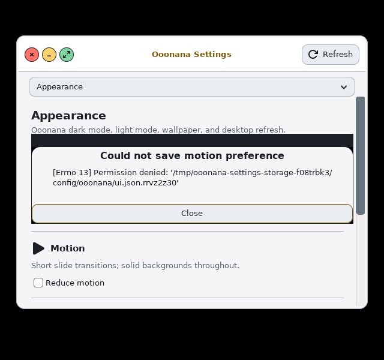

## Published checkpoint after Batch 24

Supersedes Batch 24's publication-pending note. Whole-OS review stays active.

- Source `2ff2506a243991f508bcddbc1d7e7329e824fd3a` includes runtime changes
  `c37b623` and an LF-only rule for private sudo policy fixtures. Both CIs pass:
  [GitHub 39122080915](https://github.com/Ooonana/Ooonana-OS/actions/runs/39122080915),
  [GitLab 2960139429](https://gitlab.com/Ooonana/ooonana-repo/-/pipelines/2960139429).
- Signed local `CURRENT`:
  `49c469cb08b65e99ca9056edee0882a848449f96a291a9bbb0f87d60b094e2eb`.
  SHA256SUMS digest:
  `db282fd6cc8fdd64ccb1aca538698a83560ccc014593e0d81556a5b248b1962d`.
  Full signature/pinned key and all1302 checksums verified, clean300-source-file
  manifest, supportedv3.24 base, no bundled models, 654 packages/612 dependency
  nodes. Previous generation's SHA256SUMS remains
  `e2560db45d215f7dfce6837fb815f225c175af2eddb4278ecb33eabaebe5b842`.
- Native snapshot `/var/lib/ooonana/candidate-admin-dialog-20261018.b0u5Gndo`
  reuses643 matching immutable archives and copies659 other entries. Full
  signature/checksum verification precedes core/runtime dry-runs, reinstalls,
  verification and explicit health hooks; all pass. Default cloud metadata
  resolves654 packages/two sources. Local adapter regenerated without restart.
- Installed shared UI SHA256:
  `8d8bb9c7b0fce7ee57566ea12fc3be6a464f3966ac45d58835fbaf68aaae1824`;
  askpass `0c2eef85c5ebfe2bbbc9921920d92009a788c2409d6f218f65ab787ac96a1472`.
  Both match source exactly; actual UID1000 import/syntax checks pass.
  OpenVINO installed metadata and `/etc/wsl.conf` unchanged. Native logs:
  `/var/tmp/ooonana-admin-dialog-sync-20261018.1kdZQ9HR`.
- One normal100% Paper recovery capture added above. Desktop source visuals
  are unchanged; existing README desktop capture remains current. Earlier
  failed fixtures/captures remain diagnostic history. No denied cleanup retry,
  private-key upload, models, audio or ISO operation. Stable0.9.9 and deferred
  promotion/enrollment unchanged. Remaining ledger rows stay open.

## Batch 25: dock edges and fullscreen

- New actual-display probe exercises mapped native GTK tooltips and action menus
  at all four screen corners, optical centering/bottom clearance, real44px
  targets and unchanged focused client. Initial bounds checks passed, but
  inspection of the actual fullscreen capture showed the override-redirect dock
  covering content. That baseline did not assert fullscreen hiding; its passing
  bounds markers were never proof of correct fullscreen behavior.
- Dock now uses the existing event-delivered i3 tree, with no additional query,
  timer or background service. It follows each output's visible workspace focus
  order and visible tabs, ignores i3's workspace-level fullscreen flag and
  scratchpad, and checks fullscreen container overlap with the dock monitor.
  Output-local fullscreen does not hide another output's dock; active global
  fullscreen does. Semantics follow the primary
  [i3 IPC tree documentation](https://i3wm.org/docs/ipc.html#_tree_reply).
  Normal size, icon alignment, opaque Graphite framing, motion and actions stay
  unchanged. No idle auto-hide or bottom-edge reveal policy added.
- Actual fullscreen entry now removes dock pixels; leaving fullscreen restores
  it without stealing client focus. Switching to another workspace restores it
  despite the inactive fullscreen client; returning hides it again. Pure guards
  additionally cover negative/touching output coordinates, multiple outputs,
  global fullscreen, floating containers, scratchpad and hidden tabs. Both CIs
  directly run the new display-free guard test.
- Eight final cases pass: 640×600 normal100% and200% text, 1024×768 normal100%,
  and320×600 normal100%, both native app appearances. 320px is a compact-dock
  stress case only; the harness refuses that geometry for other app probes.
  Baseline: `/var/tmp/ooonana-dock-edges-baseline-20261018.NLCWGnl4`.
  Final: `/var/tmp/ooonana-dock-fullscreen-final-20261018.RUOjfxQv` (Ubuntu).
  Actual clean fullscreen and normal100% preview captures inspected. Fixture
  XTerm titles are ASCII to avoid conflating XTerm locale/title encoding with
  dock layout; no new Korean/IME claim. No restyling was needed for edge menus
  or tooltips. Existing Graphite dock framing stays across both app themes.
- Native/rootfs/package source regressions pass under
  `/var/tmp/ooonana-dock-visibility-regress-20261018.eUWMf8XE`.
  Existing multi-session/action/keyboard regressions use a verified signed
  supplemental repository in private overlays:
  `/var/tmp/ooonana-dock-actions-regress-20261019.JdiLJJEs`.
  Source batch awaits signed generation and native WSL refresh. Physical display
  hotplug/mixed DPI, installed-session behavior and remaining ledger gates stay
  open. No release ISO, sound, model, user-history or physical device operation.

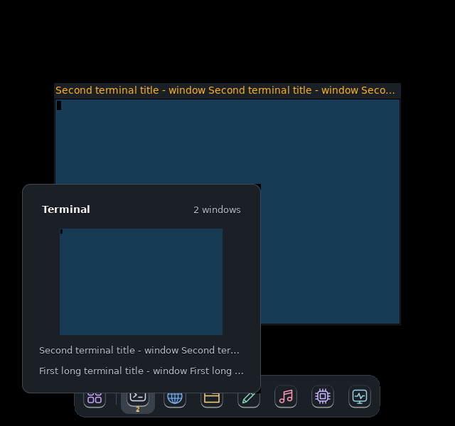

## Published checkpoint after Batch 25

Supersedes Batch 25's publication-pending note. Whole-OS review remains active.

- Runtime source `519de7d65a32fd3b7ecdbe01f192e3804ddec78f` passes both CIs,
  including the newly wired pure fullscreen guard:
  [GitHub 39169362495](https://github.com/Ooonana/Ooonana-OS/actions/runs/39169362495),
  [GitLab 2960918801](https://gitlab.com/Ooonana/ooonana-repo/-/pipelines/2960918801).
- Signed local `CURRENT`:
  `10514cb56d6b0ae8d73edd5465a2caa323e3e6c1564fb0232c20f0bd50841d6d`.
  SHA256SUMS digest:
  `1c19f6fc91b906452cf373aef5eb446eb83018b97681a8c5a61e4612c0bfe553`.
  Full signature/trust pin and all1302 checksums verified before/during atomic
  publication; clean300-source-file manifest, supportedv3.24 base, no models,
  654 packages/612 dependency nodes. Prior generation's SHA256SUMS remains
  `db282fd6cc8fdd64ccb1aca538698a83560ccc014593e0d81556a5b248b1962d`.
- Native snapshot:
  `/var/lib/ooonana/candidate-dock-fullscreen-20261019.qu9lqHlv`.
  Reuses643 matching immutable archives and copies659 other entries. Full
  signature/checksum verification precedes separate runtime/core dry-runs,
  reinstall, file verification and explicit health hooks; all pass. Actual
  UID1000 dock import/pure call pass; installed SHA256 matches source:
  `60f16b2abf87069626393526a05bfa6f2ca12e6519da798e741577fac2f5fdf6`.
  Default cloud metadata resolves654 packages/two sources. Native logs:
  `/var/tmp/ooonana-dock-fullscreen-sync-20261019.m1w9FdSF`.
- Local adapter regenerated without GUI/WSL restart. Relaunch desktop for new
  dock code. OpenVINO installed metadata and `/etc/wsl.conf` unchanged. No
  model, audio, physical device or ISO operation; signing key remains local and
  stable0.9.9/promotion deferral unchanged. Normal desktop capture remains valid.
- Both completed action-test overlays removed after exact-path/unmounted checks
  (5512KiB logical). Captures/logs/history and release generations/checkpoints
  retained. No Windows-space/compaction claim or denied cleanup retry.
- Normal Gdk scaling plus enlarged-font checks do not certify application/device
  coordinate alignment under `GDK_SCALE=2`, physical mixed DPI/hotplug, live WSLg
  or every installed-session transition. Those and other ledger rows remain
  open; edge tests are not whole-OS completion.

## Batch 26: device-scale coordinate alignment

- Actual `GDK_SCALE=2`, with normal100% text, reproduced a real coordinate
  fault. i3 requested `(818,217,22)` device pixels while the X11 controls were
  `(1636,434,132,44)`: off-target and too large for the native titlebar. Dock
  fullscreen overlap also mixed GTK logical monitor geometry with i3 device
  rectangles on a nonzero-origin monitor. Baseline:
  `/var/tmp/ooonana-device-scale-baseline-20261019.45xQXwcB` (Ubuntu).
- GTK reports monitor geometry in application pixels, and its integer scale
  maps to device pixels: primary [geometry documentation](https://docs.gtk.org/gdk3/method.Monitor.get_geometry.html)
  and [scale-factor documentation](https://docs.gtk.org/gdk3/method.Monitor.get_scale_factor.html).
  Third-party controls now convert raw i3 coordinates/size and scale their
  compact CSS/icon budgets to fit that native titlebar. Whole-application-pixel
  border quantization is explicitly budgeted. Unchanged targets avoid repeated
  restyling; changed scale recomputes geometry. Dock converts only its overlap
  rectangle, not its existing GTK rendering/placement coordinates. No additional
  polling or production scale/font setting.
- Four final real-display cases pass: dark/light × device scale1/2, normal100%
  text, device1280×800. Final2× X11 popup is `(818,216,66,22)` against the
  target `(818,217,22)`, within one device pixel of GTK integer placement.
  Actual pointer clicks hit Minimize/Close, specific-session restoration
  remaps controls, and fullscreen entry/exit hides/restores dock. Fullscreen
  itself is invoked through the actual action helper, not claimed as a button
  click. Final captures/results:
  `/var/tmp/ooonana-device-scale-final-20261019.Cvs0vF8n`.
- The offset-monitor guard uses actual measured device/application ratio but
  derived geometry: not physical multi-monitor, mixed-DPI or hotplug proof.
  `tests/test-window-control-scale.py` additionally guards negative coordinates,
  the66-device-pixel row budget, dynamic scale changes and unchanged-target
  remapping without importing GTK; wired directly into both CIs/native test.
  New harness device-scale opt-in accepts only1/2 and defaults to1.
- Intermediate70px-wide controls from fractional-border quantization failed
  confirmation and were corrected, not counted as passing. Those logs/captures
  remain diagnostic history. Native/rootfs/package-factory regressions, existing
  shared native controls and actual2× dock-edge tests pass both themes:
  `/var/tmp/ooonana-device-scale-regress-20261019.gWaRhwEH`. Signed package
  publication/native WSL refresh are in progress. Existing normal desktop capture remains applicable;
  2× fixture is not a new default. No physical device, release ISO, model, audio
  or history operation. Remaining ledger rows and whole-OS goal stay open.

## Published checkpoint after Batch 26

Supersedes Batch 26's publication-pending note. Whole-OS review remains active.

- Runtime source `32a900a78d051c0478f702dabcc299e41eaa6b9d` passes both CIs:
  [GitHub 39170843380](https://github.com/Ooonana/Ooonana-OS/actions/runs/39170843380),
  [GitLab 2960945776](https://gitlab.com/Ooonana/ooonana-repo/-/pipelines/2960945776).
  Both directly run the new display-free control-scale guard. The initial GitLab
  authenticated status query was unauthorized; public pipeline status succeeds.
- Signed local `CURRENT`:
  `32e04e40a81312cc13e732ab853d282c876b7192f743866e0137793de92cc73d`.
  SHA256SUMS digest:
  `0f662b3dd2eda057b8d492a373018b5e1957e964a51375c3d6c26685718fa6f5`.
  Signature/trust pin and all1302 checksums verified before/during publication;
  654 packages/612 dependency nodes. Clean300-source-file manifest records
  supportedv3.24, no models, source digest
  `6a82e292a99942f2939cfb1019897320123f2219d21b3d3033f199940b86238f`.
  Prior generation's SHA256SUMS remains
  `1c19f6fc91b906452cf373aef5eb446eb83018b97681a8c5a61e4612c0bfe553`.
- Native snapshot:
  `/var/lib/ooonana/candidate-device-scale-20261019.ZZVHAA6k`.
  Reuses643 matching immutable archives and copies659 other entries. Native F
  mount is enforced read-only inside the sync process because idle WSL drops
  its earlier mount; no move/restart of either WSL distro. Full signature and
  all1302 checksums pass before separate runtime/core dry-runs, reinstall,
  verification and explicit health hooks; all pass. Installed hashes match
  source exactly: dock
  `fa5ff77aa38fbdfc45a2482115e52c5490e83f1c0f79a4443fb7d1a00a4c66e1`,
  controls `1549b02db68246f3c01dd101f809b8311ff9fd2f2fe98253c74ce0ccd71fc80e`.
  Logs: `/var/tmp/ooonana-device-scale-sync-20261019.lbKy40U1`.
- Default metadata resolves654 packages/two sources and local adapter is
  regenerated without GUI restart. Actual UID1000 imports and display-free
  helper call pass. That noninteractive WSLg context emits
  `gdk_seat_get_keyboard: GDK_IS_SEAT` warning; import success is not proof of
  interactive WSLg keyboard/seat/session health. Those checks remain open.
  `/etc/wsl.conf` and OpenVINO installed metadata hashes are unchanged.
- Signed generation, prior generations/checkpoints, QA captures/logs, user
  history and local private key retained. No release ISO, models, sound playback
  or physical device test. Existing normal desktop capture is still applicable;
  default scale/typography unchanged. Stable promotion/enrollment remain
  deferred. Relaunch desktop for current code; use a fresh build rather than
  resuming an older ISO when the user chooses to build.

## Batch 27: managed Spotlight and real app handoff

- Earlier catalog/keyboard fixtures did not prove Spotlight size under real i3
  mapping. New owned-session probe discovered i3 forcing760×520 on640×600,
  moving the frame tox=-60 and clipping left window controls/search/icon.
  Both themes failed actual output bounds despite successful app launches.
  Baseline: `/var/tmp/ooonana-launcher-session-baseline-20261019.GfJt0UPh`.
  Actual compact dark/light captures inspected before editing.
- Removed only `resize set 760 520` from Spotlight's i3 rule. Existing GTK
  display-aware defaults now control initial dimensions; floating/border-none/
  centering, normal760×520 app request, typography, palette and control sizes
  remain. No percentage-based enlargement, new timer or blanket shrink.
  Native source regression refuses reintroducing a fixed resize on this rule.
- Four real final cases pass: dark/light ×640×600/1280×800, normal100% text.
  Compact mapped frame is `(27,66,586,442)` and fits; desktop770×586 includes
  GTK's CSD around its unchanged client request. Capture inspected in both
  themes, with all left controls visible. Final/regression directory:
  `/var/tmp/ooonana-launcher-session-final-20261019.gVJRPdYp`.
- Tests create one owned user `.desktop` entry and enumerate it through actual
  `Gio.AppInfo.get_all()`. Actual X11 Return launches XTerm, dismisses Spotlight,
  and hands off i3 focus. Shipped `ooonana-settings.desktop` then launches real
  native Settings through its current wrappers; process UID and command line
  confirm native GTK, not a fallback/log window. Both owned apps close normally.
  No monkey-patched launch, fabricated process or externally installed app.
- Harness read-only-binds current Settings UI/wrappers rather than executing
  stale cached candidate code. Private HOME/runtime, PID/mount/network/display
  namespaces remain isolated. Captured sample entry is QA content, not a new
  shipped app. Glycin emits its private-chroot sandbox warning; neither image
  sandbox nor physical compositor/WSLg input is certified by this test, and no
  production sandbox was disabled.
- Native/branding/rootfs/package-factory regressions pass; signed package/native
  refresh remain pending. Preferred-wrapper variants, installed
  keyboard/IME, other apps/session/physical/manual ledger rows stay open. No
  release ISO, sound playback, model or physical-device operation.

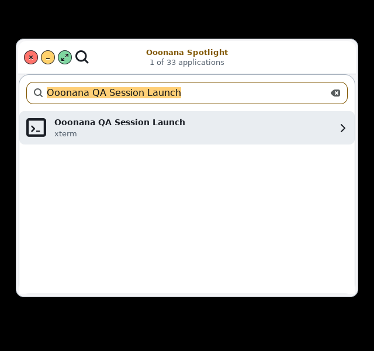

## Published checkpoint after Batch 27

Supersedes Batch 27's publication-pending note. Whole-OS review stays active.

- Runtime source `d499391b0081ff234ddb54125fa9f523983ed950` passes both CIs:
  [GitHub 39172242204](https://github.com/Ooonana/Ooonana-OS/actions/runs/39172242204),
  [GitLab 2960978910](https://gitlab.com/Ooonana/ooonana-repo/-/pipelines/2960978910).
- Signed local `CURRENT`:
  `967ddd097a907cc4bb4075280c470198dc90dd8a45561a4c8bb2b4df217bac56`.
  SHA256SUMS digest:
  `6ca51b8c099bf42995e6f94c1b10c9da3ce91b926957d27aac94fe179f54c87e`.
  Pinned signature and all1302 checksums pass before/during atomic publication;
  clean300-source-file manifest, supportedv3.24 base, no bundled models,
  654 packages/612 dependency nodes. Source digest:
  `6ed14786db7ac73e47ddf0d54ce0976f1eb118e205d122b891e40ec5e116bf8c`.
  Previous generation's manifest remains
  `0f662b3dd2eda057b8d492a373018b5e1957e964a51375c3d6c26685718fa6f5`.
- Native snapshot:
  `/var/lib/ooonana/candidate-launcher-fit-20261019.mB8UIGdn`.
  F mounted read-only inside sync; signature/full checksums pass before using
  643 matching immutable archive hardlinks and659 copies. Both core/runtime
  dry-runs, reinstall, file verification and explicit health hooks pass.
  Installed `/etc/i3/config` and `config.keycodes` both match source:
  `c1128e84238c08a8eb85a9346f008e2af47edaec17fbcdb565372f2f83993414`.
  No user-level i3 override was present or rewritten; UID1000 `i3 -C` passes.
  Logs: `/var/tmp/ooonana-launcher-fit-sync-20261019.THFBdt5U`.
- Default metadata resolves654 packages/two sources. Local adapter refreshed;
  OpenVINO installed metadata and `/etc/wsl.conf` hashes unchanged. No forced
  GUI/WSL restart, physical test, models, sound playback or release ISO build.
  Prior generations/checkpoints, user history, captures/logs and private signing
  key retained. Stable promotion/enrollment remain deferred.
- Relaunch manually for current rules (close old nested desktop when ready):

  ```powershell
  wsl -d Ooonana --exec /usr/local/bin/start-ooonana-i3 --nested
  ```

  This is a launch command, not proof of WSLg mouse/keyboard/IME/clipboard health.
  The private probe injects actual X11 key events, not physical keyboard input.
  Remaining ledger rows stay open. A fresh ISO build, not an old resume, is
  required to carry these changed rules onto USB.

## Batch 28: Task View, media and periodic notification recovery

- User-requested Task View replaces numeric panel workspaces at every responsive
  width with the existing Font Awesome overlapping-window pictogram. Click or
  `Mod+Ctrl+Tab` opens a searchable windows/desktops chooser, including hidden
  sessions, desktop switching and New desktop. Existing numbered/move/cycling
  bindings remain. This is a compact Ooonana switcher, not a claim of Windows
  11's full thumbnail-overview implementation.
- First actual 640px chooser captures revealed an offscreen fixed-height list
  and default white child backgrounds. Task View now uses at most six dynamic
  rows; inherited child backgrounds/text are explicit. Shared chooser supports
  Paper/Graphite preferences without changing font defaults or copying Windows
  assets. Actual X11 shortcut, Escape, search/Enter, exact minimized-client
  restoration, New desktop and return to an occupied desktop pass in both
  themes at640×600 and1280×800. Bounds asserted before capture. Pure tests cover
  safely quoted desktop names, closed targets, cancellation and unavailable IPC.
  Evidence: `/var/tmp/ooonana-task-view-confirm-20261019.5xhcKUB0`.
  Earlier functional captures and a failed QA-only geometry-check placement are
  retained for diagnostics; the latter was corrected before confirmation.
- Four actual source Polybar captures, both themes and640/1280px, pass missing
  glyph, long CJK/full-counter, AI center and overlap checks. Status values are
  samples; new icon uses shipped FA7, not a Unicode substitute. Evidence:
  `/var/tmp/ooonana-task-view-20261019.Uxbjm7C7`. Task View selection uses real
  rofi/i3 processes; panel click routing is source-asserted, not a human click.
- Real private MPD/mpc exposed stripped empty tag columns, ASCII-converted
  Korean metadata and shared body sizing overriding the display-aware header.
  Added a metadata prefix, narrowly opt-in UTF-8 command locale, and retained
  bounded body size. Parser commands still default to C. Actual Music and panel
  watcher cover empty/play/pause/volume/next/stop, daemon loss and restart;
  filename fallback/CJK text and compact panel clearance pass both themes and
  sizes. MPD has exactly one null output, verified enabled before play; fixtures
  are silent and no Pulse/ALSA/PipeWire or audio device is available to QA.
  Evidence: `/var/tmp/ooonana-media-runtime-confirm-20261019.RkITgJCE` and stable
  light1280 rerun `/var/tmp/ooonana-media-final-regress-20261019.hePlbcP7`.
  A prior confirmation's final wrapper exited after its already-passing UI
  assertions when the harness was edited while running; the unchanged-harness
  rerun passes. Shared control200% text checks pass both themes; production
  text/cursor scale stays unchanged.
- Real Dunst, private non-activating session bus and unchanged five-second
  Notifications timer cover DND change, loss, restart, retained history and new
  expired Korean message with reused ID. No manual refresh/focus event; focus
  count remains unchanged. Observed recovery intervals4.73–4.97seconds. Both
  compact themes pass; destroying the center removes its timer. No production
  notification behavior changed. Evidence:
  `/var/tmp/ooonana-notification-auto-baseline-20261019.kSi9VQRx`.
- Private chroot emits Glycin sandbox warnings; no production sandbox disabled.
  Hardware/audio routing, actual WSLg input, full session lifecycle and the
  rest of the coverage ledger remain open. OpenVINO, signing enrollment/stable
  promotion stay deferred. Publication/native refresh pending; no release ISO.

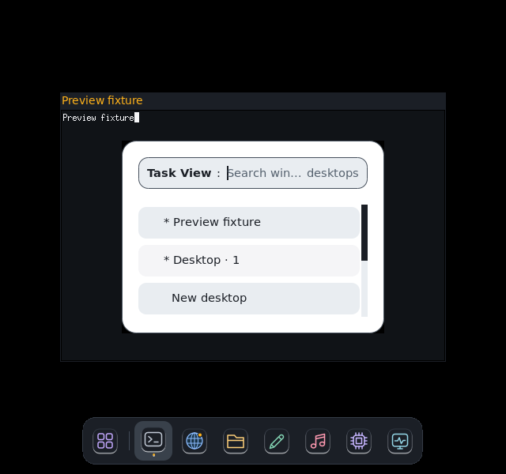

## Published checkpoint after Batch 28

Supersedes this batch's publication-pending note. Whole-OS review stays active.

- Runtime source `5395853e1fc83689289f59d172e26bce56382a10` passes
  [GitHub 39197785522](https://github.com/Ooonana/Ooonana-OS/actions/runs/39197785522)
  and [GitLab 2961533344](https://gitlab.com/Ooonana/ooonana-repo/-/pipelines/2961533344).
  Native/branding/rootfs/package-factory and panel-session regressions pass.
- Signed local generation:
  `ea616da2e3aa29602afdc8d26e21bbf4b418ae2ec8452cd020908155ac43f2d1`.
  SHA256SUMS digest:
  `486688fbe4327117c70ca558a2ad677f55fb06a563f878f1e5b16675107a8596`.
  Pinned signature/all1302 checksums, clean300-source-file manifest and
  654-package/612-node closure verified. Source digest:
  `36742f6c05ad629a6874821b3fd86c36fe06695b3602b39f5ee550e22bacff07`.
  Previous generation's SHA256SUMS remains
  `6ca51b8c099bf42995e6f94c1b10c9da3ce91b926957d27aac94fe179f54c87e`.
  An interrupted staging helper was resumed/verified before atomic promotion;
  no incomplete generation became CURRENT.
- Native snapshot:
  `/var/lib/ooonana/candidate-task-view-media-20261019.nWfFQQYr`.
  F mounted read-only for full signature/checksum verification;643 matching
  archive hardlinks/659 copies. Core/runtime dry-run, reinstall, file verification
  and both explicit health hooks pass. Installed common/controls/helper match
  source; both i3 configs match SHA256
  `4e400a15ce0589e14434822755ecf0d9ec682acf87f6ed6c203ea6626eab9d23`.
  The finish helper lacked `cmp`; resumed comparisons use available SHA256,
  without repeating or bypassing transactions. UID1000 i3 syntax and installed
  rofi/i3-msg availability pass. Logs:
  `/var/tmp/ooonana-task-view-media-sync-20261019.xMFlXnia`.
- Default metadata resolves654 packages/two sources; local adapter refreshed.
  OpenVINO installed metadata and WSL boot config hashes unchanged. No forced
  GUI/WSL restart, audio-device playback, models or release ISO. Signing key
  remains local; enrollment/stable promotion and remaining ledger rows deferred.
- Close the old nested GUI manually when ready, then launch updated rules:

  ```powershell
  wsl -d Ooonana --exec /usr/local/bin/start-ooonana-i3 --nested
  ```

  Actual WSLg mouse/keyboard/IME/clipboard remains a manual gate. Fresh ISO build,
  not an old resume, is needed to put these runtime changes on USB.

## Batch 29: scaled Qt pickers and session Home defaults

- Added explicit, validated **QA-only** Qt scale factor, default1. Actual
  Qt6/QTerminal100% at640×600 and200% at1280×800 pass both appearances. Native
  settings, six category pages, font chooser and GTK portal image chooser remain
  usable. Qt200% is per-app stress with GTK portal at desktop100%, not evidence
  of physical mixed-DPI or a production scale change. Normal window/exit actions
  also pass with scaled content. No Qt stylesheet or platform override added.
- Picker tests now use scaled observed menu/font targets and actual keyboard
  focus traversal to reach an offscreen image Select control. Native scrolling
  reveals it; cancel/reopen/select, exact private path with spaces, post-return
  parent bounds and keyboard refocus/reopen after a long path pass. Outer Cancel
  leaves the user's pending image unapplied. [Upstream form/focus order](https://github.com/lxqt/qterminal/blob/2.4.0/src/forms/propertiesdialog.ui)
  informed the fixture. A QMenu End/Up driver selected Quit rather than
  Preferences; corrected using captured menu evidence, not a product patch.
  A subsequent old unscaled field click was another driver fault, also corrected.
  Their failed logs/screens remain for diagnostics.
- Apparent clipping in a pending-path screenshot did not prove window overflow.
  Post-return geometry stays bounded; Tab refocus reveals Select and can reopen
  the real chooser. No unproven resize workaround introduced. Evidence:
  `/var/tmp/ooonana-qt-scale-confirm-20261019.f5wGsxRk` (four cases) and
  `/var/tmp/ooonana-qt-return-confirm-20261019.dNHX9sSa` (both200% themes).
- Actual installed BusyBox user handoff preserved `/` and `/tmp` as cwd even
  with `HOME=/home/ooonana`; source session had no Home transition. This affected
  desktop app/default picker locations. Session now enters quoted Home before
  bus/theme/app startup; unavailable Home fails with clear diagnostic rather
  than launching in an unrelated directory. Explicit app paths/workdirs and
  saved preferences remain untouched. Seven baseline failures become passing
  tests for normal/spaced/Korean/literal-shell-character Home, missing/unset/
  empty/file targets and quiet CDPATH handling.
- Qt integration executes the actual source session prefix as real UID1000,
  before its private bus/WM, not a fake test-only cd. It asserts/records
  `/home/ooonana` cwd. Actual picker opens Home, while QTerminal's explicit shell
  workdir still points to the owned fixture. Final matrix:
  `/var/tmp/ooonana-qt-home-final-20261019.PMqShSiF`.
- Native/rootfs/WSL/package-factory regressions pass. Source-only working-directory
  test runs in both CIs. Native/logical scale defaults, audio, models, cursor,
  sandbox policy and kernel unchanged. Actual WSLg input, other Qt apps,
  installed authentication, whole-desktop/mixed-DPI, physical and remaining
  ledger gates stay open. Signed publication/native refresh pending this batch.
- Completed private Qt overlays are removed only after terminal probe exit and
  exact path/no-mount checks. Captures, logs, source caches, history and existing
  package/ISO generations stay. Logical ext4 reclaim is not a claim of immediate
  Windows free-space gain or VHD compaction. No denied cleanup retried.

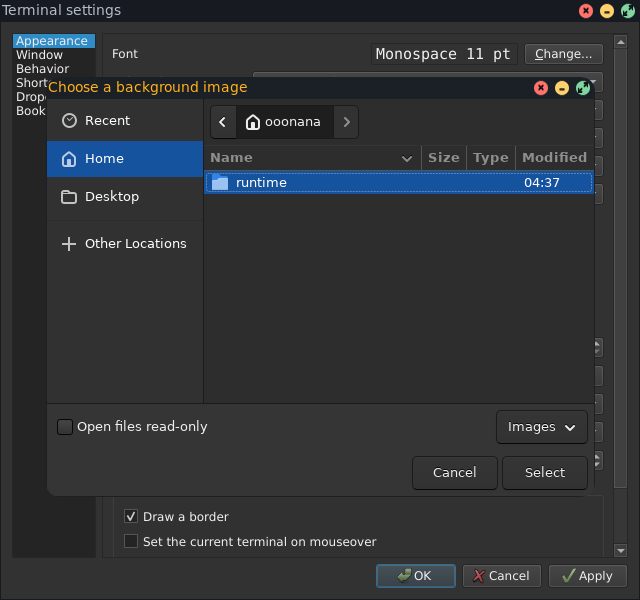

## Published checkpoint after Batch 29

Supersedes publication-pending note above. New dock direction remains queued,
not implemented: user requested finishing existing work first.

- Runtime source `f8402a76c007923222fd60e087c36b148ee0f816` passes
  [GitHub 39218797636](https://github.com/Ooonana/Ooonana-OS/actions/runs/39218797636)
  and [GitLab 2962086647](https://gitlab.com/Ooonana/ooonana-repo/-/pipelines/2962086647).
- Signed local generation:
  `0c5889376f3bf6a88291ed60e5a7f80d6cb79ce33e31977d0010767d12ecc895`.
  SHA256SUMS digest:
  `7e66655bc558116d75d6120bca9bc431691bb2bb981ddd9f6bf55a721d763b70`.
  All1302 checksums/signature/trust pin verified before/during atomic publication;
  clean300-source-file manifest,654-package/612-node closure, v3.24 base, no
  bundled models. Source digest:
  `c37811c47f50eb660262116fa65ac153fc1d0125bc5333e8bfd8ae97e94e6d66`.
  Previous generation SHA256SUMS stays
  `486688fbe4327117c70ca558a2ad677f55fb06a563f878f1e5b16675107a8596`.
- Native snapshot:
  `/var/lib/ooonana/candidate-session-home-20261019.sIpnTvc4`.
  F mounted read-only;1302 checksums/signature verified there and in local
  snapshot (643 immutable archive hardlinks,662 copies including trust files).
  Separate core/runtime dry-runs, reinstall transactions, installed-file
  verification and both health hooks pass. Update backups retained.
- Installed session SHA256:
  `4e2362d3aaa38cb411336881e1691f8fa9e49613df72b9a5b98b6c469c713d4d`.
  Exact generated source matches; real installed prefix as UID1000 from `/`
  reaches `/home/ooonana`, stopping before bus/theme/app/audio startup. Both i3
  configs match source; UID1000 `i3 -C` passes. Adapter and default654-package/
  two-source metadata refreshed. Logs:
  `/var/tmp/ooonana-session-home-sync-20261019.CTEsyfgZ`.
- OpenVINO installed metadata and `/etc/wsl.conf` hashes unchanged. No forced
  GUI/WSL restart, model download, hardware audio playback or release ISO.
  Signing key remains local; enrollment/stable promotion still deferred.
- Cleanup removed45 inactive private GUI overlays after exact-path, no-symlink,
  no-active-harness and all-process mount checks:434204KiB logical (~424MiB).
  These test copies are regenerable; captures/logs, Firefox QA homes, caches,
  history and package/ISO generations remain. Receipt:
  `/var/tmp/ooonana-cleanup-20261019.KfO0FPGs`. Windows deletion command was
  rejected before execution; no C:/F: files were removed and no workaround
  attempted. Remaining22 `.pyc` files (~961kB) are under the vendored OpenVINO
  source cache; two other discovered Python cache directories are empty. Newly
  completed duplicate stage remains:
  `F:\Ooonana\ooonana-os\build\session-home-stage-20261019-f8402a7-l3oz_4qg`.
  Earlier denied Qt publication-stage cleanup was not retried. Ext4 reclaim
  does not certify immediate Windows free-space gain or VHD compaction.
- Next dock brief: flat, opaque surface; running/minimized app windows in dock,
  improved direct right-click actions and grouping. No active title/window list
  added to top panel. Existing dock visual/behavior unchanged this batch. Broader
  ledger, actual WSLg input, physical/mixed-DPI/USB and PDF viewer gates stay open.

Close old nested GUI manually when ready; launch updated session:

```powershell
wsl -d Ooonana --exec /usr/local/bin/start-ooonana-i3 --nested
```

Fresh ISO build is needed for runtime changes, never an old resume. Waiting for
queued dock work avoids another subsequent rebuild:

```powershell
& 'F:\Ooonana\ooonana-os\Build-ISO.ps1' --repo '/mnt/winf/Ooonana/ooonana-os/build/full-i3-repo-0.10'
```

## Batch 30: flat dock, app groups and persistent pins

- Impeccable refinement preserves opaque Graphite/Paper identity and normal
  typography. Removed raised/gradient icon tiles, hover lifting and top-panel
  window controls. Normal dock stays60px high,32px icons,44px-or-larger targets,
  centered indicators and12px bottom clearance.200% is isolated text stress,
  not shipped default. Top panel has no active-window title/window list.
- Dock groups actual windows by app, keeping preferred default launchers
  separate from Firefox/other apps. Stable native roles distinguish Settings,
  Packages and other native apps; transient dialogs follow actual parents.
  Click raises one focused/most-recent visible session, or one exact minimized
  session; siblings stay minimized. Hover never steals focus.
- Native right-click menu exposes window rows and direct Show/Minimize/
  Enter-or-Exit fullscreen/Close. Right-click a window row or Shift+F10 targets
  that exact window. XID guard refuses stale/reused container IDs. New window
  appears only for a declared desktop-entry action, not invented CLI flags.
- Pin/Unpin works for installed launchers. Pinned apps stay left, unpinned
  running apps right, separated visually; Apps utility stays fixed far left.
  Unpin never closes windows. Closed pins remain and relaunch via desktop ID.
  Hold/move/release reorders within either section; cross-section drag does not
  silently pin/unpin. Move left/right supplies keyboard alternative. Atomic
  `~/.config/ooonana/dock.json` saves validated app IDs/order only, no commands,
  titles, PIDs or window history. Corrupt preferences stay retained/refuse
  overwrite; read-only save fails visibly and keeps prior layout. Missing apps
  expose reinstall/unpin recovery. Small-screen More apps retains idle pins,
  including keyboard-accessible Unpin, rather than silently dropping launchers.
- Pure model and native/rootfs/package-factory/panel-session regressions pass;
  pure model runs in both CIs. Real GTK/i3 uses owned XTerms, native header
  fixtures, registered desktop-entry action and actual X11 input. Four cases:
  dark1280×800100%, light640×600100%, dark640×600200%, light1280×800200%.
  Actual GTK drag signals, section ordering/rejection, pin/relaunch/reload,
  readonly failure/retry, transient grouping, MRU restore and legacy keyboard
  window actions pass. Fullscreen restore and actual tooltips/hidden-pin
  options pass at320×600200%; normal panels at640/1280 and actual2× device
  controls pass. Evidence:
  `/var/tmp/ooonana-dock-pins-confirm-20261019.CyYUue2J`.
  Source regressions:
  `/var/tmp/ooonana-dock-pins-regress-20261019.ClfVP1Qp`.
- Earlier failures were retained: compact overflow test assumed every pin had
  running windows; updated for intentional idle-pin reachability. Edge retry
  created required output directory; panel-session test is Python, not shell.
  These driver errors did not weaken runtime requirements. Enlarged-text
  tooltip overflow was fixed with actual Pango width budgeting.
- README uses latest normal100% private desktop capture. Panel values are
  illustrative; no physical hardware/tray authentication claim. No model
  download, audio playback, forced GUI restart or release ISO. Publication/
  native refresh pending. Whole-OS ledger remains open: actual WSLg input,
  preferred launcher wrappers, privileged package/auth flows, other Qt/Firefox
  integration, physical/mixed-DPI/session/USB tests and Chromium PDF viewer.
  OpenVINO and signing enrollment/stable promotion remain deferred.

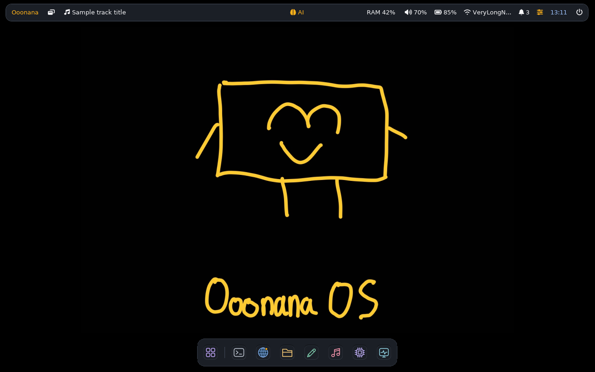

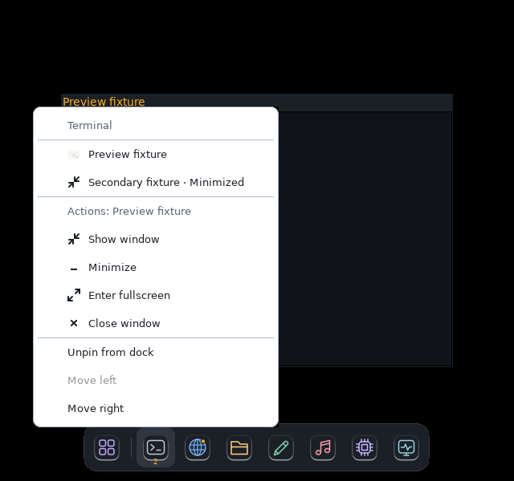

## Published checkpoint after Batch 30

Supersedes publication-pending notes above. Whole-OS review remains active.

- Runtime source `5a39c8cddb5d5941e335a226422eea921496eaaa` passes
  [GitHub39258579926](https://github.com/Ooonana/Ooonana-OS/actions/runs/39258579926)
  and [GitLab2963317461](https://gitlab.com/Ooonana/ooonana-repo/-/pipelines/2963317461).
  Signed generation:
  `26bb8cf5f3ff10af9a104ac78886f32fe3f4fad280dd7644a7a956345be87942`.
  SHA256SUMS digest:
  `282fecba4eacefc237cfdfb47ab9b724e5d6ba0f20106619c7543bd7731397d3`.
  Full old/new signature/checksum verification,301-source-file clean manifest,
  654-package/612-node closure and atomic publication pass. Source digest:
  `c2d7ff1cf819b628ce640dc4608d460158f053f3f35883fb9aadb131b88bbcb4`.
  v3.24 base unchanged; models not bundled. Old generation/checksums retained.
- Native snapshot:
  `/var/lib/ooonana/candidate-flat-pins-20261019.Bxv6AKJz`.
  Read-only F generation and local snapshot each pass all1302 checksums and
  trusted signature;643 immutable archive links/662 copies. Separate runtime/
  core dry-run, reinstall, file verification and health hooks pass; rollback
  backups kept. Five changed UI/helper files match current source byte-for-byte.
  Installed dock SHA256:
  `1a3c0a59517e35ed2b776b9ee1237e421fc9b08aa5c9d24675793d8c5e5b0337`.
  New panel configuration installed; UID1000 dock/model imports and `i3 -C`
  pass. WSL-local adapter and default654-package/two-source metadata refreshed.
  Logs: `/var/tmp/ooonana-flat-pins-sync-20261019.yd10VJ9t`.
- OpenVINO metadata and `/etc/wsl.conf` hashes unchanged. No forced GUI/WSL
  restart, model download, audio-device playback or release ISO. Actual human
  WSLg input/session and remaining ledger gates stay unverified, not certified
  by package synchronization. Signing key stays local; no stable promotion.
- 15 completed private QA overlays removed only after exact-path/no-symlink,
  no-active-harness and all-process mount checks:41340KiB logical (~40MiB).
  Receipt: `/var/tmp/ooonana-flat-pins-cleanup-20261019.Hdk64QGw`.
  Screenshots/logs/history/models/checkpoints/ISO assets retained. Logical
  ext4 reclaim is not immediate Windows free space or VHD compaction.
- Newly completed duplicate F publication stage deletion was blocked before
  execution, not retried through another route. Previous denied Windows
  cleanup remains untouched. Optional exact manual cleanup for this new stage
  only (published generation is separate and remains):

```powershell
Remove-Item -LiteralPath 'F:\Ooonana\ooonana-os\build\flat-pins-stage-20261019-5a39c8c-8rx2iy5j' -Recurse -Force
```

Close old nested GUI manually when ready; launch updated session:

```powershell
wsl -d Ooonana --exec /usr/local/bin/start-ooonana-i3 --nested
```

Fresh ISO command, user-run only; never resume an old image for new UI code:

```powershell
& 'F:\Ooonana\ooonana-os\Build-ISO.ps1' --repo '/mnt/winf/Ooonana/ooonana-os/build/full-i3-repo-0.10'
```

## Batch 31: preferred launchers, search selection and default app fit

- Expanded real Spotlight integration to installed `xterm.desktop`,
  `geany.desktop` and `nemo.desktop`, alongside owned desktop entry/native
  Settings. Current source wrappers/UI are read-only-bound in private candidate
  namespace, not trusted from old cache. Theme application and Geany schemes
  affect private QA Home only. Actual X11 Return, owned UID/process command,
  focus and close verified. Geany uses chosen scheme/Monospace11; Nemo targets
  Home. No audio/network/browser/model operation.
- Normal640×600 baseline exposed902×623 Geany at(-131,-24), clipping native
  menus/titlebar. Nemo's normal height also covered reserved panel/dock region.
  Source window-controls manager now fits only newly observed floating normal
  Geany/Nemo frames to shipped usable clearances when needed. No global
  constraints, stylesheet scaling or forced enlargement of fitting defaults.
  One deferred correction revalidates unchanged geometry and actual XID;
  user move/resize, hidden/tiled/fullscreen/native/dialog/closed/reused windows
  remain untouched. Existing Qt-dialog-only reposition logic stays unchanged.
- Baseline Files selection opened Wi-Fi, not Nemo. Retained client/process
  evidence shows `wifi_app.py`: deferred search selected first description
  match (`profiles`) after explicit row choice. Search now filters, ranks and
  selects synchronously on text change, before Return/idle. Exact app name,
  prefix, word and name substring outrank description matches; empty query
  preserves native-first catalog order. No application removed/hidden just
  for a misleading description match. Unicode and no-match recovery preserved.
- Pure selection/ranking and initial placement guards pass and run in both
  CIs. Real wrapper/default-fit matrix passes dark/light compact and desktop
  cases. New editor/files frames fit output plus panel/dock clearances;
  subsequent real user resize/move is not reset. Device-controls/native/rootfs
  regressions pass. Initial environment-only enlarged-text labels were not
  sufficient evidence: final Impeccable review caught missing launcher DPI
  application and missing shared-content CLI forwarding. Those QA fixtures
  now apply/record actual196608 Xft DPI (192DPI/200% text). Corrected dark640
  and light1280 launcher plus shared-content cases pass with visible enlarged
  labels and no clipping; long/no-match/rejection/recovery still work. This
  scales tested parent GTK widgets, not external app processes or whole desktop.
  Normal production defaults remain100%. Corrected evidence:
  `/var/tmp/ooonana-launcher-true-text-scale-20261020.B2QfrRL8`.
  Normal wrapper/default-fit evidence:
  `/var/tmp/ooonana-launcher-files-fit-final-20261020.fCfqlMOS`.
  Earlier baseline/diagnostic/confirmation captures and logs retained under
  `/var/tmp/ooonana-launcher-wrappers-20261020.zbOUtJDo`,
  `/var/tmp/ooonana-launcher-wrapper-diagnose-20261020.7dIcpyLZ` and
  `/var/tmp/ooonana-launcher-fit-confirm-20261020.I3wFmYq1`.
- Impeccable pass preserves normal10pt/native controls,11pt editor text,
  opaque surfaces and existing layout identity. Fresh screenshots below are
  normal100%, not200% default. Browser/hardware-wrapper variants, actual
  WSLg/IME, physical/mixed-DPI/tray/session/USB and other ledger gates remain.
  Publication/native refresh pending; no ISO built. OpenVINO stays deferred.

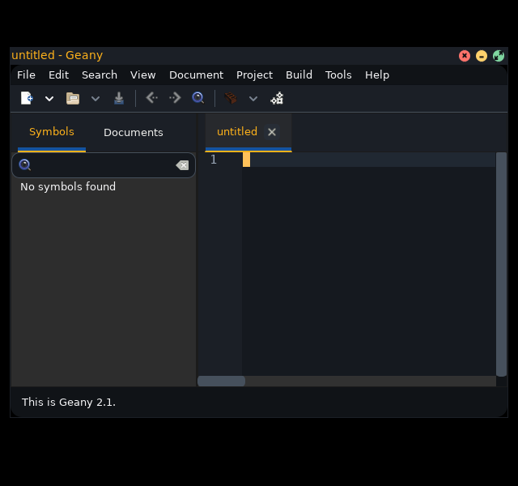

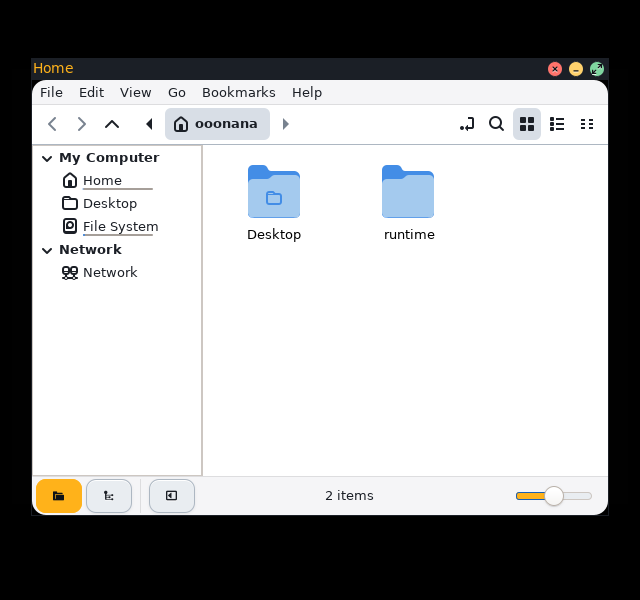

## Impeccable review after Batch 31

- Reviewed actual final normal-size dock/menu, Geany and Files captures, plus
  corrected actual200% Spotlight/shared-content captures, against source.
  Flat opaque identity, centered dock icons, pin/run divider, normal text/icon
  proportions, keyboard focus/selection, right-click targeting, fit clearances
  and no-clipping states checked. No extra cosmetic resize loop or transparency.
- User-requested pin/drag behavior remains covered by actual mouse gestures,
  saved layout/relaunch and failure/retry checks from Batch30. New source does
  not alter dock bytes. This is not certification of live WSLg, physical
  compositor/mixed-DPI, every external app or remaining whole-OS ledger.
- Runtime source `11a51a74000317d1d54771167e614e2d44a20b2a` passes
  [GitHub39395479651, attempt2](https://github.com/Ooonana/Ooonana-OS/actions/runs/39395479651)
  and [GitLab2966641963](https://gitlab.com/Ooonana/ooonana-repo/-/pipelines/2966641963).
  First GitHub attempt hit Python's nine-second outer watchdog in existing
  PDF VM fixture; same source passes locally and unchanged CI retry. No PDF
  runtime, internal timeout, benchmark or rate-hook assertion weakened.
- Signed/published generation:
  `26407e012bd145c98b543d03621a7d563e6eb2e947c19e9517086687c2e8ca31`.
  SHA256SUMS:
  `665fde1f8097da8aa2c0bee658169773ce4fa2efc99568784ae018998715d1ea`.
  Full old/new signed-file verification,301-file clean source manifest,
  654-package/612-node closure and atomic promotion pass. Source digest:
  `d91378db765f2411f4505731ae61a0c7579637ee14924876aa92c94f1a8a4f77`.
  Earlier generation unchanged; no bundled models, stable promotion or new
  signing enrollment. Native refresh remains pending until receipt below.
- QA-only scaling corrections change no runtime payload. Newly completed
  duplicate stage retained; Windows cleanup was already blocked, not retried.
  Optional exact manual cleanup, after immutable publication completed:

```powershell
Remove-Item -LiteralPath 'F:\Ooonana\ooonana-os\build\launch-fit-stage-20261020-11a51a7-yy0nbqt5' -Recurse -Force
```

### Batch 31 native receipt

Supersedes native-refresh-pending notes above. Snapshot:
`/var/lib/ooonana/candidate-launch-fit-20261020.dTIFgty8`.
Read-only F and native copy each verify all1302 checksums/trusted signature;
643 immutable archive links/662 copies. Separate runtime/core dry-run,
reinstall, file verification and health hooks pass; backups remain. Installed
launcher/window-controls/dock match source. Launcher SHA256:
`41b18289821d3e75c76a90d884e50e8f147bbbf890f098bea85d7d47b2aea01a`.
Controls SHA256:
`77f9c3b25ac4bf546670924cb2bbc6bf0f6c5a6ab3f58dc234cb2374933a2682`.
UID1000 imports and `i3 -C` pass. WSL-local adapter/default654-package/two-source
metadata refreshed; OpenVINO installed metadata and boot config unchanged.
Logs: `/var/tmp/ooonana-launch-fit-sync-20261020.7SyQ5XUk`.
No GUI/WSL restart, audible playback, model downloads or ISO build. F build
launcher still resolves canonical C source, not a second scattered checkout.
QA scaling corrections affect tests only;301-file runtime source digest remains
identical to signed manifest. Next user request is third-party/native control
size/placement parity; that new patch is not included in this checkpoint.

## Batch 32: native and third-party control parity

Status: source/native-WM candidate validated, signed/published and installed
in Ooonana WSL; receipt below. Previous generation retained unchanged. Whole-OS
scope is not complete. OpenVINO and stable promotion/signing enrollment remain
deferred; no models, audible playback, GUI restart or ISO build.

- Actual baseline measured native24px/left14px/glyph12 versus third-party
  16px/right/glyph10; at2× native controls scaled while i3 decoration stayed22px.
  Unsupported `titlebar_padding` is not inserted into i3 config.
- Opt-in, pinned i3 4.24 source patch reserves32px per device scale for header
  height and108px per scale before captions. It keeps existing title font,
  does not double-apply already-HiDPI Xft resolution, and leaves native CSD
  undecorated. Narrow tabs retain captions/dock access rather than overlapping
  another tab with buttons. No window-manager replacement or larger native app
  header/content sizing.
- Manager negotiates capability from the **running** WM once per connection,
  not an upgraded binary on disk. New24px left controls use native colours,
 12px icons,5px gaps and14px inset. Older running WM retains fitting legacy
  controls until user relaunches desktop. Actions check both container and XID.
- GTK-owned headers use matching24px controls and left-side default, keeping
  explicit custom layouts; only former Ooonana default migrates. Layout follows
  [GTK's native setting](https://docs.gtk.org/gtk3/property.Settings.gtk-decoration-layout.html).
  Native GTK decoration spacing and app-owned header content remain native.
  Opt-in WM maps client minimize to exact scratchpad session and maximize to
  output fullscreen, handling paired GTK axis requests once. Legacy WM behavior
  stays unchanged when opted out. Compatibility normal-state acknowledgement
  remains; client is hidden/restored using existing scratchpad semantics.
- Both dark/light, actual1×/2× device suites pass24/48px diameter,12/24px glyph,
  14/28px left placement, real pointer minimize/fullscreen/close and dock restore.
  Private GTK CSD suites pass matching diameter/inset, no duplicate titlebar,
  pointer minimize/fullscreen/close and Alt+F10 restore. Pixel sampling now
  verifies visible screen fills, not just backing pixmaps. Final glyph check
  compares contrast-weighted silhouettes, not a hard antialiasing cutoff.
- Real Geany+Open picker, Nemo, Chromium sandbox/actions, Qt6/QTerminal's six
  Preferences pages, Escape and exit Cancel/confirm pass with candidate i3.
  Native controls and actual workspace keys/drag/resize/focus/tabs/stacking,
  fullscreen, exact minimized restore and unfocused close pass. Old preserved
  QA helper lacked new expected-XID protocol; private source helper bind fixes
  fixture, without changing preserved cache or weakening assertion.
- Pure C metrics, UTF-8/exact-source/no-partial/double-patch guards, running-WM
  cache/scale/XID tests, GTK preference preservation/migration, initial placement,
  repository/ISO guards and package factory pass. Both CIs include new pure i3
  source/provenance regression. Release preflight now refuses upstream-only or
  stale native i3 inputs instead of silently shipping different controls.

Native source/build provenance:

- Official4.24 archive SHA256:
  `5baefd0e5e78f1bafb7ac85deea42bcd3cbfe65f1279aa96f7e49661637ac981`.
  Detached signature verified with isolated public key fingerprint
  `424E14D703E7C6D43D9D6F364E7160ED4AC8EE1D`. No client trust enrollment.
- Owned F workspace: `F:\Ooonana\ooonana-os\qa-i3-controls-20261020-4a5c2779`.
  Separate sparse ext4 **build image**, not WSL distro disk. Signed upstream
  build tools installed only there; compile network disabled, no block devices
  exposed. Exact dependency versions and source/header hashes recorded in
  `out/build-manifest.json`; raw build logs retained.
- Binary SHA256:
  `f11014782a9100af7b81b98459cf7165d27db4fe6f91fb1ea00de9aec46ac307`.
  Package `i3wm4.24-r0.ooonana1`, archive SHA256:
  `556069b1b4eeb9b17e0f0c7d027a851964c31d29a8f035b65a7fb7e65e3a312a`.
  Pinned original payload/tools retained; only WM executable replaced, plus
  source patch/header/provenance documentation. Existing ABI dependencies stay.
- Factory accepts `--i3-controls-binary PATH` after verified isolated build;
  `build-i3-controls-package.py` refuses changed upstream payload, stale inputs,
  wrong musl executable, existing output and published-generation mutation.
  Rebuild uses same pinned archives/bootstrap and recorded dependencies; newer
  toolchain/dependency revisions require review, not a bit-reproducibility claim.

QA receipts:

- Controls/CSD matrix: `/var/tmp/ooonana-controls-confirm-20261022.sVXmrpj7`.
- Apps: `/var/tmp/ooonana-controls-app-regress-20261022.givzhrwS`.
- Current-protocol workspace confirmation:
  `/var/tmp/ooonana-controls-workspace-confirm-20261022.vBV4Kgym`.
- Visible CSD fills: `/var/tmp/ooonana-csd-visible-confirm-20261022.3TD32qD3`.
- Glyph diagnostics: `/var/tmp/ooonana-csd-glyph-confirm-20261022.g307TQbm`
  and `/var/tmp/ooonana-csd-glyph-settled-20261022.pIimDwBz`. Hard100-channel
  cutoff gave0.698 despite matching glyph geometry; weighted shape similarity
  is0.955 versus0.249 for original wrong square. Check now requires0.95
  similarity and bounded weighted ink area. One physical pixel of edge filtering
  removes GtkImage/background-image antialiasing bias; an actual replacement
  square glyph is independently rejected before restoring the correct icon.

Final CSD confirmation: `/var/tmp/ooonana-header-confirm-20261022.146DJmSU`.
Both appearances at1×/2× verify actual pointer actions, rendered glyph geometry
and wrong-square negative control. No production icon/font change was made to
satisfy rasterization differences.

Remaining:
actual WSLg/physical compositor, mixed DPI/hotplug, other app-owned headers,
Firefox-specific theme variants and whole-OS ledger. Theme-aware third-party
outer chrome remains a separate review item; preserving current WM palette
does not certify every application's full light/dark content/header styling.

## Batch 33: compact native titlebars

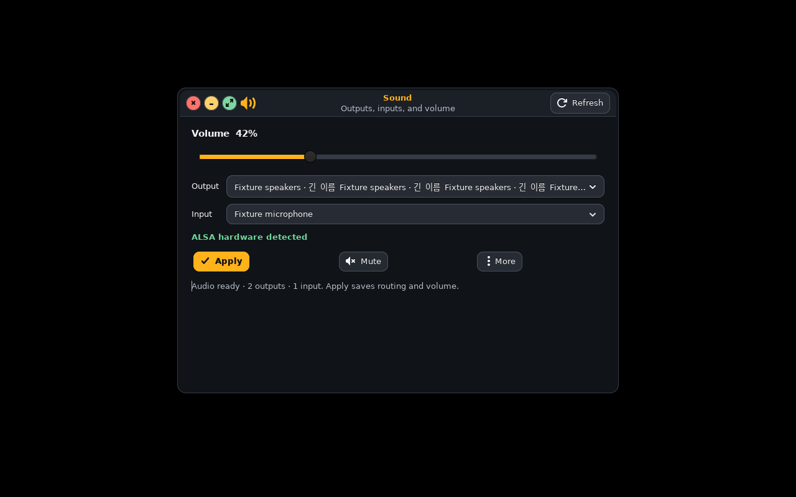

Capture uses silent fixture devices on private1280×800 X11, normal100% text;
not physical hardware certification.

User identified excessive height around native controls/title text. Shared
GTK header now removes inherited minimum height, uses4px vertical padding and
reserves a subtitle row only when supplied. Header action buttons no longer
add Adwaita's extra vertical margins. Useful subtitles, title text, controls,
content and all actions remain; no forced font reduction or fixed-height cap.

Actual GTK measurements in both themes:

- Normal100%:32px title-only,42px with subtitle, including Refresh action.
- Accessibility200% text:40px title-only,72px subtitle; no vertical clipping.
- Controls remain24px, glyphs12px; title/body10pt remains unchanged.

Impeccable review inspected native100% dark/light and enlarged text captures,
then real Sound UI. That inspection caught header-action margins, fixed in the
same bounded pass. Final confirmation:
`/var/tmp/ooonana-header-confirm-20261022.146DJmSU`.
Silent Sound/Brightness/Music states and keyboard checks, plus actual native
minimize/fullscreen/close, pass. No hardware commands or sound playback.
Density regressions now measure real header allocation, title/subtitle text,
button diameter/centering, unchanged typography and user text scaling.

Publication/native receipt below covers this shared header patch too. Older
released images do not acquire these changes automatically. Broader UI ledger,
physical/WSLg checks and deferred OpenVINO remain open.

### Published checkpoint after Batches 32–33

- Source `75923c555790630480c7d53186868feecca9b9f1` passes
  [GitHub regression](https://github.com/Ooonana/Ooonana-OS/actions/runs/39686608905)
  and [GitLab smoke](https://gitlab.com/Ooonana/ooonana-repo/-/pipelines/2974082513).
  Both remotes pushed on candidate branch; no stable promotion.
- Atomic signed generation:
  `720239ac278222d731c34a423e0e7908d37bcbc8eac5025d60585b0556c7f926`.
  SHA256SUMS digest:
  `d292ba22749cbec35e604afb19e06241613926bcaa20c861899c39024e453f6e`.
  Clean306-file source manifest pins75923c5, digest
  `f45ce503ce589684e79f2c784a66e2c50608d1c35329d5c8e21f5bc924f6d006`.
  Native-control provenance/signature gate,654 packages/612 dependency nodes
  and all1302 signed checksum entries pass; no models bundled.
  Old26407e0 generation checksum manifest unchanged.
- Ooonana WSL verified local snapshot:
  `/var/lib/ooonana/candidate-native-controls-20261022.yzez35dY`.
 642 immutable archives hardlinked,660 files copied; full signed checksum
  verification passes. Native i3 upgrade and separate runtime/core reinstall
  transactions preserve checkpoints and pass file/health checks. UID1000
  imports and opt-in i3 config validation pass. One import-probe shell quoting
  error was corrected separately; no package transaction repeated.
- Native hashes match source/built candidate: i3
  `f11014782a9100af7b81b98459cf7165d27db4fe6f91fb1ea00de9aec46ac307`,
  shared header
  `662b310c74f09bf95971b5c7b0a673321ece241fe811406b2a50215b59cd2532`,
  window controller
  `acd80e7e275fa0b9c717f6476455843bf9d79f4ae1394aad9f7e6d2adf31b355`.
- Default builtin repository had stale i3 metadata despite temporary-source
  refresh. WSL-local CURRENT now atomically selects the verified native
  snapshot through its generation link; old root metadata remains intact.
  Default metadata refresh resolves654 packages/two sources and actually
  reports i3 `4.24-r0.ooonana1`. No duplicate1GiB archive copy or package-owned
  config replacement. Local adapter refreshed.
  Logs: `/var/tmp/ooonana-native-controls-sync-20261022.4KRaDqjI`.
- OpenVINO installed metadata, trusted public key and `/etc/wsl.conf` hashes
  unchanged. Private key remains local; enrollment deferred. No sound,
  GUI/WSL restart, WSL disk move or ISO build. Core remains0.10.0 candidate.

Manually close old nested desktop when ready; launch:

```powershell
wsl -d Ooonana --exec /usr/local/bin/start-ooonana-i3 --nested
```

Fresh ISO build, user-owned; no old resume:

```powershell
& 'F:\Ooonana\ooonana-os\Build-ISO.ps1' --repo '/mnt/winf/Ooonana/ooonana-os/build/full-i3-repo-0.10'
```

### October 22 cleanup limit

One confirmed owned incomplete3GiB logical build image remains. Exact file was
checked as regular, not loop-attached, with no active formatter. Automated
deletion was policy-blocked and was not retried through another shell/tool.
Successful build image, source, binary, package, logs and history stay intact.
Manual PowerShell command, only if this incomplete file still exists:

```powershell
Remove-Item -LiteralPath 'F:\Ooonana\ooonana-os\qa-i3-controls-20261020-4a5c2779\build-root.ext4.interrupted-before-mount' -Force
```

## Batch 34: compact Power and safe keyboard defaults

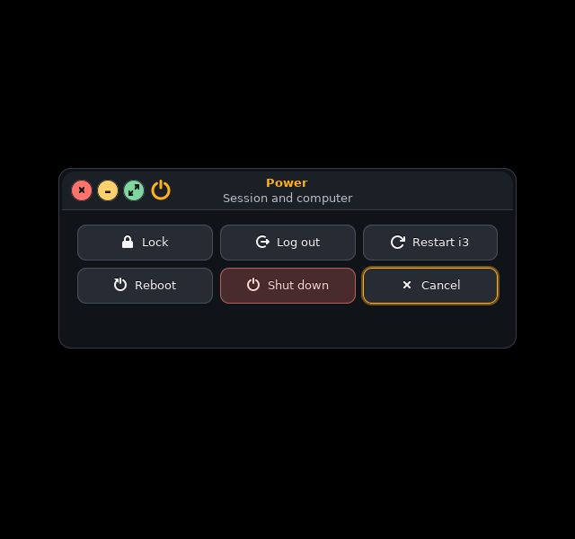

Normal100% on640×600. All power/session backends are mocked; capture is not a
real shutdown or lock test.

- Replaced fixed170×70 tiles with content-width columns and40px minimum rows.
  Actual200% text naturally grows rows to44px;10pt text and native24px window
  controls remain unchanged. Natural-height menu removes unused vertical space
  and duplicate question heading; all six actions remain in familiar3×2 order.
- Cancel receives initial focus/default. Actual Return closes without a
  request; Escape also closes. During a submitted request, label becomes Close
  and tooltip explains it is not cancellation. Duplicate actions stay disabled,
  failure restores controls/Cancel and closed-parent callbacks create no UI.
- Logout/reboot/shutdown warnings retain exact commands, unsaved-work warning
  and default Cancel. Shared native header and bounded dialog placement now
  match first-party chrome. Explicit show-all is essential: a titlebar object
  alone did not paint. Final fixture asserts mapped header, not just existence.
- QA repair: Settings deliberately changes theme, previously making subsequent
  Power captures light even in a dark case. Fixture restores requested theme
  and now sets actual98304/196608 Xft DPI. Earlier screenshots are not retroactive
  proof of dark/200% Power behavior. New cases use private UID1000 i3 with current
  native-control binary, real Return/Escape input and mocked command queues.
- Final Power confirmation, dark/light100/200% at640×600:
  `/var/tmp/ooonana-power-visible-confirm-20261022.iDhClXqm`.
  Initial/WM receipts and25-page catalog per theme:
  `/var/tmp/ooonana-power-wm-20261022.irMbeOhf`.
  Catalog proves initial bounds/accessibility only, not every app workflow.
  Native source regression suite passes. No audio, actual power operation,
  OpenVINO setup/models, desktop restart or ISO build.

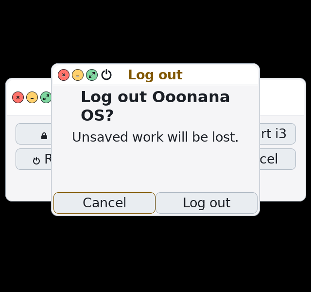

Impeccable bounded review preserves opaque Graphite/Paper identity. Remaining
whole-OS ledger is unchanged: Paper third-party outer frames/theme inheritance,
installed tray/authentication, external app variants, physical/WSLg/multi-output
input/session checks, PDF viewer and deferred OpenVINO. Prior signed checkpoints
remain intact; this follow-up is published below.

### Published checkpoint after Batch 34

- Source `953758ed79ead9c165a22f890b2967b1dd130d8b` passes
  [GitHub regression](https://github.com/Ooonana/Ooonana-OS/actions/runs/39714885036)
  and [GitLab smoke](https://gitlab.com/Ooonana/ooonana-repo/-/pipelines/2974640398).
  Both remotes pushed on candidate branch.
- Signed generation:
  `321e5115a1432916f1264c1e9ecf4364d3b67dfd5afa20ba72b7d542638761a2`.
  SHA256SUMS digest:
  `3166de21371e49ee59abf24e0341f7f79f48e3db8b823165ae29d287ee3f1a03`.
  Clean306-file source manifest pins953758e, source digest
  `42d8be4bce747e4a8530cc544ad7a66d65f4529fb46ecda1de87de42ee9c5371`.
  Full signed checksum verification, native-control provenance and654-package/
  612-node release closure pass. Old720239ac manifest unchanged.
- Native Ooonana WSL snapshot:
  `/var/lib/ooonana/candidate-power-ui-20261022.IZ7xNEY1`.
 643 immutable archive links/659 copies; all1302 signed entries verified.
  Runtime/core dry-run, separate reinstall transactions and verify/health checks
  pass with rollback checkpoints retained. Installed controls_app.py hash
  `66cf68d0d8cfb3402876852fbd961a88e7af85e3891300c911747d386f202b88`
  matches source. i3/header bytes remain previous verified versions.
- WSL-local adapter/default signed generation pointer advanced atomically,
  preserving prior root metadata and generation. Default654-package/two-source
  metadata refresh passes. UID1000 headless imports and i3 config validation
  pass. Initial import with unattached WSLg environment emitted a seat warning;
  explicit headless confirmation is clean, not live WSLg input certification.
  Logs: `/var/tmp/ooonana-power-ui-sync-20261022.i5c8XCDd`.
- Boot config, trusted key and OpenVINO installed metadata hashes unchanged.
  No sound, power command, GUI/WSL restart, disk move or ISO build. Private
  key local; stable promotion/enrollment and OpenVINO remain deferred.

### Next reproduced UI defect

Read-only source-helper probe used private generated preference and an inherited
OOONANA_THEME=dark. Saving light then reloading the exact load_theme function
produced ACTIVE=dark/SAVED=light. No installed preference changed. Theme
inheritance/toggle/new-app consistency now has a concrete repair target, ahead
of the broader Paper third-party frame review. Whole-OS goal stays active.
